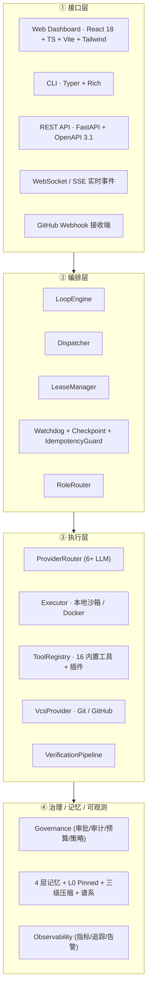

<div align="center">

# LoopForge 🔁

**开源 · 自托管 · 模型无关的长程自主编程智能体编排与治理平台**

[](https://opensource.org/licenses/Apache-2.0)
[](https://www.python.org)
[](https://github.com/huzjie/loopforge)
[](https://github.com/huzjie/loopforge/commits/main)
[](https://github.com/huzjie/loopforge/issues)
[](https://github.com/huzjie/loopforge/pulls)

*让任意团队用任意 LLM，在数小时到数天的时间尺度上，自主完成真实软件工程任务——并且**可恢复、可治理、可审计、可观测**。*

</div>

---

## ✨ 一句话定位

> LoopForge 把 2026-08-03 阿里 Qwen 3.8-Max 展示的 **Loop Engineering（循环工程）** 范式产品化：以「Issue 状态机 + Dispatcher + 多角色智能体 + 验证流水线 + 治理护栏」为核心的**长程自主编程操作系统**。

它不是又一个"会写代码的聊天机器人"，而是一套**自带可靠性与治理原语的编排平台**——这正是 2026 年行业从「完全自主」转向「结构化工作流 + 人在回路 + 可审计可恢复」后的刚需。

---

## 🤔 为什么需要 LoopForge？（与同类项目对比）

| 维度 | **LoopForge** | [OpenHands](https://github.com/All-Hands-AI/OpenHands) | [MetaGPT](https://github.com/geekan/MetaGPT) | [LangGraph](https://github.com/langchain-ai/langgraph) | [AutoGen](https://github.com/microsoft/autogen) |
|---|---|---|---|---|---|
| 定位 | 长程自主编程**编排 + 治理**平台 | 端到端 AI 软件工程师（产品） | 软件团队 SOP 模拟 | 通用图编排框架 | 对话式多智能体（研究） |
| 长程可靠性 | 租约 + 检查点 + 看门狗 + 幂等 + 重放 | 依赖会话 / 容器 | 无 | 检查点（需自接持久化） | 弱 |
| 治理 / 护栏 | 审批(HITL) + 审计 + 预算护栏 + 策略 | 沙箱 + 人工确认 | 文档驱动 | 需自接 | 弱 |
| 验证流水线 | Build → Unit → E2E → Lifecycle | 无内置 | 无内置 | 无 | 无 |
| 模型无关 | 6+ Provider 插件化（Mock/DashScope/OpenAI/Anthropic/DeepSeek/Ollama） | 多（托管优先） | 多 | 任意 | 多 |
| 可定制性 | 角色 / 工具 / Provider **全可插拔** | 低（产品） | 中 | 高 | 中 |
| 自托管 | ✅ Apache-2.0 | ✅ | ✅ | ✅ | ✅ |

**LoopForge 的独特价值**：把「崩溃可恢复、上下文有治理、成本有护栏、全链路可观测可审计」四个生产级能力做成**内核原语**，而不是事后补丁。如果你要的是"跑几天无人干预还能从故障里爬起来、并且每一步都可追责"的自主编程系统，LoopForge 是为你而生的。

---

## 🧱 四大生产级支柱

### 1. 编排（Orchestration）—— 让长程任务跑得稳
- **LoopEngine**：`plan → act → observe → verify → commit → evolve` 六阶段主循环
- **Dispatcher**：FIFO / 优先级 / DAG 三种调度
- **LeaseManager**：乐观锁 + Fencing Token，杜绝多 Agent 抢占同一任务
- **CheckpointStore + IdempotencyGuard**：两阶段意图协议，副作用可重放、可恢复
- **Watchdog**：超时 / 卡死 / 孤儿任务自动回收；**Recovery / Replay** 支持断点续跑
- **RoleRouter + HandoffContract**：Planner / Coder / Reviewer / Tester / Summarizer 五角色按阶段与任务类型交接

### 2. 治理（Governance）—— 让 Agent 跑得安全
- **审批（Approval / HITL）**：关键操作人工确认，而非完全失控
- **审计（Audit）**：全链路操作留痕，可追溯每一步决策
- **预算护栏（Budget Guardrails）**：成本 / 调用次数上限硬约束
- **策略（Policy）**：命令策略引擎 + 路径沙箱，限制 Agent 能碰什么

### 3. 验证（Verification）—— 让交付跑得对
- **VerificationPipeline**：`Build → Unit → E2E → Lifecycle` 四级验证
- **FailureRouter**：失败自动归类并触发对应修复路径
- 与 `git_ops` / `create_pr` / `patch_apply` 工具链打通，验证通过才提交 / 提 PR

### 4. 可观测（Observability）—— 让过程看得见
- **Metrics / Tracing / Health / Alerting** 四件套
- 与 OpenTelemetry 风格事件总线对齐，可接入既有监控栈

---

## 🏗️ 架构总览



完整设计见 [`docs/ARCHITECTURE.md`](docs/ARCHITECTURE.md)（含类图 `docs/class-diagram.mermaid`、时序图 `docs/sequence-diagram.mermaid`、ADR 决策记录 `docs/adr/`）。

---

## 🚀 快速开始

> 要求：Python 3.11+。推荐用 Docker 执行器做代码沙箱。

```bash
# 1. 安装（可编辑模式）
pip install -e ".[all]"

# 2. 配置 Provider（任选其一/多个）
cp .env.example .env
# 填写 DASHSCOPE_API_KEY / OPENAI_API_KEY / ANTHROPIC_API_KEY / DEEPSEEK_API_KEY 之一

# 3. 初始化数据库
alembic upgrade head

# 4. 启动 Web 控制台
loopforge web          # http://localhost:8000

# 5. 或用 CLI 跑一个自主编程 Loop
loopforge run \
  --repo ./my-target-repo \
  --task "为登录接口补充单元测试并修复边界条件" \
  --provider openai-compat \
  --executor docker
```

详细部署（Docker Compose / K8s-Helm）见 [`docs/guides/`](docs/guides/)。

---

## 🧩 内置能力速览

| 模块 | 关键能力 |
|---|---|
| **Providers** | Mock / DashScope / OpenAI 兼容 / Anthropic / DeepSeek / Ollama；成本计费、重试、流式、定价路由、Token 计数 |
| **Executors** | `LocalSubprocess`（路径沙箱 + 命令策略，全平台）/ `Docker`（生产推荐）/ K8s（扩展点） |
| **Tools（16+）** | 文件读写列改、代码检索、Shell、Patch 应用、测试运行器、Git 操作、HTTP 抓取、**ask_human（人在回路）**、创建 PR、插件注册 |
| **Memory** | 4 层记忆 + L0 固定约束 + 三级压缩 + 压缩谱系（Lineage）+ BM25 / Embedding 混合检索 |
| **VCS** | Git 客户端 / GitHub / 本地沙箱，规范化 commit message |
| **Interfaces** | Web 控制台 + CLI + REST API（OpenAPI 3.1）+ WebSocket/SSE + GitHub Webhook |

---

## 🗺️ 路线图

- [x] 五角色多智能体编排 + 验证流水线（v1.0）
- [x] 本地 / Docker 执行器 + 治理护栏（v1.0）
- [ ] 分布式执行（K8s Job Executor 落地）
- [ ] 多 Agent 协作（跨仓库 / 跨 PR 的编排）
- [ ] 可视化 Loop 时序回放与归因面板
- [ ] 与 Langfuse / OpenTelemetry 后端对接

---

## 📚 文档

- [系统架构设计](docs/ARCHITECTURE.md)
- [产品需求文档（PRD）](docs/PRD.md)
- [任务拆解](docs/TASK_BREAKDOWN.md)
- [贡献指南](docs/contributing)
- [安全模型](docs/security)

---

## 📄 License

[Apache-2.0](LICENSE) —— 可自由商用、自托管、二次开发。

---

<div align="center">

**⭐ 如果这个项目对你有价值，请给它一个 Star —— 帮助更多团队把"自主编程"真正用在生产里。**

</div>
