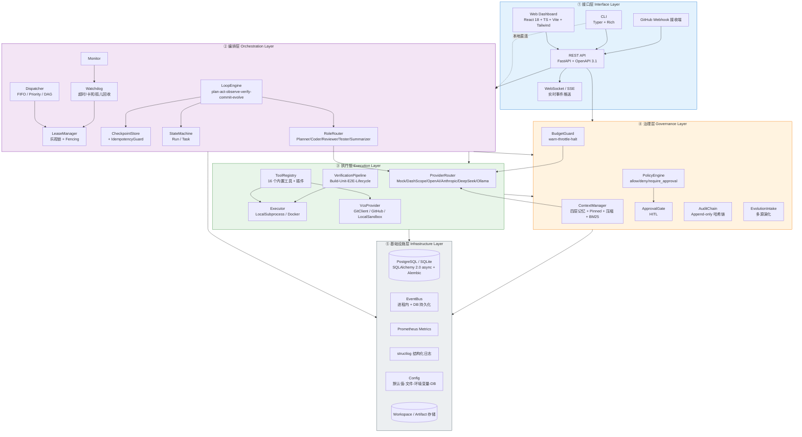
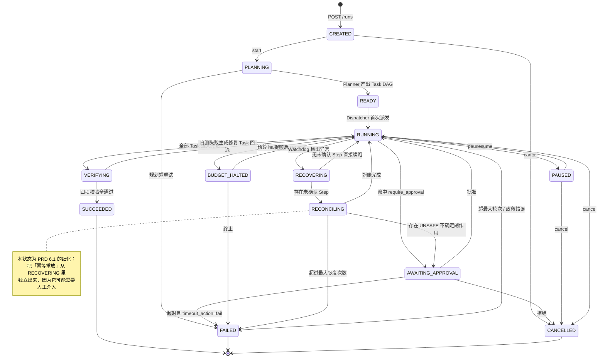
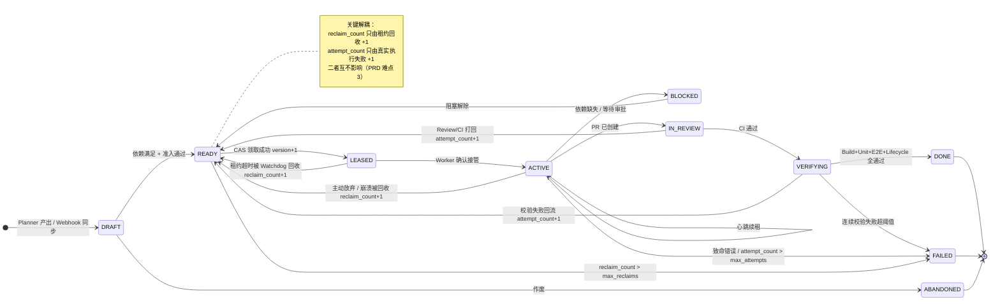
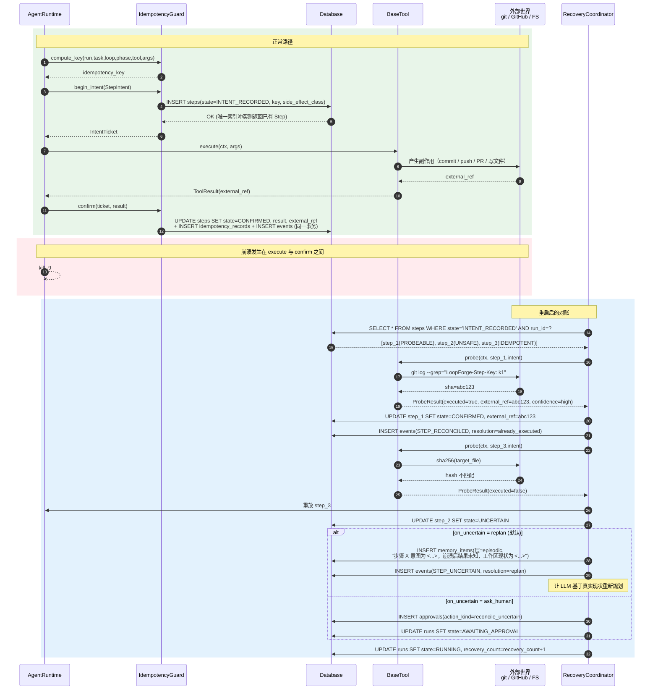
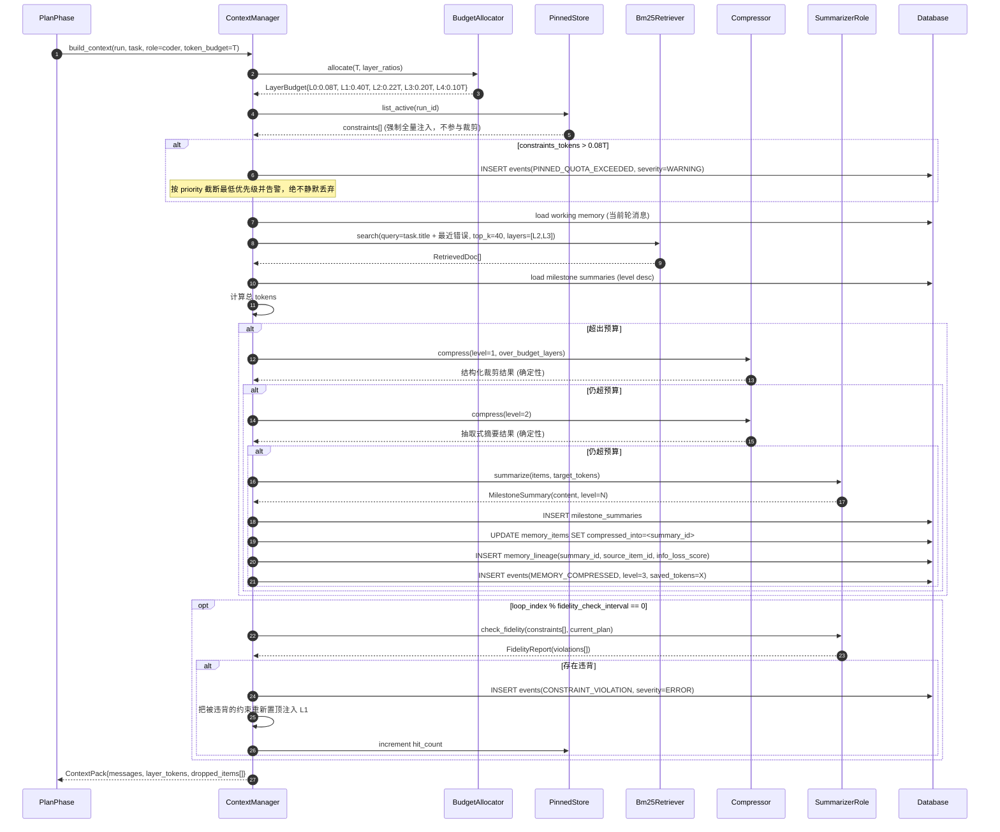
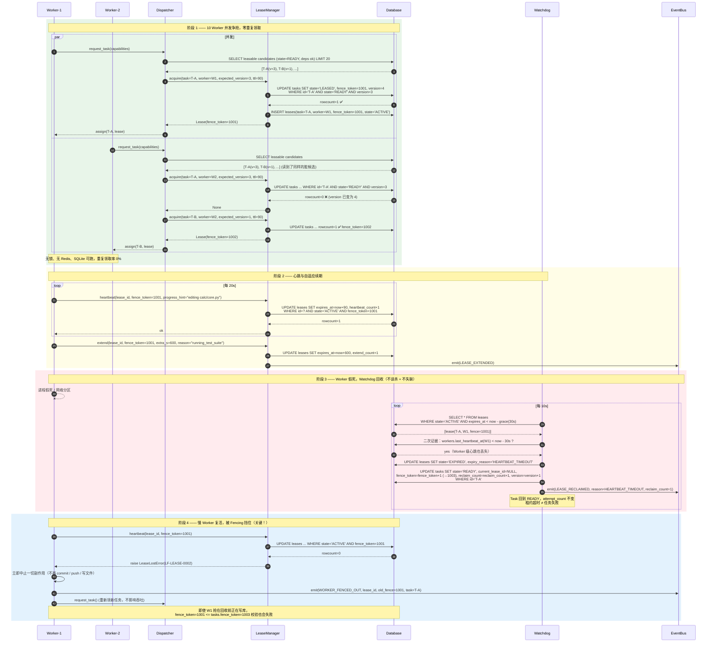
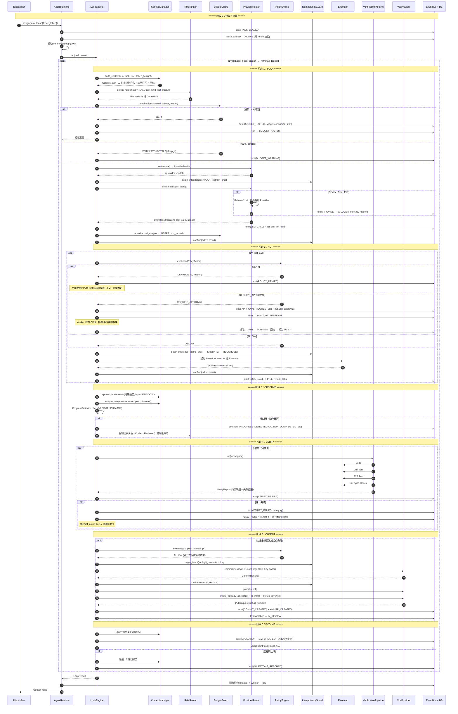
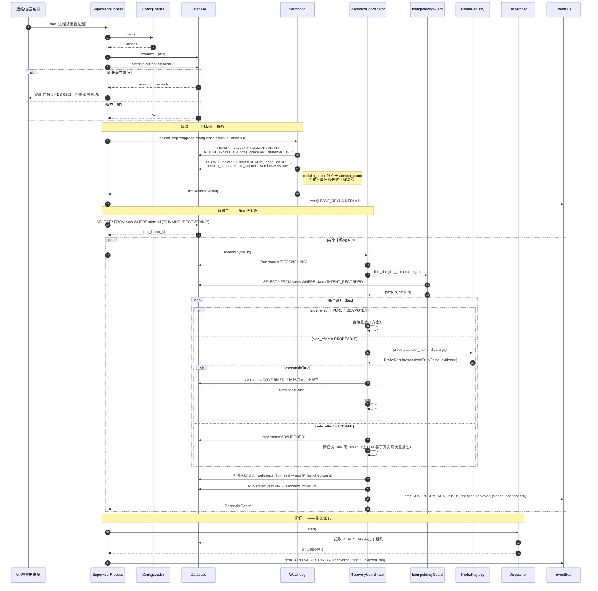

# LoopForge 系统架构设计（ARCHITECTURE.md）

> **开源、自托管、模型无关的长程自主编程智能体编排与治理平台**
> 本文档是给工程团队的**施工图**。所有文件路径、接口签名、错误码、事件名以本文档为准。

---

## 0. 文档信息

| 项 | 内容 |
|---|---|
| 文档版本 | v1.0 |
| 撰写日期 | 2026-08-03 |
| 架构师 | 高见远 |
| 上游输入 | `docs/PRD.md`（产品经理 许清楚，v1.0，884 行） |
| 决策授权 | 齐活林（主理人）已就 Q2 / Q3 / Q7 拍板 |
| 配套文档 | `docs/TASK_BREAKDOWN.md`（8 个并行工作包） |
| 语言约定 | 文档/注释/日志说明文本用中文；标识符/API 字段/目录名/错误码/事件名/commit message 用英文 |

### 0.1 已落定的三项决策（来自主理人）

| 编号 | 决策 | 架构落地 |
|---|---|---|
| **Q2 沙箱** | v1.0 提供两种 Executor | `BaseExecutor` 抽象 + `LocalSubprocessExecutor`（默认，路径沙箱 + 命令策略引擎，Win/Linux/macOS 全平台）+ `DockerExecutor`（生产推荐）。K8s Job 仅保留**扩展点文档**（`docs/guides/writing-executors.md`），**不写空壳文件**（避免 `NotImplementedError` 占位违规） |
| **Q3 检索** | v1.0 纯 Python BM25 + 关键词倒排 | `BaseRetriever` 抽象 + `Bm25Retriever`（零外部依赖，SQLite 可跑，默认启用）+ `EmbeddingRetriever`（走 Provider embedding 接口，`memory.retrieval.embedding.enabled=false` 默认关闭）。**不引入 pgvector 硬依赖** |
| **Q7 多角色** | v1.0 实现 5 个角色 | `BaseRole` 抽象 + Planner / Coder / Reviewer / Tester / Summarizer，`RoleRouter` 按 Loop 阶段与任务类型路由，`HandoffContract` 定义角色间交接协议 |

### 0.2 本文档对 PRD 三大设计难点的回应索引

| 难点 | 章节 |
|---|---|
| 崩溃恢复的幂等性 | **§8.1 两阶段意图协议（Two-Phase Intent Protocol）+ 副作用分类 + Probe 探测** |
| 上下文治理的信息保真度 | **§8.2 四层记忆 + L0 Pinned Constraints + 三级压缩 + 压缩谱系（Lineage）** |
| 租约与并发一致性 | **§8.3 条件 UPDATE 乐观锁 + Fencing Token + reclaim/attempt 双计数解耦** |

---

## 1. 总体架构

### 1.1 五层分层架构图



### 1.2 进程拓扑

LoopForge 运行时由 **3 类进程**组成，全部无状态（状态一律落库）：

| 进程 | 入口 | 职责 | 可水平扩展 |
|---|---|---|---|
| **API Server** | `loopforge.api.app:create_app`（uvicorn） | REST / WS / SSE / Webhook；只做读写编排，不跑 LLM | ✅ 无限 |
| **Agent Worker** | `loopforge.workers.entrypoint:run_agent_worker` | 领租约 → 跑 LoopEngine → 调 LLM/工具 → 提交 | ✅ 线性（租约保证零重复） |
| **Scheduler/Watchdog** | `loopforge.workers.entrypoint:run_supervisor` | Dispatcher 派发 + Watchdog 回收 + 告警评估 + 预算对账 | ⚠️ 建议单实例（多实例靠 DB 咨询锁选主） |

> **单机模式**：`loopforge run start --inline` 会在同一进程内以 asyncio task 拉起三者，用于零门槛验证（AC-A2）。

### 1.3 关键架构原则

| # | 原则 | 落地约束 |
|---|---|---|
| **AP-1** | **无内存态单点** | 任何跨 Loop 轮次存活的状态必须落库。内存中只允许存在「本轮可重建的缓存」。代码评审红线：禁止模块级可变全局字典保存运行态 |
| **AP-2** | **一切副作用先记意图** | 任何有外部副作用的动作（写文件/shell/git/HTTP/PR）必须先写 `steps` 行并提交事务，再执行（§8.1） |
| **AP-3** | **抽象在边界，实现在叶子** | 5 个抽象基类：`BaseProvider` / `BaseExecutor` / `BaseTool` / `BaseRetriever` / `BaseRole`。新增实现 = 新增 1 个文件 + 注册，不改核心 |
| **AP-4** | **DB 方言中立** | 只用 SQLAlchemy Core/ORM 表达式；禁止裸 `SELECT FOR UPDATE`、禁止 PG 独有类型。JSON 列走 `db/types.py:JsonType`（PG→JSONB，SQLite→JSON TEXT） |
| **AP-5** | **确定性可测** | 时间通过 `core/clock.py` 注入；随机数通过 `core/ids.py` 注入 seed；MockProvider 输出由 `(role, loop_index, task_key)` 完全确定 |
| **AP-6** | **事件即真相** | 所有状态迁移必须伴随事件写入；回放（Replay）只依赖 `events` 表即可重建 UI 时间轴 |
| **AP-7** | **单文件 ≤ 500 行** | 超出则拆分。禁止 `TODO` / 裸 `pass` / `NotImplementedError` 出现在 P0 路径 |

---

## 2. 目录约定与命名规范

### 2.1 顶层目录

```
loopforge/                     # 仓库根
├── loopforge/                 # Python 包（后端全部代码）
├── web/                       # 前端 React 应用
├── tests/                     # 后端测试（unit / integration / e2e / perf）
├── alembic/                   # 数据库迁移
├── config/                    # 默认配置、价目表、策略、红线用例集
├── prompts/                   # 角色 Prompt 模板（.md，运行时加载）
├── docker/                    # Dockerfile 与容器入口脚本
├── deploy/                    # k8s manifests + helm chart
├── monitoring/                # prometheus 规则 + grafana dashboards
├── examples/                  # 示例目标仓库（零 Key 验证用）
├── scripts/                   # 运维与开发脚本
├── docs/                      # 全部文档
└── .github/                   # CI 工作流与模板
```

### 2.2 命名规范（硬性）

| 对象 | 规范 | 示例 |
|---|---|---|
| Python 模块/包 | `snake_case` | `lease_manager.py` |
| Python 类 | `PascalCase` | `LeaseManager` |
| 抽象基类 | `Base` 前缀 | `BaseProvider` |
| Pydantic 请求体 | `<Entity><Verb>Request` | `RunCreateRequest` |
| Pydantic 响应体 | `<Entity>Response` / `<Entity>ListResponse` | `RunResponse` |
| SQLAlchemy 模型 | 单数 `PascalCase`，表名复数 `snake_case` | `class Run` → `runs` |
| 仓储类 | `<Entity>Repository` | `TaskRepository` |
| 服务类 | `<Entity>Service` | `RunService` |
| 枚举 | `PascalCase` 类 + `SCREAMING_SNAKE` 成员 | `RunState.BUDGET_HALTED` |
| 事件名 | `SCREAMING_SNAKE`，`<主体>_<动作过去式>` | `LEASE_RECLAIMED` |
| 错误码 | `LF-<DOMAIN>-<4位数字>` | `LF-LEASE-0003` |
| Prometheus 指标 | `loopforge_<subsystem>_<name>_<unit>` | `loopforge_llm_latency_seconds` |
| 前端组件文件 | `PascalCase.tsx` | `RunTimeline.tsx` |
| 前端 hook | `useXxx.ts` | `useEventStream.ts` |
| React Query key | `['runs', runId, 'events']` | 集中在 `web/src/api/queryKeys.ts` |
| Git 分支（Agent 产出） | `loopforge/task-<task_key>-<short_id>` | `loopforge/task-T12-a3f9c1` |
| Commit trailer | `LoopForge-Step-Key: <idempotency_key>` | 幂等探测依赖，**不可省略** |

### 2.3 配置层级（后覆盖前）

```
1. 代码内默认值（pydantic-settings 字段 default）
2. config/default.yaml
3. <LOOPFORGE_CONFIG_FILE> 指定的 YAML（默认 ./loopforge.yaml，存在才加载）
4. 环境变量（前缀 LOOPFORGE__，双下划线表示嵌套：LOOPFORGE__DB__URL）
5. .env 文件
6. 数据库中的 provider_configs / policies（仅限运行期可热改项）
7. CLI 显式参数 / API 请求体字段（最高优先级，仅作用于单次调用）
```

---

## 3. 完整文件清单（施工图）

> **总计 546 个文件**。分类统计见 §3.9。
> 格式：`路径` — 职责一句话。所有文件必须有真实完整实现，禁止空壳。

### 3.1 后端核心包 `loopforge/`（305 个 Python 文件）

#### 3.1.1 包根（3）

| 文件 | 职责 |
|---|---|
| `loopforge/__init__.py` | 包元信息、`__version__`、公共导出（`LoopForgeError`、`get_settings`） |
| `loopforge/__main__.py` | `python -m loopforge` 入口，转发到 `cli.main:app` |
| `loopforge/constants.py` | 全局常量：默认 TTL、重试次数、token 配额比例、分页上限、trailer 键名等 |

#### 3.1.2 `loopforge/core/`（14）— 内核基础设施

| 文件 | 职责 |
|---|---|
| `core/__init__.py` | 内核公共导出 |
| `core/config.py` | pydantic-settings 配置树：`Settings`/`DbSettings`/`ProviderSettings`/`MemorySettings`/`GovernanceSettings`/`ExecutorSettings`/`ApiSettings`/`WorkerSettings`；`get_settings()` 单例 + `reload_settings()` |
| `core/logging.py` | structlog 配置：JSON/Console 双渲染器、`trace_id/run_id/task_id/step_id` contextvar 绑定、敏感字段自动脱敏处理器 |
| `core/errors.py` | 异常层级：`LoopForgeError` 根类（含 `code`/`http_status`/`details`/`retryable`）及 12 个域异常 |
| `core/error_codes.py` | 错误码枚举与注册表（§10.2），提供 `code_to_http()` 映射 |
| `core/enums.py` | 全局枚举：`RunState`/`TaskState`/`StepState`/`LeaseState`/`PolicyDecision`/`SideEffectClass`/`MemoryLayer`/`RoleName`/`Severity`/`BudgetScope`/`BudgetAction` |
| `core/event_types.py` | `EventType` 枚举（62 种，§10.3）+ 每种事件的 payload Pydantic 模型 + `EVENT_PAYLOAD_MAP` |
| `core/event_bus.py` | 进程内异步发布订阅 `EventBus`：`publish()`/`subscribe()`/`unsubscribe()`；带持久化钩子与背压队列 |
| `core/ids.py` | ID 生成：`new_ulid()`（时间有序）、`short_id()`、`new_trace_id()`、可注入 seed 的确定性模式 |
| `core/clock.py` | `Clock` 协议 + `SystemClock` + `FrozenClock`（测试用）；全仓禁止直接调 `datetime.now()` |
| `core/hashing.py` | `sha256_hex()`、`canonical_json()`（稳定序列化）、`chain_hash(prev, payload)`（审计哈希链） |
| `core/resilience.py` | `retry_async()` 指数退避装饰器、`CircuitBreaker`、`TokenBucketLimiter`、`timeout_guard()` |
| `core/redaction.py` | 敏感信息脱敏：内置 24 条 Secret 正则（OpenAI/Anthropic/DashScope/GitHub PAT/AWS/私钥/JWT…），`redact_text()`/`redact_mapping()` |
| `core/registry.py` | 泛型注册表 `Registry[T]`：`register()`/`get()`/`list_names()`/`load_entry_points()`，供 Provider/Tool/Executor/Retriever/Role 复用 |

> 注：`core/` 实际 14 个文件（含 `__init__.py`）。

#### 3.1.3 `loopforge/db/`（19）— 持久化基础设施

| 文件 | 职责 |
|---|---|
| `db/__init__.py` | 导出 `Base`、`get_session`、`UnitOfWork` |
| `db/base.py` | SQLAlchemy 2.0 `DeclarativeBase`、命名约定（索引/约束前缀）、`metadata` |
| `db/engine.py` | async engine 工厂：SQLite（aiosqlite，开启 WAL + `busy_timeout`）与 PostgreSQL（asyncpg，连接池）分支；断线重连与 `pool_pre_ping` |
| `db/session.py` | `async_sessionmaker`、`get_session()` 依赖、`session_scope()` 上下文管理器 |
| `db/types.py` | 方言中立列类型：`JsonType`（JSONB/JSON）、`UtcDateTime`、`StrEnumType`、`DecimalMoney`（18,8） |
| `db/mixins.py` | `TimestampMixin`（created_at/updated_at）、`SoftDeleteMixin`、`VersionMixin`（乐观锁 version 列）、`MetadataMixin` |
| `db/uow.py` | `UnitOfWork`：聚合全部仓储、统一事务边界、`commit()`/`rollback()`、嵌套 savepoint |
| `db/seed.py` | 种子数据：默认 admin ApiKey、默认策略集、默认价目表、示例 Project/Repo、5 个 AgentRole 配置 |
| `db/repositories/__init__.py` | 仓储包导出 |
| `db/repositories/base.py` | `BaseRepository[ModelT]`：`get`/`get_or_raise`/`list`/`count`/`add`/`delete`/`paginate`，统一游标分页 |
| `db/repositories/project_repo.py` | Project + Repo 实体的查询与写入（含按 slug 查、按 remote_url 唯一约束处理） |
| `db/repositories/run_repo.py` | Run 查询（状态过滤、活跃 Run、超时 Run）、状态 CAS 更新、统计聚合 |
| `db/repositories/task_repo.py` | Task 查询、`find_leasable_candidates()`（依赖满足 + 路径无冲突）、`cas_transition()` 条件 UPDATE |
| `db/repositories/lease_repo.py` | Lease 创建/心跳/续期/回收；`acquire_lease_cas()`、`heartbeat_cas()`、`find_expired()`、fence token 分配 |
| `db/repositories/step_repo.py` | Step + Checkpoint + IdempotencyRecord 读写；`find_unconfirmed_steps()`（恢复用） |
| `db/repositories/event_repo.py` | Event + LlmCall + ToolCall + AuditLog 追加写；游标分页、按 trace 聚合、哈希链尾部读取 |
| `db/repositories/memory_repo.py` | MemoryItem + MilestoneSummary + PinnedConstraint + Artifact 读写；倒排索引表维护 |
| `db/repositories/governance_repo.py` | Budget + CostRecord + Policy + Approval 读写；成本五维聚合查询 |
| `db/repositories/system_repo.py` | Worker + User + ApiKey + EvolutionItem + WebhookDelivery 读写；Worker 心跳与健康 |

#### 3.1.4 `loopforge/models/`（16）— SQLAlchemy ORM 模型

| 文件 | 职责 |
|---|---|
| `models/__init__.py` | 汇总导入所有模型（Alembic autogenerate 依赖此文件） |
| `models/project.py` | `Project`（项目）+ `Repo`（代码仓库注册，含 provider/remote_url/default_branch/credentials_ref） |
| `models/run.py` | `Run`（一次长程任务，含 goal/constraints/state/loop_index/milestone_index/config_snapshot） |
| `models/task.py` | `Task`（Issue，含 state/priority/deps/touch_paths/version/reclaim_count/attempt_count/external_issue_number） |
| `models/lease.py` | `Lease`（租约：task_id/worker_id/fence_token/ttl/expires_at/heartbeat_count/state/expiry_reason） |
| `models/step.py` | `Step`（含 idempotency_key 唯一索引/phase/state/intent_payload/result_payload/external_ref/side_effect_class）+ `Checkpoint` + `IdempotencyRecord` |
| `models/event.py` | `Event`（append-only：seq/type/payload/prev_hash/hash/trace_id）+ `AuditLog` |
| `models/call.py` | `LlmCall`（provider/model/messages/response/tokens/cost/latency/attempt）+ `ToolCall`（tool/args/result/exit_code/duration） |
| `models/artifact.py` | `Artifact`（diff/patch/test-report/log/pr-body 等产物，含 storage_uri/sha256/size/mime） |
| `models/memory.py` | `MemoryItem`（layer/content/tokens/salience/embedding_ref）+ `MilestoneSummary`（level/covers/source_ids）+ `PinnedConstraint` + `MemoryLineage` |
| `models/budget.py` | `Budget`（scope/limit/window/thresholds/actions）+ `CostRecord`（五维归因：run/task/pr/model/provider） |
| `models/policy.py` | `Policy`（YAML 源 + 编译后规则）+ `PolicyRule` + `Approval`（HITL 请求与裁决） |
| `models/worker.py` | `Worker`（worker_id/hostname/pid/capabilities/state/last_heartbeat/current_task_id/drain_flag） |
| `models/agent_role.py` | `AgentRole`（角色 → provider/model/temperature/max_tokens/prompt_version 绑定）+ `ProviderConfig`（Provider 实例配置） |
| `models/auth.py` | `User`（username/role/hashed_password）+ `ApiKey`（prefix/hashed_secret/scopes/expires_at） |
| `models/evolution.py` | `EvolutionItem`（多源演化工作项：source/raw/normalized/score/cluster_id/state）+ `WebhookDelivery` |

#### 3.1.5 `loopforge/schemas/`（15）— Pydantic v2 DTO

| 文件 | 职责 |
|---|---|
| `schemas/__init__.py` | DTO 汇总导出 |
| `schemas/common.py` | `ApiResponse[T]`（`{code,data,message,trace_id}`）、`PageParams`、`CursorPage[T]`、`ErrorDetail`、`IdempotencyHeader` |
| `schemas/project.py` | Project/Repo 的 Create/Update/Response/List DTO |
| `schemas/run.py` | `RunCreateRequest`（goal/constraints/repo_id/role_overrides/budget）、`RunResponse`、`RunControlRequest`、`RunTimelineResponse` |
| `schemas/task.py` | Task 的 CRUD DTO + `TaskTransitionRequest` + `TaskGraphResponse`（DAG 节点边） |
| `schemas/step.py` | `StepResponse`、`StepIntent`、`StepResult`、`ReconcileRequest/Response` |
| `schemas/event.py` | `EventResponse`、`EventFilter`（type/severity/since_seq/trace_id）、`EventExportRequest` |
| `schemas/artifact.py` | Artifact DTO + 上传/下载元信息 |
| `schemas/memory.py` | `ContextPackResponse`、`PinnedConstraintCreate`、`MemorySearchRequest/Response`、`MemoryLineageResponse` |
| `schemas/budget.py` | Budget CRUD DTO、`CostSummaryResponse`、`CostBreakdownResponse`、`CostEstimateRequest/Response` |
| `schemas/policy.py` | `PolicyCreateRequest`（YAML 文本）、`PolicyResponse`、`PolicyEvaluateRequest/Response`（dry-run） |
| `schemas/approval.py` | `ApprovalResponse`、`ApprovalDecisionRequest`（approve/reject + reason） |
| `schemas/provider.py` | `ProviderConfigCreate/Update/Response`、`ProviderTestResult`、`ModelInfo`、`PricingEntry` |
| `schemas/worker.py` | `WorkerResponse`、`LeaseResponse`、`HeartbeatRequest/Response`（含 fence_token） |
| `schemas/auth.py` | `LoginRequest`、`TokenResponse`、`ApiKeyCreate/Response`、`CurrentUser` |

#### 3.1.6 `loopforge/providers/`（19）— LLM Provider 层

| 文件 | 职责 |
|---|---|
| `providers/__init__.py` | Provider 注册表初始化，导出 `get_provider()` |
| `providers/base.py` | **`BaseProvider` 抽象类**（§7.1 签名）：`chat`/`chat_stream`/`count_tokens`/`capabilities`/`health_check` |
| `providers/types.py` | `Message`/`ToolSpec`/`ToolCallRequest`/`ChatRequest`/`ChatResult`/`StreamChunk`/`Usage`/`ProviderCapabilities` |
| `providers/registry.py` | Provider 名称 → 类映射；从配置与 DB `provider_configs` 实例化；entry-point 插件加载 |
| `providers/router.py` | **`ProviderRouter`**：按 `RoleName` + 任务类型 + 成本策略选择 Provider/Model；`resolve(role, hint) -> ProviderBinding` |
| `providers/failover.py` | `FailoverChain`：主备链路、5xx/超时/限流分类、切换原因记录、熔断冷却 |
| `providers/token_counter.py` | Token 计数：tiktoken（可选依赖，缺失时降级）+ 各家近似算法 + 字符估算兜底；`count_messages()` |
| `providers/pricing.py` | 价目表加载（`config/pricing.yaml` + DB 覆盖）、`price_of(provider, model)`、`estimate_cost()`、`actual_cost()` |
| `providers/tool_schema.py` | 内部 `ToolSpec` ↔ 各家 function-calling schema 的双向转换（OpenAI / Anthropic / DashScope 三种方言） |
| `providers/mock/__init__.py` | Mock 包导出 |
| `providers/mock/provider.py` | **`MockProvider`**：确定性伪 LLM。输入 `(role, loop_index, task_key, context_digest)` → 稳定输出；支持 tool_calls、流式、token 计数、可注入故障（5xx/超时/限流）用于恢复测试 |
| `providers/mock/scripts.py` | 场景脚本库：为 Planner/Coder/Reviewer/Tester/Summarizer 各定义状态化剧本（如「补齐单测」剧本会依次产出测试文件、修 bug、写 PR 描述） |
| `providers/mock/codegen.py` | **真实代码生成器**：基于目标仓库 AST 分析产出可编译/可运行的 Python 代码与 unified diff（不是假字符串），保证 Mock 模式下 `pytest` 真的能跑绿 |
| `providers/openai_compat.py` | OpenAI 兼容实现（覆盖官方 API / vLLM / 自建网关 / 任意 base_url） |
| `providers/dashscope.py` | 阿里云百炼 DashScope（Qwen 系，含 Qwen3.8-Max），兼容模式与原生模式双通道 |
| `providers/anthropic.py` | Anthropic Messages API（system 独立字段、tool_use/tool_result 块转换） |
| `providers/deepseek.py` | DeepSeek（OpenAI 兼容变体 + 独立价目 + reasoning_content 处理） |
| `providers/ollama.py` | Ollama 本地推理（`/api/chat`，模型自动 pull 检查，无成本计量） |
| `providers/embedding.py` | `BaseEmbedder` + `OpenAIEmbedder` + `DashScopeEmbedder` + `MockEmbedder`（确定性 hash 向量） |

#### 3.1.7 `loopforge/executors/`（9）— 执行沙箱

| 文件 | 职责 |
|---|---|
| `executors/__init__.py` | Executor 注册表与导出 |
| `executors/base.py` | **`BaseExecutor` 抽象类**（§7.2）：`run`/`write_file`/`read_file`/`list_dir`/`prepare`/`cleanup`/`healthcheck` |
| `executors/local_subprocess.py` | **`LocalSubprocessExecutor`**（默认）：asyncio subprocess + 路径沙箱 + 命令策略 + 资源限制 + 环境变量白名单；Windows 用 `CREATE_NEW_PROCESS_GROUP`，POSIX 用 `setsid` 保证整组可杀 |
| `executors/docker_executor.py` | **`DockerExecutor`**（生产）：docker SDK，容器复用、只读挂载、`--network none` 默认、cgroup 限额、`docker exec` 流式输出 |
| `executors/path_sandbox.py` | 路径沙箱：`realpath` 归一化 + 符号链接解析 + 前缀白名单校验 + Windows 盘符/UNC 处理；抵御 `../`、`~`、符号链接逃逸 |
| `executors/command_policy.py` | 命令执行前置策略适配：把 `governance.policy` 的裁决接到 Executor 边界（双保险，Executor 自身也拦截） |
| `executors/resource_limits.py` | 资源限额：超时、内存（POSIX `setrlimit`，Windows Job Object）、输出字节上限、并发进程数 |
| `executors/workspace.py` | 工作区管理：`WorkspaceHandle`（run/task 级隔离目录）、创建/挂载/清理/快照/磁盘配额 |
| `executors/factory.py` | 按配置 `executor.kind` 构造 Executor；`ExecutorPool` 复用与生命周期管理 |

#### 3.1.8 `loopforge/tools/`（16）— Agent 工具集

| 文件 | 职责 |
|---|---|
| `tools/__init__.py` | 工具注册表初始化，注册全部内置工具 |
| `tools/base.py` | **`BaseTool` 抽象类**（§7.3）：`name`/`description`/`args_schema`/`side_effect_class`/`execute`/`probe`/`dry_run` |
| `tools/registry.py` | `ToolRegistry`：注册、按名取、导出 `ToolSpec` 列表给 Provider、按角色过滤可用工具 |
| `tools/plugins.py` | 第三方工具加载：`importlib.metadata.entry_points(group="loopforge.tools")` + 本地插件目录 |
| `tools/fs_read.py` | `read_file`：分片读、行号范围、编码探测、二进制拒绝、大小上限 |
| `tools/fs_write.py` | `write_file`：原子写（临时文件 + rename）、目录自动创建、内容 sha256 回传（供 probe） |
| `tools/fs_edit.py` | `edit_file`：精确字符串替换（含唯一性校验）、多处替换、失败给出上下文差异 |
| `tools/fs_patch.py` | `apply_patch`：解析并应用 unified diff，支持模糊匹配与 3-way 合并，失败回滚 |
| `tools/list_dir.py` | `list_dir`：树形/平铺、gitignore 感知、深度与条目上限 |
| `tools/search_code.py` | `search_code`：纯 Python 正则/字面量搜索（ripgrep 存在时优先调用），带上下文行、结果截断 |
| `tools/run_shell.py` | `run_shell`：经 Executor 执行任意命令，策略裁决 + 输出截断 + 超时 + 退出码 |
| `tools/run_tests.py` | `run_tests`：自动探测测试框架（pytest/vitest/npm test/go test/cargo），解析结构化结果（通过/失败/错误明细） |
| `tools/git_ops.py` | `git_ops`：status/diff/add/commit/branch/checkout/push/pull/log；commit 自动写入 `LoopForge-Step-Key` trailer |
| `tools/create_pr.py` | `create_pr`：调 VcsProvider 建 PR，PR body 自动嵌入自测报告 + 轨迹链接 + step key |
| `tools/http_fetch.py` | `http_fetch`：出站域名白名单校验、大小/超时限制、自动脱敏、支持 `Idempotency-Key` |
| `tools/ask_human.py` | `ask_human`：创建 Approval 记录并挂起当前 Step，等待 Dashboard/CLI 回应 |

#### 3.1.9 `loopforge/orchestration/`（26）— 编排引擎

| 文件 | 职责 |
|---|---|
| `orchestration/__init__.py` | 编排层导出 |
| `orchestration/loop_engine.py` | **`LoopEngine`**：核心循环 `plan→act→observe→verify→commit→evolve`；轮次上限、单轮超时、里程碑判定、崩溃点安全 |
| `orchestration/state_machine.py` | 通用 FSM：`StateMachine[StateT]`，声明式转移表、守卫、副作用钩子、非法转移抛 `IllegalTransitionError` |
| `orchestration/run_states.py` | Run 状态机定义（§6.1）：14 个状态与全部合法转移 |
| `orchestration/task_states.py` | Task 状态机定义（§6.2）：10 个状态与全部合法转移，含租约相关转移 |
| `orchestration/dispatcher.py` | **`Dispatcher`**：拉取候选 → 依赖检查 → 路径冲突检查 → 调 LeaseManager CAS 领取 → 投递给 Worker；饥饿防护 |
| `orchestration/scheduling/__init__.py` | 调度策略注册 |
| `orchestration/scheduling/strategies.py` | `FifoStrategy` / `PriorityStrategy` / `DependencyAwareStrategy`（拓扑序 + 关键路径优先）+ `BaseSchedulingStrategy` |
| `orchestration/lease_manager.py` | **`LeaseManager`**：`acquire`（条件 UPDATE 乐观锁）/`heartbeat`/`extend`/`release`/`revoke`；fence token 发放与校验（§8.3） |
| `orchestration/heartbeat.py` | `HeartbeatLoop`：后台 asyncio 任务，周期续租；租约丢失时触发 `LeaseLostError` 让 Worker 自我熔断 |
| `orchestration/monitor.py` | **`Monitor`**：采集 Run/Task/Worker/Step 实时状态、进度、成本速率；对外提供快照与实时流 |
| `orchestration/watchdog.py` | **`Watchdog`**：扫描过期租约、失联 Worker、卡死 Run；执行回收/重排/降级/上报人工；`grace_period` 防误杀 |
| `orchestration/progress_detector.py` | 进展与循环检测：动作指纹环形缓冲、文件变更净值、连续无变更计数；产出 `NO_PROGRESS_DETECTED` / `ACTION_LOOP_DETECTED` |
| `orchestration/checkpoint.py` | **`CheckpointStore`**：每 Step 增量点 + 每轮次一致性快照；`save`/`load_latest`/`restore`/`prune` |
| `orchestration/idempotency.py` | **`IdempotencyGuard`**：幂等键计算、两阶段意图协议、`begin_intent`/`confirm`/`abort`（§8.1） |
| `orchestration/recovery.py` | **`RecoveryCoordinator`**：启动时扫描未确认 Step → 调用工具 `probe()` 对账 → 决策 `skip/replay/replan/ask_human` |
| `orchestration/replay.py` | 轨迹回放：由 `events` 重建帧序列 `ReplayFrame`，支持分页、按 step 折叠、上下文快照还原 |
| `orchestration/agent_runtime.py` | **`AgentRuntime`**：单个 Worker 的运行时，绑定租约 → 构建依赖（Provider/Executor/Tools/Memory/Policy）→ 驱动 LoopEngine |
| `orchestration/phases/__init__.py` | 阶段注册 |
| `orchestration/phases/base.py` | `BasePhase`：`name`/`execute(ctx) -> PhaseResult`；统一事件发射、异常包装、检查点写入 |
| `orchestration/phases/plan.py` | PLAN：构建上下文 → 预算预检 → Planner 角色出计划与 tool_calls |
| `orchestration/phases/act.py` | ACT：逐 tool_call 走 PolicyEngine → 两阶段意图 → Executor 执行 → 事件落库 |
| `orchestration/phases/observe.py` | OBSERVE：结果写入工作记忆、文件变更汇总、进展判定、压缩触发判定 |
| `orchestration/phases/verify.py` | VERIFY：调 VerificationPipeline，失败则生成修复子任务回流 |
| `orchestration/phases/commit.py` | COMMIT：策略裁决 → 结构化 commit → push → 建 PR → 释放租约 → Task 转 IN_REVIEW |
| `orchestration/phases/evolve.py` | EVOLVE：把本轮经验沉淀为语义记忆；把失败归因投递给 EvolutionIntake |

#### 3.1.10 `loopforge/memory/`（19）— 上下文治理

| 文件 | 职责 |
|---|---|
| `memory/__init__.py` | 记忆层导出 |
| `memory/manager.py` | **`ContextManager`**（§7.4 相关）：`build_context()` 编排四层召回 + Pinned 注入 + 预算裁剪 + 压缩触发 |
| `memory/context_pack.py` | `ContextPack` 数据结构：分层 messages、token 明细、被裁剪项清单、`to_messages()` |
| `memory/pinned.py` | **`PinnedConstraintStore`**：不可压缩约束的增删查、优先级排序、命中计数、来源溯源、硬配额守卫 |
| `memory/budget_allocator.py` | **`ContextBudgetAllocator`**：按层配额分配 + 空闲配额再分配 + 最小保障；输出 `LayerBudget` |
| `memory/compressor.py` | **三级压缩**：L1 结构化裁剪 / L2 抽取式摘要（规则、确定性）/ L3 生成式递归摘要（走 Summarizer） |
| `memory/summarizer.py` | 递归摘要器：构建 summary tree（level 0..N）、覆盖区间记录、生成 `MilestoneSummary` |
| `memory/salience.py` | 显著性打分：错误/决策/约束/文件路径/数字权重、时间衰减、命中反馈提升 |
| `memory/layers/__init__.py` | 记忆层注册 |
| `memory/layers/base.py` | `BaseMemoryLayer`：`append`/`recall(query, budget)`/`compact`/`token_size` |
| `memory/layers/working.py` | L1 工作记忆：当前 Loop 轮次的滚动消息窗口 |
| `memory/layers/episodic.py` | L2 情景记忆：本 Run 历史事件的结构化条目，支持按 step/phase/时间召回 |
| `memory/layers/semantic.py` | L3 语义记忆：代码库知识（符号表/README/接口签名）+ 跨 Run 经验条目 |
| `memory/layers/milestone.py` | L4 里程碑摘要：层级摘要树的读写与召回 |
| `memory/retrieval/__init__.py` | 检索器注册 |
| `memory/retrieval/base.py` | **`BaseRetriever` 抽象类**（§7.4）：`index`/`search`/`delete`/`stats` |
| `memory/retrieval/bm25.py` | **`Bm25Retriever`**：纯 Python BM25（k1/b 可配）+ 增量索引 + SQLite 持久化倒排表；零外部依赖 |
| `memory/retrieval/tokenizer.py` | 检索分词：代码感知（驼峰/下划线拆分、路径切分）+ 中文二元切分 + 停用词 |
| `memory/retrieval/embedding_retriever.py` | **`EmbeddingRetriever`**（默认关闭）：走 `BaseEmbedder`，向量存 `memory_items.embedding`（BLOB），余弦相似 numpy 计算；与 BM25 可 RRF 融合 |

#### 3.1.11 `loopforge/governance/`（24）— 治理层

| 文件 | 职责 |
|---|---|
| `governance/__init__.py` | 治理层导出 |
| `governance/budget/__init__.py` | 预算子包导出 |
| `governance/budget/guard.py` | **`BudgetGuard`**：`precheck(estimated)` / `record(actual)`；三级动作 `warn→throttle→halt`；多级作用域（Run/Day/Org）串联判定 |
| `governance/budget/estimator.py` | 成本预估：按上下文 token + 历史平均输出比 + 模型单价估算；置信区间输出 |
| `governance/budget/ledger.py` | 成本账本：原子累加、窗口聚合（滚动日/自然日）、速率计算（$/h） |
| `governance/budget/attribution.py` | 五维归因：Run / Task / PR / Model / Provider；下钻查询与报表数据组装 |
| `governance/policy/__init__.py` | 策略子包导出 |
| `governance/policy/engine.py` | **`PolicyEngine`**（§7.5 相关）：`evaluate(action) -> PolicyVerdict`；规则短路顺序 deny > require_approval > allow；命中详情与原因 |
| `governance/policy/dsl.py` | 策略 DSL 数据模型（Pydantic）：`PolicyDocument`/`RuleSpec`/`MatchSpec`/`Effect`；编译为可执行 matcher |
| `governance/policy/loader.py` | 从 YAML 文件与 DB 加载策略、校验、版本化、热重载 |
| `governance/policy/ast_analyzer.py` | Shell 命令 AST 分析（`shlex` + 自研管道/重定向/子命令解析），识别 `curl \| sh`、`$(...)`、`&&` 链式绕过 |
| `governance/policy/redlines.py` | **内置 ≥ 200 条红线用例集**加载与匹配引擎（数据在 `config/redlines.yaml`），提供召回率自测 |
| `governance/policy/rules/__init__.py` | 规则包导出与注册 |
| `governance/policy/rules/command.py` | 命令白/黑名单规则：正则 + AST 双重判定、参数级检查（如 `rm -rf /`、`chmod 777 /`） |
| `governance/policy/rules/path.py` | 文件路径规则：白名单前缀、禁写路径（`~/.ssh`、`/etc`、`.git/hooks`、CI 配置）、穿越检测 |
| `governance/policy/rules/network.py` | 出站网络规则：默认 deny、域名/IP 白名单、私网地址阻断（SSRF 防护） |
| `governance/policy/rules/git.py` | Git 规则：受保护分支、`--force` 阻断、tag 删除阻断、大文件与二进制阻断 |
| `governance/policy/rules/secret.py` | Secret 扫描规则：提交前扫 diff、日志/事件脱敏校验、命中即 deny |
| `governance/policy/rules/dependency.py` | 依赖安装管控：`pip install` / `npm i` 拦截为 `require_approval`，含包名与来源校验 |
| `governance/approval/__init__.py` | 审批子包导出 |
| `governance/approval/gate.py` | **`ApprovalGate`**：创建审批请求、挂起 Run、通知、超时策略（`fail`/`deny`/`allow`）、裁决落库与恢复 |
| `governance/audit/__init__.py` | 审计子包导出 |
| `governance/audit/chain.py` | **`AuditChain`**：事件哈希链构建 `hash = sha256(prev_hash + canonical_json(payload))`、链完整性校验、断链定位 |
| `governance/audit/exporter.py` | 审计导出：JSON / CSV / JSONL；按 commit → issue → 轨迹 → LLM 调用 → 命令 → 审批 的溯源查询组装 |

#### 3.1.12 `loopforge/roles/`（9）— 多角色 Agent

| 文件 | 职责 |
|---|---|
| `roles/__init__.py` | 角色注册表 |
| `roles/base.py` | **`BaseRole` 抽象类**（§7.5）：`name`/`allowed_tools`/`build_messages`/`parse_output`/`act` |
| `roles/planner.py` | **Planner**：把 Run goal 分解为 Task DAG；产出 `TaskDraft[]` + 里程碑定义 + 初始 Pinned Constraints |
| `roles/coder.py` | **Coder**：读代码 → 改代码 → 自查；工具集含 fs/search/patch/shell |
| `roles/reviewer.py` | **Reviewer**：审阅 diff，产出 `ReviewVerdict{approved, findings[], must_fix[]}`；不允许写文件 |
| `roles/tester.py` | **Tester**：设计并补齐测试、执行验证流水线、解析失败归因 |
| `roles/summarizer.py` | **Summarizer**：递归压缩、里程碑摘要、PR 描述生成、约束保真度校验 |
| `roles/router.py` | **`RoleRouter`**：按 Loop 阶段 + Task 类型 + 上一轮结果选择角色；支持配置覆盖与单角色降级模式 |
| `roles/prompts.py` | Prompt 加载器：读 `prompts/*.md`、Jinja2 渲染、版本号与 hash 记录（进 LlmCall 便于 A/B） |

#### 3.1.13 `loopforge/vcs/`（14）— 版本控制与 GitHub

| 文件 | 职责 |
|---|---|
| `vcs/__init__.py` | VCS 层导出与 provider 注册 |
| `vcs/base.py` | **`BaseVcsProvider` 抽象类**：`clone`/`create_branch`/`commit`/`push`/`create_pr`/`update_pr`/`comment`/`list_issues`/`sync_issue`/`get_checks` |
| `vcs/git_client.py` | 本地 Git 客户端（subprocess 封装）：clone/fetch/checkout/add/commit/push/log/diff/status/rev-parse；全部经 Executor 走策略 |
| `vcs/workspace.py` | 仓库工作区：按 run/task 隔离 clone、稀疏检出、缓存复用、脏工作区检测与清理 |
| `vcs/commit_message.py` | 结构化 commit message 构造：`<type>(<scope>): <subject>` + body + `LoopForge-Task: `/`LoopForge-Run: `/`LoopForge-Step-Key: `/`LoopForge-Trace: ` trailers |
| `vcs/diff.py` | Diff 解析与统计：unified diff → 文件级/行级结构；变更净值计算（供进展检测） |
| `vcs/conflict.py` | 冲突检测与处理：rebase/merge 冲突识别、冲突文件提取、串行化建议、自动 abort 回滚 |
| `vcs/local_sandbox.py` | **本地 Git 沙箱**：用本地 bare 仓库模拟 remote，PR 以 JSON 对象存 DB；零 Key 全流程（AC-A2）依赖此实现 |
| `vcs/github/__init__.py` | GitHub 子包导出 |
| `vcs/github/client.py` | GitHub REST/GraphQL 客户端：httpx + 认证（PAT / GitHub App）+ 限流处理 + 重试 + Enterprise base_url |
| `vcs/github/issues.py` | Issue 读写与双向同步：label 驱动准入（`loopforge:auto`）、状态映射、评论回写 |
| `vcs/github/pulls.py` | PR 创建/更新/评论/合并状态查询；PR body 模板渲染（改动理由 + 自测报告 + 轨迹链接） |
| `vcs/github/webhooks.py` | Webhook 接收与校验：HMAC 签名校验、事件解析（issues/pull_request/check_run/push）、幂等去重（delivery_id） |
| `vcs/github/mapper.py` | GitHub 实体 ↔ LoopForge 实体映射（Issue↔Task、PR↔Artifact、CheckRun↔VerifyResult） |

#### 3.1.14 `loopforge/verification/`（8）— 自测闭环

| 文件 | 职责 |
|---|---|
| `verification/__init__.py` | 验证层导出 |
| `verification/pipeline.py` | **`VerificationPipeline`**：串联 Build → Unit → E2E → Lifecycle，短路策略与聚合报告 |
| `verification/build.py` | 构建步骤：探测并执行（pip install -e . / npm run build / make / cargo build），解析错误 |
| `verification/unit_test.py` | 单测步骤：pytest / vitest / jest / go test / cargo test，解析用例级结果与覆盖率 |
| `verification/e2e.py` | E2E 步骤：执行项目声明的 e2e 命令（`loopforge.yaml` 或探测），超时与产物收集 |
| `verification/lifecycle.py` | 生命周期校验：启动服务 → 健康检查轮询 → 优雅关停；端口占用与僵尸进程清理 |
| `verification/detectors.py` | 项目类型与命令探测：pyproject/package.json/go.mod/Cargo.toml/Makefile 特征识别 |
| `verification/failure_router.py` | 失败归因与回流：把失败分类（编译/断言/超时/环境/依赖）→ 生成修复子任务并路由回原 Task |

#### 3.1.15 `loopforge/evolution/`（7）— 多源演化

| 文件 | 职责 |
|---|---|
| `evolution/__init__.py` | 演化层导出 |
| `evolution/sources.py` | 四类来源采集器：`CommunitySource`（GitHub Discussions/Issues）、`FeedbackSource`（Dashboard/API）、`VerifyFailureSource`、`MetricsAnomalySource`，共享 `BaseEvolutionSource` |
| `evolution/normalizer.py` | 归一化：不同来源 → 统一 `NormalizedItem{title, body, tags, severity, evidence}` |
| `evolution/dedup.py` | 去重与聚类：SimHash + BM25 相似度 + 标题规范化；产出 cluster_id |
| `evolution/scorer.py` | 打分：`score = impact × frequency × cost_saved / effort`，权重可配 |
| `evolution/intake.py` | 准入闸门：按策略自动入池（→ Task READY）或进人工 Review 队列 |
| `evolution/workitem_factory.py` | 由 `EvolutionItem` 生成 `TaskDraft`（含验收标准与依赖推断） |

#### 3.1.16 `loopforge/observability/`（14）— 可观测

| 文件 | 职责 |
|---|---|
| `observability/__init__.py` | 可观测层导出 |
| `observability/metrics.py` | **Prometheus 指标定义（48 项）**：Counter/Gauge/Histogram 全部集中声明（§10.4） |
| `observability/collectors.py` | 自定义 Collector：从 DB 实时拉取 Run/Task 状态分布、队列深度、Worker 健康、预算余量 |
| `observability/tracing.py` | trace 上下文传播：`trace_id` 生成与 contextvar 绑定，贯穿 API→Worker→LLM→Tool |
| `observability/health.py` | 健康检查：`liveness`（进程）/`readiness`（DB+Provider+Executor）/`detail`（依赖项逐项耗时与错误） |
| `observability/alerting/__init__.py` | 告警子包导出 |
| `observability/alerting/rules.py` | **内置 10 条告警规则**定义（成本速率、失败率、租约超时、队列积压、Worker 失联、LLM 错误率、卡死检出、审批积压、预算逼近、审计断链） |
| `observability/alerting/evaluator.py` | 规则评估器：周期评估、去抖（for duration）、告警状态机（pending/firing/resolved） |
| `observability/alerting/channels/__init__.py` | 通道注册 |
| `observability/alerting/channels/base.py` | `BaseAlertChannel`：`send(alert) -> DeliveryResult`，重试与失败记录 |
| `observability/alerting/channels/webhook.py` | 通用 Webhook 通道（可配置模板） |
| `observability/alerting/channels/slack.py` | Slack Incoming Webhook / Block Kit 消息 |
| `observability/alerting/channels/feishu.py` | 飞书自定义机器人（含签名校验） |
| `observability/alerting/channels/wecom.py` | 企业微信群机器人（markdown 消息） |

#### 3.1.17 `loopforge/api/`（37）— FastAPI 接口层

| 文件 | 职责 |
|---|---|
| `api/__init__.py` | API 包导出 |
| `api/app.py` | `create_app()`：注册路由/中间件/异常处理器/OpenAPI 元信息/CORS/静态前端挂载 |
| `api/lifespan.py` | 生命周期：启动时初始化 DB/EventBus/Provider/Metrics/Policy 热加载；关闭时优雅收尾 |
| `api/deps.py` | 依赖注入：`get_uow`/`get_current_user`/`require_role`/`get_event_bus`/`get_provider_router`/`get_policy_engine` |
| `api/errors.py` | 全局异常处理器：`LoopForgeError`→`ApiResponse`、校验错误、未捕获异常兜底（含 trace_id） |
| `api/pagination.py` | 游标分页工具：编码/解码 cursor、`paginate()` 助手 |
| `api/security/__init__.py` | 安全子包导出 |
| `api/security/api_key.py` | API Key 认证：`Authorization: Bearer lf_<prefix>_<secret>`，prefix 索引 + 常量时间比对 |
| `api/security/rbac.py` | RBAC：`admin`/`operator`/`viewer` 三角色与端点权限矩阵；`require_scope()` 装饰器 |
| `api/security/idempotency.py` | 幂等键中间件：`Idempotency-Key` 头，重复请求返回首次结果（存 `idempotency_records`） |
| `api/middleware/__init__.py` | 中间件导出 |
| `api/middleware/request_context.py` | 生成 `trace_id`、绑定 contextvar、注入响应头 `X-Trace-Id` |
| `api/middleware/access_log.py` | 结构化访问日志 + 请求耗时 + 指标上报 |
| `api/middleware/rate_limit.py` | 令牌桶限流：按 API Key / IP，可配额度与突发 |
| `api/routers/__init__.py` | 路由汇总注册 |
| `api/routers/health.py` | `/healthz` `/readyz` `/health/detail` `/metrics` |
| `api/routers/system.py` | 系统信息、配置只读快照、版本、能力探测 |
| `api/routers/auth.py` | 登录、当前用户、API Key 管理 |
| `api/routers/projects.py` | Project CRUD + 统计 + Repo 子资源 |
| `api/routers/runs.py` | Run CRUD + start/pause/resume/cancel/retry + timeline/logs/cost/checkpoints/milestones |
| `api/routers/tasks.py` | Task CRUD + transition/lease/heartbeat/release/requeue + 依赖图 |
| `api/routers/steps.py` | Step 查询 + llm-calls/tool-calls + 手动 reconcile |
| `api/routers/events.py` | 事件查询、类型字典、SSE 流、导出 |
| `api/routers/artifacts.py` | Artifact 列表/详情/下载/上传/删除 |
| `api/routers/memory.py` | 上下文包查询、Pinned 增删、压缩触发、记忆检索、压缩谱系 |
| `api/routers/budgets.py` | Budget CRUD + 成本汇总/时序/下钻/预估 |
| `api/routers/policies.py` | Policy CRUD + 激活 + dry-run 评估 + 红线用例集查询 |
| `api/routers/approvals.py` | 审批列表/详情/批准/拒绝/升级/待办计数 |
| `api/routers/providers.py` | Provider 配置 CRUD + 连通性测试 + 模型列表 + 价目表 + 角色绑定 |
| `api/routers/workers.py` | Worker 列表/详情/drain/注销 + Lease 列表/撤销/过期查询 |
| `api/routers/replay.py` | 回放帧列表、单帧详情、导出 |
| `api/routers/audit.py` | 审计日志、commit 溯源、哈希链校验、导出、覆盖率 |
| `api/routers/evolution.py` | 演化工作项列表/创建/提升/拒绝/外部摄入 |
| `api/routers/webhooks.py` | GitHub Webhook 接收、投递记录、重投、测试 |
| `api/ws/__init__.py` | WS 子包导出 |
| `api/ws/manager.py` | `ConnectionManager`：连接注册、按 run_id/类型订阅、广播、心跳与断线清理、背压丢弃策略 |
| `api/ws/stream.py` | `/api/v1/ws/events` 端点与 SSE 复用逻辑；EventBus 桥接、断线续传（`since_seq`） |

#### 3.1.18 `loopforge/services/`（13）— 应用服务层

| 文件 | 职责 |
|---|---|
| `services/__init__.py` | 服务层导出 |
| `services/project_service.py` | Project/Repo 业务：创建校验、远端可达性校验、凭据引用解析、删除级联 |
| `services/run_service.py` | Run 业务：创建（含预算/策略/角色快照）、状态控制（幂等）、恢复、时间轴组装 |
| `services/task_service.py` | Task 业务：DAG 校验（环检测）、批量创建、状态迁移、requeue、依赖满足计算 |
| `services/event_service.py` | 事件写入（哈希链）+ 查询 + 导出 + 审计溯源组装 |
| `services/artifact_service.py` | Artifact 存储抽象（本地目录/对象存储）、去重、清理策略 |
| `services/budget_service.py` | 预算 CRUD、成本报表组装、对账（平台记录 vs Provider 用量） |
| `services/policy_service.py` | 策略 CRUD、编译校验、激活切换、dry-run 评估 |
| `services/approval_service.py` | 审批业务：创建、通知分发、裁决、超时扫描、恢复被挂起的 Run |
| `services/provider_service.py` | Provider 配置 CRUD（密钥加密存储）、连通性测试、模型探测、角色绑定 |
| `services/replay_service.py` | 回放帧构建与缓存、上下文快照还原、导出 |
| `services/evolution_service.py` | 演化项 CRUD、人工提升为 Task、外部摄入接口 |
| `services/auth_service.py` | 用户/ApiKey 生命周期、密码哈希（argon2/pbkdf2）、Key 生成与校验 |

#### 3.1.19 `loopforge/cli/`（18）— Typer CLI

| 文件 | 职责 |
|---|---|
| `cli/__init__.py` | CLI 包导出 |
| `cli/main.py` | Typer 根 app：全局选项（`--json`/`--profile`/`--api-url`/`--verbose`）、子命令挂载、异常渲染 |
| `cli/context.py` | CLI 上下文：配置解析、API 客户端（httpx）与本地直连模式切换 |
| `cli/output.py` | 双模输出：Rich 表格/面板/进度 与 `--json` 机器可读；统一 `emit()` |
| `cli/commands/__init__.py` | 命令注册 |
| `cli/commands/init.py` | `loopforge init`：交互式生成 `loopforge.yaml` + `.env` + 初始化 DB + 示例仓库 |
| `cli/commands/config.py` | `config show/get/set/validate/path` |
| `cli/commands/provider.py` | `provider list/add/test/models/pricing/set-role` |
| `cli/commands/project.py` | `project create/list/show/delete` + `repo add/list/sync` |
| `cli/commands/run.py` | `run create/start/pause/resume/cancel/list/show/logs/watch/cost/checkpoints` |
| `cli/commands/task.py` | `task list/show/create/transition/requeue/graph` |
| `cli/commands/policy.py` | `policy list/show/apply/activate/test/redlines` |
| `cli/commands/budget.py` | `budget list/set/show/report/estimate` |
| `cli/commands/approve.py` | `approve list/show/approve/reject`（支持 `--watch` 阻塞等待） |
| `cli/commands/worker.py` | `worker start/list/drain/stop`（`start` 可直接在本地起 Agent Worker） |
| `cli/commands/db.py` | `db migrate/upgrade/downgrade/seed/backup/restore/reset` |
| `cli/commands/replay.py` | `replay show/export`（终端逐帧回放，Rich 渲染） |
| `cli/commands/doctor.py` | `doctor`：环境自检（Python 版本/DB 连通/Provider 连通/Docker 可用/git 可用/端口占用/磁盘），输出修复建议 |

#### 3.1.20 `loopforge/workers/`（5）— Worker 进程

| 文件 | 职责 |
|---|---|
| `workers/__init__.py` | Worker 包导出 |
| `workers/entrypoint.py` | 进程入口：`run_agent_worker()` / `run_supervisor()` / `run_inline()`；参数解析与依赖装配 |
| `workers/agent_worker.py` | Agent Worker 主循环：注册 Worker → 请求任务 → 起 `AgentRuntime` → 心跳 → 优雅退出 |
| `workers/watchdog_worker.py` | Supervisor 进程：周期跑 Dispatcher / Watchdog / 告警评估 / 审批超时 / 预算对账；DB 咨询锁选主 |
| `workers/signals.py` | 信号处理：SIGTERM/SIGINT 优雅停机（释放租约、写检查点）、Windows CTRL_BREAK 兼容 |

### 3.2 数据库迁移 `alembic/`（7 Python + 1 模板）

| 文件 | 职责 |
|---|---|
| `alembic/env.py` | 迁移环境：async engine 适配、`target_metadata` 绑定、离线/在线模式 |
| `alembic/script.py.mako` | 迁移模板（配置文件） |
| `alembic/versions/0001_initial_schema.py` | 初始表：projects/repos/runs/tasks/leases/steps/checkpoints |
| `alembic/versions/0002_events_and_calls.py` | events / audit_logs / llm_calls / tool_calls / artifacts + 哈希链索引 |
| `alembic/versions/0003_memory_and_retrieval.py` | memory_items / milestone_summaries / pinned_constraints / memory_lineage / inverted_index |
| `alembic/versions/0004_governance.py` | budgets / cost_records / policies / policy_rules / approvals |
| `alembic/versions/0005_system_and_auth.py` | workers / users / api_keys / provider_configs / agent_roles / evolution_items / webhook_deliveries / idempotency_records |
| `alembic/versions/0006_indexes_and_constraints.py` | 全部性能索引、复合唯一约束、CHECK 约束、分区建议注释 |


### 3.3 前端 `web/`（87 个 TS/TSX/CSS 文件 + 10 个配置）

#### 3.3.1 入口与基础（5）

| 文件 | 职责 |
|---|---|
| `web/src/main.tsx` | React 入口：QueryClient、Router、I18nProvider、ThemeProvider、ErrorBoundary 装配 |
| `web/src/App.tsx` | 应用外壳，挂载 AppShell 与路由出口 |
| `web/src/router.tsx` | React Router 路由表（13 页 + 懒加载 + 404） |
| `web/src/vite-env.d.ts` | Vite 环境类型声明 |
| `web/src/styles/index.css` | Tailwind 指令 + CSS 变量（明/暗主题）+ 全局基础样式 |

#### 3.3.2 API 与数据访问（5）

| 文件 | 职责 |
|---|---|
| `web/src/api/client.ts` | httpx 风格的 fetch 封装：baseURL、API Key 头、`ApiResponse` 解包、错误码 → 前端异常 |
| `web/src/api/types.ts` | 与后端 Pydantic DTO 一一对应的 TS 类型（手写镜像，字段名逐字一致） |
| `web/src/api/endpoints.ts` | 全部端点的类型化调用函数（按资源分组，135 个端点） |
| `web/src/api/ws.ts` | WebSocket 客户端：自动重连、指数退避、`since_seq` 断线续传、订阅管理 |
| `web/src/api/queryKeys.ts` | TanStack Query key 工厂（唯一来源，禁止散落字符串） |

#### 3.3.3 Hooks（11）

| 文件 | 职责 |
|---|---|
| `web/src/hooks/useRuns.ts` | Run 列表查询 + 创建/控制 mutation + 乐观更新 |
| `web/src/hooks/useRunDetail.ts` | Run 详情 + timeline + checkpoints 聚合查询 |
| `web/src/hooks/useTasks.ts` | Task 列表/看板数据 + 依赖图 + 状态迁移 |
| `web/src/hooks/useEvents.ts` | 事件分页查询与筛选 |
| `web/src/hooks/useEventStream.ts` | WS 实时事件订阅 → 合并进 Query 缓存；缓冲与节流 |
| `web/src/hooks/useCosts.ts` | 成本汇总/时序/下钻查询 |
| `web/src/hooks/usePolicies.ts` | 策略 CRUD 与 dry-run |
| `web/src/hooks/useApprovals.ts` | 审批列表、待办计数轮询、裁决 mutation |
| `web/src/hooks/useProviders.ts` | Provider 配置与连通性测试 |
| `web/src/hooks/useHealth.ts` | 健康详情轮询 |
| `web/src/hooks/useTheme.ts` | 明暗主题切换与持久化 |

#### 3.3.4 状态与国际化（5）

| 文件 | 职责 |
|---|---|
| `web/src/stores/uiStore.ts` | 全局 UI 状态（侧栏折叠、筛选器、回放播放状态） |
| `web/src/stores/authStore.ts` | API Key/当前用户/权限判定 |
| `web/src/i18n/index.ts` | 极简 i18n（`t()` + 语言切换 + 持久化） |
| `web/src/i18n/zh-CN.ts` | 中文文案（全量键） |
| `web/src/i18n/en-US.ts` | 英文文案（全量键） |

#### 3.3.5 布局与通用组件（16）

| 文件 | 职责 |
|---|---|
| `web/src/components/layout/AppShell.tsx` | 整体布局：侧栏 + 顶栏 + 内容区 + 全局 Toast 容器 |
| `web/src/components/layout/Sidebar.tsx` | 导航侧栏（含待审批红点、活跃 Run 计数） |
| `web/src/components/layout/TopBar.tsx` | 顶栏：面包屑、主题切换、语言切换、健康指示灯 |
| `web/src/components/common/Button.tsx` | 按钮（variant/size/loading/icon） |
| `web/src/components/common/Card.tsx` | 卡片容器 |
| `web/src/components/common/Badge.tsx` | 状态徽标（映射 Run/Task 状态 → 颜色语义） |
| `web/src/components/common/DataTable.tsx` | 通用表格：列定义、排序、游标分页、空态、加载骨架、虚拟滚动 |
| `web/src/components/common/Modal.tsx` | 模态框（含焦点陷阱与 ESC 关闭） |
| `web/src/components/common/Drawer.tsx` | 右侧抽屉（详情面板用） |
| `web/src/components/common/Tabs.tsx` | 标签页 |
| `web/src/components/common/Toast.tsx` | 轻提示与队列管理 |
| `web/src/components/common/EmptyState.tsx` | 空状态占位（带操作引导） |
| `web/src/components/common/ErrorBoundary.tsx` | 错误边界（展示 trace_id 便于排查） |
| `web/src/components/common/JsonViewer.tsx` | JSON 折叠查看器（事件 payload / 工具参数） |
| `web/src/components/common/CodeDiff.tsx` | Unified diff 渲染（行级高亮、折叠未变更块） |
| `web/src/components/common/Pagination.tsx` | 游标分页控件 |

#### 3.3.6 图表（4）

| 文件 | 职责 |
|---|---|
| `web/src/components/charts/CostTrendChart.tsx` | 成本时序折线（Recharts，含预算阈值参考线） |
| `web/src/components/charts/TokenUsageChart.tsx` | Token 用量堆叠柱状（按 Provider/Model） |
| `web/src/components/charts/RunStatusPie.tsx` | Run/Task 状态分布环图 |
| `web/src/components/charts/LoopRateChart.tsx` | 循环轮次速率与成功率双轴图 |

#### 3.3.7 业务组件（25）

| 文件 | 职责 |
|---|---|
| `web/src/components/run/RunTable.tsx` | Run 列表表格（状态/进度/成本/耗时/操作） |
| `web/src/components/run/RunStatusBadge.tsx` | Run 状态徽标（14 态配色） |
| `web/src/components/run/RunControls.tsx` | start/pause/resume/cancel/retry 操作组（含二次确认） |
| `web/src/components/run/RunTimeline.tsx` | Run 阶段时间轴（里程碑 + 阶段耗时 + 异常标记） |
| `web/src/components/task/TaskBoard.tsx` | Issue 看板（按状态分列，拖拽受权限限制） |
| `web/src/components/task/TaskCard.tsx` | 任务卡片（优先级/租约/Worker/重试计数） |
| `web/src/components/task/TaskDetailPanel.tsx` | 任务详情抽屉（步骤、事件、diff、PR） |
| `web/src/components/task/StateMachineGraph.tsx` | 状态机可视化（当前态高亮 + 合法转移提示） |
| `web/src/components/event/EventStreamPanel.tsx` | 实时事件流面板（虚拟滚动 + 自动跟随 + 暂停） |
| `web/src/components/event/EventRow.tsx` | 单条事件行（类型图标、严重级配色、摘要） |
| `web/src/components/event/EventFilterBar.tsx` | 事件筛选（类型多选、严重级、时间窗、trace_id） |
| `web/src/components/replay/ReplayPlayer.tsx` | 轨迹回放器主体（帧渲染：思考/工具/结果/上下文） |
| `web/src/components/replay/ReplayControls.tsx` | 播放控制（播放/暂停/步进/倍速/跳转） |
| `web/src/components/replay/ReplayStepList.tsx` | 步骤导航列表（按 Loop 轮次与阶段折叠） |
| `web/src/components/governance/BudgetPanel.tsx` | 预算面板（额度/已用/速率/预计耗尽时间） |
| `web/src/components/governance/PolicyEditor.tsx` | 策略 YAML 编辑器（语法校验 + dry-run 试评估） |
| `web/src/components/governance/ApprovalQueue.tsx` | 审批队列（待办优先，超时倒计时） |
| `web/src/components/governance/ApprovalCard.tsx` | 单条审批卡片（动作详情、风险说明、批准/拒绝） |
| `web/src/components/provider/ProviderList.tsx` | Provider 列表与健康状态 |
| `web/src/components/provider/ProviderForm.tsx` | Provider 配置表单（密钥输入即遮蔽、测试连通） |
| `web/src/components/memory/ContextInspector.tsx` | 上下文包检视器（分层 token 占比条 + 被裁剪项） |
| `web/src/components/memory/PinnedConstraintList.tsx` | Pinned Constraints 管理（置顶/删除/来源溯源） |
| `web/src/components/memory/LineageTree.tsx` | 压缩谱系树（摘要 ← 原始条目，可下钻） |
| `web/src/components/audit/TraceExplorer.tsx` | commit → issue → 轨迹 → LLM → 命令 → 审批 溯源视图 |
| `web/src/components/audit/ChainVerifyBadge.tsx` | 哈希链完整性校验结果徽标 |

#### 3.3.8 页面（13）

| 文件 | 职责 |
|---|---|
| `web/src/pages/OverviewPage.tsx` | 总览大盘：活跃 Run、今日成本、成功率、告警、队列深度 |
| `web/src/pages/RunsPage.tsx` | Run 列表与创建 |
| `web/src/pages/RunDetailPage.tsx` | Run 详情：概览 + 任务 + 事件流 + 上下文 + 成本 |
| `web/src/pages/TaskBoardPage.tsx` | Issue 看板 + 状态机视图 |
| `web/src/pages/ReplayPage.tsx` | 轨迹回放页 |
| `web/src/pages/CostPage.tsx` | 成本分析（五维下钻 + 时序 + 导出） |
| `web/src/pages/PoliciesPage.tsx` | 策略管理与红线用例集 |
| `web/src/pages/ApprovalsPage.tsx` | 审批中心 |
| `web/src/pages/ProvidersPage.tsx` | Provider 与角色模型绑定配置 |
| `web/src/pages/ProjectsPage.tsx` | 项目与仓库管理 |
| `web/src/pages/HealthPage.tsx` | 系统健康与 Worker 状态 |
| `web/src/pages/SettingsPage.tsx` | 设置：API Key、主题、语言、通知通道 |
| `web/src/pages/NotFoundPage.tsx` | 404 |

#### 3.3.9 工具函数（3）

| 文件 | 职责 |
|---|---|
| `web/src/utils/format.ts` | 格式化：金额、token、时长、字节、相对时间、状态文案 |
| `web/src/utils/time.ts` | 时区与 ISO 8601 处理、倒计时 |
| `web/src/utils/download.ts` | 前端导出（JSON/CSV 下载） |

#### 3.3.10 前端配置（10）

`web/package.json`、`web/tsconfig.json`、`web/tsconfig.node.json`、`web/vite.config.ts`、`web/tailwind.config.ts`、`web/postcss.config.js`、`web/.eslintrc.cjs`、`web/.prettierrc`、`web/vitest.config.ts`、`web/index.html`

### 3.4 测试 `tests/` + `web/src/**/*.test.*`（64）

#### 3.4.1 基础设施（5）

`tests/conftest.py`（全局 fixture：临时 DB、FrozenClock、MockProvider、临时 workspace）、`tests/factories.py`（模型工厂）、`tests/fixtures/db.py`、`tests/fixtures/providers.py`、`tests/fixtures/repos.py`（构造本地 git 沙箱仓库）

#### 3.4.2 单元测试（36）

| 目录 | 文件 |
|---|---|
| `tests/unit/core/` | `test_config.py`、`test_errors.py`、`test_event_bus.py`、`test_redaction.py` |
| `tests/unit/db/` | `test_repositories.py`、`test_migrations.py` |
| `tests/unit/providers/` | `test_mock_provider.py`（确定性）、`test_router_failover.py`、`test_pricing.py`、`test_openai_compat.py` |
| `tests/unit/executors/` | `test_path_sandbox.py`（穿越/符号链接）、`test_command_policy.py`、`test_local_subprocess.py` |
| `tests/unit/tools/` | `test_fs_tools.py`、`test_patch_tools.py`、`test_shell_git_tools.py` |
| `tests/unit/orchestration/` | `test_state_machine.py`、`test_lease_manager.py`、`test_dispatcher.py`、`test_watchdog.py`、`test_idempotency.py`、`test_recovery.py`、`test_loop_engine.py` |
| `tests/unit/memory/` | `test_bm25.py`、`test_compressor.py`、`test_budget_allocator.py`、`test_pinned.py` |
| `tests/unit/governance/` | `test_policy_engine.py`、`test_redlines.py`（≥200 用例召回率）、`test_budget_guard.py`、`test_audit_chain.py` |
| `tests/unit/roles/` | `test_roles.py` |
| `tests/unit/vcs/` | `test_git_client.py`、`test_local_sandbox.py` |
| `tests/unit/verification/` | `test_pipeline.py` |
| `tests/unit/observability/` | `test_metrics_alerts.py` |

#### 3.4.3 集成测试（10）

`tests/integration/` ：`test_api_runs.py`、`test_api_tasks.py`、`test_api_governance.py`、`test_api_auth_rbac.py`、`test_ws_stream.py`、`test_webhooks.py`、`test_cli.py`、`test_lease_concurrency.py`（10 Worker 抢同一 Task）、`test_crash_recovery.py`（kill -9 注入）、`test_db_reconnect.py`

#### 3.4.4 E2E 测试（5）

`tests/e2e/`：`test_mock_full_run.py`（AC-A2 全流程）、`test_replay.py`、`test_budget_halt.py`、`test_approval_flow.py`、`test_multi_role.py`

#### 3.4.5 性能测试（2）

`tests/perf/test_event_throughput.py`（≥1000 events/s）、`tests/perf/test_lease_contention.py`（1000 次领取无竞态）

#### 3.4.6 前端测试（6）

`web/src/api/client.test.ts`、`web/src/hooks/useEventStream.test.ts`、`web/src/components/common/DataTable.test.tsx`、`web/src/components/run/RunTable.test.tsx`、`web/src/components/replay/ReplayPlayer.test.tsx`、`web/src/utils/format.test.ts`

### 3.5 配置与数据资产 `config/` `prompts/` `examples/`（22）

| 文件 | 职责 |
|---|---|
| `config/default.yaml` | 全部配置项默认值（带中文注释，作为配置文档的事实来源） |
| `config/pricing.yaml` | 内置价目表：6 类 Provider × 主流模型的输入/输出单价、货币、生效日期 |
| `config/policies/default.yaml` | 默认策略集（平衡：常规操作 allow，危险操作 require_approval） |
| `config/policies/strict.yaml` | 严格策略集（生产推荐：写操作最小化，依赖安装/CI 修改一律审批） |
| `config/policies/permissive.yaml` | 宽松策略集（本地实验用，仍拦截红线） |
| `config/redlines.yaml` | **≥200 条危险命令红线用例集**（命令 + 期望裁决 + 分类），既是规则数据也是测试数据 |
| `config/alerts.yaml` | 10 条内置告警规则定义 |
| `prompts/planner.md` | Planner 系统提示词模板 |
| `prompts/coder.md` | Coder 系统提示词模板 |
| `prompts/reviewer.md` | Reviewer 系统提示词模板 |
| `prompts/tester.md` | Tester 系统提示词模板 |
| `prompts/summarizer.md` | Summarizer 系统提示词模板 |
| `prompts/compress_milestone.md` | 里程碑递归摘要提示词 |
| `prompts/pr_description.md` | PR 描述生成模板 |
| `prompts/constraint_check.md` | Pinned Constraints 保真度校验提示词 |
| `prompts/evolution_normalize.md` | 多源演化归一化提示词 |
| `prompts/fix_from_failure.md` | 验证失败 → 修复任务生成提示词 |
| `examples/sample-python-lib/pyproject.toml` | 零 Key 验证用示例仓库（缺测试的 Python 库） |
| `examples/sample-python-lib/src/calc/__init__.py` | 示例包入口 |
| `examples/sample-python-lib/src/calc/core.py` | 示例业务代码（含 2 个已知缺陷供 Agent 修复） |
| `examples/sample-python-lib/src/calc/validators.py` | 示例校验模块（无测试，供 Agent 补测） |
| `examples/sample-python-lib/README.md` | 示例仓库说明与任务建议 |

### 3.6 部署 `docker/` `deploy/` `monitoring/` `scripts/`（40）

#### Docker（8）
`docker/Dockerfile.api`、`docker/Dockerfile.worker`、`docker/Dockerfile.web`、`docker/entrypoint-api.sh`、`docker/entrypoint-worker.sh`、`docker/nginx.conf`、`docker/wait-for-db.sh`、`docker/healthcheck.sh`

#### Compose（3）
`docker-compose.yml`（生产形态：postgres+redis+api+worker+supervisor+web+prometheus+grafana）、`docker-compose.dev.yml`（热重载）、`docker-compose.mock.yml`（零 Key 最小集：sqlite+api+worker+web）

#### Kubernetes（12）
`deploy/k8s/namespace.yaml`、`configmap.yaml`、`secret.example.yaml`、`postgres-statefulset.yaml`、`redis-deployment.yaml`、`api-deployment.yaml`、`worker-deployment.yaml`、`supervisor-deployment.yaml`、`web-deployment.yaml`、`services.yaml`、`ingress.yaml`、`hpa-pdb.yaml`

#### Helm（10）
`deploy/helm/loopforge/Chart.yaml`、`values.yaml`、`values-production.yaml`、`.helmignore`、`templates/_helpers.tpl`、`templates/api-deployment.yaml`、`templates/worker-deployment.yaml`、`templates/web-deployment.yaml`、`templates/configmap-secret.yaml`、`templates/ingress-service-hpa-pdb-servicemonitor.yaml`

#### Monitoring（5）
`monitoring/prometheus.yml`、`monitoring/rules/loopforge-alerts.yml`、`monitoring/grafana/dashboards/overview.json`、`monitoring/grafana/dashboards/cost.json`、`monitoring/grafana/dashboards/reliability.json`

#### Scripts（2）
`scripts/bootstrap_dev.sh`（一键本地开发环境）、`scripts/verify_scale.py`（文件数/空壳/占位符扫描，对应 AC-E1/E2）

### 3.7 CI 与仓库配置（14）

`.github/workflows/ci.yml`（ruff + mypy strict + pytest + coverage）、`.github/workflows/e2e.yml`（Mock 模式 E2E）、`.github/workflows/docker.yml`（多架构镜像构建推送）、`.github/workflows/release.yml`（PyPI + GHCR + Helm）、`.github/workflows/security.yml`（pip-audit + npm audit + CodeQL）、`.github/ISSUE_TEMPLATE/bug_report.md`、`.github/ISSUE_TEMPLATE/feature_request.md`、`.github/PULL_REQUEST_TEMPLATE.md`、`pyproject.toml`（含 ruff/mypy/pytest/coverage 配置）、`requirements.txt`、`requirements-dev.txt`、`alembic.ini`、`Makefile`、`.pre-commit-config.yaml`

> 另有 `.env.example`、`.gitignore`、`.dockerignore` 三个仓库根文件。

### 3.8 文档 `docs/`（58）

| 分组 | 文件 |
|---|---|
| 顶层（5） | `docs/PRD.md`（已存在）、`docs/ARCHITECTURE.md`（本文）、`docs/TASK_BREAKDOWN.md`、`docs/class-diagram.mermaid`、`docs/sequence-diagram.mermaid` |
| architecture（8） | `overview.md`、`data-model.md`、`loop-engine.md`、`state-machine.md`、`memory.md`、`concurrency.md`、`idempotency.md`、`roles.md` |
| ADR（14） | `adr/ADR-0001-tech-stack.md`、`0002-db-neutral-orm.md`、`0003-lease-optimistic-lock.md`、`0004-two-phase-intent.md`、`0005-four-layer-memory.md`、`0006-bm25-over-pgvector.md`、`0007-dual-executor.md`、`0008-multi-role-in-v1.md`、`0009-event-sourcing-hash-chain.md`、`0010-provider-abstraction.md`、`0011-budget-multi-scope.md`、`0012-checkpoint-granularity.md`、`0013-mock-provider-determinism.md`、`0014-frontend-stack.md` |
| deployment（4） | `docker-compose.md`、`kubernetes.md`、`helm.md`、`production-checklist.md` |
| api（3） | `rest-api.md`、`events.md`（事件字典）、`errors.md`（错误码字典） |
| guides（8） | `quickstart.md`、`mock-mode.md`、`providers.md`、`writing-tools.md`、`writing-executors.md`、`writing-providers.md`、`cli.md`、`troubleshooting.md` |
| security（3） | `threat-model.md`、`policy-reference.md`、`sandbox.md` |
| operations（5） | `monitoring.md`、`alerting.md`、`backup-restore.md`、`cost-management.md`、`runbook.md` |
| contributing（4） | `CONTRIBUTING.md`、`code-style.md`、`testing.md`、`release-process.md` |
| 仓库根（4） | `README.md`、`LICENSE`、`CHANGELOG.md`、`SECURITY.md` |

### 3.9 文件数统计

| 分类 | 目录 | 文件数 | 要求下限 | 达标 |
|---|---|---:|---:|:--:|
| **Python 源码** | `loopforge/**` | **305** | — | |
| | `alembic/**`（.py） | **7** | — | |
| | **小计** | **312** | ≥ 190 | ✅ +64% |
| **前端源码** | `web/src/**`（.ts/.tsx/.css） | **87** | ≥ 55 | ✅ +58% |
| **测试** | `tests/**` + `web/src/**/*.test.*` | **64** | ≥ 45 | ✅ +42% |
| **文档** | `docs/**` + 仓库根 md | **58** | ≥ 28 | ✅ +107% |
| **配置/部署** | `config/` `prompts/` `examples/` `docker/` `deploy/` `monitoring/` `scripts/` `.github/` `web/` 配置 + 根配置 | **90** | ≥ 25 | ✅ +260% |
| **合计** | | **611** | ≥ 320 | ✅ +91% |

> 统计口径：`scripts/verify_scale.py` 计入「配置/部署」而不重复计入 Python；`web/` 的 10 个配置文件计入「配置/部署」而不计入前端源码；测试文件不重复计入源码。
> 该统计由 **`scripts/verify_scale.py` 在 CI 中自动校验（对应 AC-E1/E2）**，任一分类低于下限或扫描到空壳文件即令流水线失败。

各 Python 子包明细：

| 子包 | 文件数 | 子包 | 文件数 |
|---|---:|---|---:|
| 包根 | 3 | `orchestration/` | 26 |
| `core/` | 14 | `memory/` | 19 |
| `db/` | 19 | `governance/` | 24 |
| `models/` | 16 | `roles/` | 9 |
| `schemas/` | 15 | `vcs/` | 14 |
| `providers/` | 19 | `verification/` | 8 |
| `executors/` | 9 | `evolution/` | 7 |
| `tools/` | 16 | `observability/` | 14 |
| `api/` | 37 | `services/` | 13 |
| `cli/` | 18 | `workers/` | 5 |
| **小计** | | | **305** |

---

## 4. 核心数据模型

### 4.1 类图（Mermaid classDiagram）

```mermaid
classDiagram
    direction LR

    class Project {
        +str id
        +str slug
        +str name
        +str description
        +dict settings
        +datetime created_at
        +datetime updated_at
    }

    class Repo {
        +str id
        +str project_id
        +str provider
        +str remote_url
        +str default_branch
        +str credentials_ref
        +str local_path
        +dict labels_config
        +bool webhook_enabled
    }

    class Run {
        +str id
        +str project_id
        +str repo_id
        +str goal
        +list~str~ constraints
        +RunState state
        +int loop_index
        +int milestone_index
        +int max_loops
        +dict config_snapshot
        +str budget_id
        +str policy_id
        +int recovery_count
        +datetime started_at
        +datetime finished_at
        +transition(to, reason) void
    }

    class Task {
        +str id
        +str run_id
        +str task_key
        +str title
        +str body
        +TaskState state
        +int priority
        +list~str~ depends_on
        +list~str~ touch_paths
        +int version
        +int attempt_count
        +int reclaim_count
        +int max_attempts
        +str current_lease_id
        +int fence_token
        +int external_issue_number
        +str branch_name
        +str pr_url
    }

    class Lease {
        +str id
        +str task_id
        +str worker_id
        +int fence_token
        +LeaseState state
        +int ttl_seconds
        +datetime acquired_at
        +datetime expires_at
        +datetime last_heartbeat_at
        +int heartbeat_count
        +int extend_count
        +str expiry_reason
    }

    class Step {
        +str id
        +str run_id
        +str task_id
        +int loop_index
        +LoopPhase phase
        +str role
        +StepState state
        +str idempotency_key
        +SideEffectClass side_effect_class
        +dict intent_payload
        +dict result_payload
        +str external_ref
        +int attempt
        +datetime intent_at
        +datetime confirmed_at
    }

    class Checkpoint {
        +str id
        +str run_id
        +str task_id
        +int loop_index
        +str kind
        +dict snapshot
        +str last_step_id
        +str content_hash
    }

    class IdempotencyRecord {
        +str key
        +str scope
        +str step_id
        +str external_ref
        +dict response_snapshot
        +datetime created_at
    }

    class Event {
        +int seq
        +str id
        +str run_id
        +str task_id
        +str step_id
        +EventType type
        +Severity severity
        +dict payload
        +str trace_id
        +str prev_hash
        +str hash
        +datetime created_at
    }

    class LlmCall {
        +str id
        +str step_id
        +str provider
        +str model
        +str role
        +dict request
        +dict response
        +int prompt_tokens
        +int completion_tokens
        +Decimal cost_usd
        +int latency_ms
        +int attempt
        +str failover_from
        +str prompt_version
    }

    class ToolCall {
        +str id
        +str step_id
        +str tool_name
        +dict args
        +dict result
        +int exit_code
        +int duration_ms
        +PolicyDecision policy_decision
        +bool truncated
    }

    class Artifact {
        +str id
        +str run_id
        +str task_id
        +str kind
        +str storage_uri
        +str sha256
        +int size_bytes
        +str mime_type
        +dict meta
    }

    class MemoryItem {
        +str id
        +str run_id
        +str task_id
        +MemoryLayer layer
        +str content
        +int tokens
        +float salience
        +bool compressed_into
        +bytes embedding
        +dict meta
    }

    class MilestoneSummary {
        +str id
        +str run_id
        +int level
        +int covers_from_seq
        +int covers_to_seq
        +str content
        +int tokens
        +list~str~ source_item_ids
    }

    class PinnedConstraint {
        +str id
        +str run_id
        +str text
        +int priority
        +str origin
        +str origin_step_id
        +int hit_count
        +bool active
    }

    class MemoryLineage {
        +str id
        +str summary_id
        +str source_item_id
        +float info_loss_score
    }

    class Budget {
        +str id
        +BudgetScope scope
        +str scope_ref
        +Decimal limit_usd
        +str window
        +Decimal warn_at
        +Decimal throttle_at
        +Decimal halt_at
        +Decimal consumed_usd
        +datetime window_start
    }

    class CostRecord {
        +str id
        +str run_id
        +str task_id
        +str pr_ref
        +str provider
        +str model
        +int prompt_tokens
        +int completion_tokens
        +Decimal cost_usd
        +datetime occurred_at
    }

    class Policy {
        +str id
        +str name
        +int version
        +bool active
        +str yaml_source
        +dict compiled
        +datetime activated_at
    }

    class PolicyRule {
        +str id
        +str policy_id
        +str rule_id
        +str category
        +dict match
        +PolicyDecision effect
        +int order
        +str reason
    }

    class Approval {
        +str id
        +str run_id
        +str step_id
        +str action_kind
        +dict action_payload
        +str risk_note
        +str state
        +str decided_by
        +str decision_reason
        +datetime expires_at
        +str timeout_action
    }

    class ProviderConfig {
        +str id
        +str name
        +str kind
        +str base_url
        +str api_key_enc
        +str default_model
        +dict options
        +bool enabled
        +int priority
    }

    class AgentRole {
        +str id
        +RoleName name
        +str provider_config_id
        +str model
        +float temperature
        +int max_tokens
        +list~str~ allowed_tools
        +str prompt_version
    }

    class Worker {
        +str id
        +str hostname
        +int pid
        +list~str~ capabilities
        +str state
        +str current_task_id
        +bool drain
        +datetime last_heartbeat_at
    }

    class EvolutionItem {
        +str id
        +str source
        +dict raw
        +dict normalized
        +str cluster_id
        +float score
        +str state
        +str promoted_task_id
    }

    class AuditLog {
        +str id
        +str actor
        +str action
        +str resource_type
        +str resource_id
        +dict before
        +dict after
        +str trace_id
    }

    class ApiKey {
        +str id
        +str prefix
        +str hashed_secret
        +list~str~ scopes
        +str user_id
        +datetime expires_at
    }

    class User {
        +str id
        +str username
        +str role
        +str hashed_password
        +bool active
    }

    Project "1" --> "*" Repo : owns
    Project "1" --> "*" Run : hosts
    Repo "1" --> "*" Run : targets
    Run "1" --> "*" Task : decomposes_into
    Run "1" --> "*" Checkpoint : snapshots
    Run "1" --> "*" MilestoneSummary : compresses_to
    Run "1" --> "*" PinnedConstraint : constrained_by
    Run "1" --> "1" Budget : limited_by
    Run "1" --> "1" Policy : governed_by
    Task "1" --> "*" Lease : leased_by
    Task "1" --> "*" Step : executes
    Task "*" --> "*" Task : depends_on
    Step "1" --> "*" LlmCall : invokes
    Step "1" --> "*" ToolCall : invokes
    Step "1" --> "0..1" IdempotencyRecord : guarded_by
    Step "1" --> "*" Artifact : produces
    Step "1" --> "*" Event : emits
    Step "1" --> "0..1" Approval : may_require
    Run "1" --> "*" MemoryItem : accumulates
    MemoryItem "*" --> "1" MilestoneSummary : folded_into
    MemoryLineage "*" --> "1" MilestoneSummary : traces
    MemoryLineage "*" --> "1" MemoryItem : traces
    Budget "1" --> "*" CostRecord : accounts
    LlmCall "1" --> "1" CostRecord : bills
    Policy "1" --> "*" PolicyRule : contains
    PolicyRule "1" --> "*" Approval : triggers
    ProviderConfig "1" --> "*" AgentRole : binds
    AgentRole "1" --> "*" LlmCall : performs
    Worker "1" --> "*" Lease : holds
    EvolutionItem "0..1" --> "1" Task : promoted_to
    User "1" --> "*" ApiKey : owns
```



### 4.2 抽象接口类图

```mermaid
classDiagram
    direction TB

    class BaseProvider {
        <<abstract>>
        +str name
        +ProviderCapabilities capabilities
        +chat(req ChatRequest) ChatResult
        +chat_stream(req ChatRequest) AsyncIterator~StreamChunk~
        +count_tokens(messages, model) int
        +health_check() ProviderHealth
        +close() None
    }
    class MockProvider
    class OpenAiCompatProvider
    class DashScopeProvider
    class AnthropicProvider
    class DeepSeekProvider
    class OllamaProvider
    BaseProvider <|-- MockProvider
    BaseProvider <|-- OpenAiCompatProvider
    BaseProvider <|-- DashScopeProvider
    BaseProvider <|-- AnthropicProvider
    BaseProvider <|-- DeepSeekProvider
    BaseProvider <|-- OllamaProvider

    class BaseExecutor {
        <<abstract>>
        +str kind
        +prepare(spec WorkspaceSpec) WorkspaceHandle
        +run(cmd CommandSpec) CommandResult
        +write_file(path, content) FileStat
        +read_file(path, max_bytes) FileContent
        +list_dir(path, depth) DirListing
        +cleanup(handle) None
        +healthcheck() ExecutorHealth
    }
    class LocalSubprocessExecutor
    class DockerExecutor
    BaseExecutor <|-- LocalSubprocessExecutor
    BaseExecutor <|-- DockerExecutor

    class BaseTool {
        <<abstract>>
        +str name
        +str description
        +Type~BaseModel~ args_schema
        +SideEffectClass side_effect_class
        +execute(ctx, args) ToolResult
        +probe(ctx, intent) ProbeResult
        +dry_run(ctx, args) ToolPreview
    }

    class BaseRetriever {
        <<abstract>>
        +str name
        +index(docs) IndexStats
        +search(query, top_k, filters) list~RetrievedDoc~
        +delete(doc_ids) int
        +stats() IndexStats
    }
    class Bm25Retriever
    class EmbeddingRetriever
    class HybridRetriever
    BaseRetriever <|-- Bm25Retriever
    BaseRetriever <|-- EmbeddingRetriever
    BaseRetriever <|-- HybridRetriever

    class BaseRole {
        <<abstract>>
        +RoleName name
        +list~str~ allowed_tools
        +build_messages(ctx ContextPack) list~Message~
        +parse_output(result ChatResult) RoleOutput
        +act(ctx RoleContext) RoleOutput
    }
    class PlannerRole
    class CoderRole
    class ReviewerRole
    class TesterRole
    class SummarizerRole
    BaseRole <|-- PlannerRole
    BaseRole <|-- CoderRole
    BaseRole <|-- ReviewerRole
    BaseRole <|-- TesterRole
    BaseRole <|-- SummarizerRole

    class BaseVcsProvider {
        <<abstract>>
        +clone(repo, dest) WorkspaceHandle
        +create_branch(name, base) BranchRef
        +commit(msg, paths) CommitRef
        +push(branch, force) PushResult
        +create_pr(spec) PullRequestRef
        +find_pr_by_key(key) PullRequestRef
        +list_issues(filter) list~IssueRef~
        +sync_issue(task) IssueRef
    }
    class GitHubProvider
    class LocalSandboxProvider
    BaseVcsProvider <|-- GitHubProvider
    BaseVcsProvider <|-- LocalSandboxProvider

    class BaseMemoryLayer {
        <<abstract>>
        +MemoryLayer layer
        +append(item) None
        +recall(query, budget) list~MemoryItem~
        +compact(strategy) CompactionResult
        +token_size() int
    }

    class BaseAlertChannel {
        <<abstract>>
        +send(alert Alert) DeliveryResult
    }

    class BaseEvolutionSource {
        <<abstract>>
        +collect(since) list~RawItem~
    }
```




---

## 5. 数据库表设计

> 共 **26 张表**。ID 一律 `VARCHAR(26)` 存 ULID（时间有序，跨库可移植）。金额 `NUMERIC(18,8)`。时间一律 UTC，`UtcDateTime` 类型。JSON 走 `JsonType`（PG→JSONB / SQLite→JSON）。

### 5.1 表清单与关键字段

| 表名 | 关键字段 | 索引 | 约束 |
|---|---|---|---|
| `projects` | `id`, `slug`, `name`, `description`, `settings`, `created_at`, `updated_at` | `uq_projects_slug` | slug 唯一、非空 |
| `repos` | `id`, `project_id`, `provider`(github/local), `remote_url`, `default_branch`, `credentials_ref`, `local_path`, `labels_config`, `webhook_secret_enc`, `webhook_enabled` | `ix_repos_project_id`, `uq_repos_project_remote` | FK→projects ON DELETE CASCADE |
| `runs` | `id`, `project_id`, `repo_id`, `goal`, `constraints`, `state`, `loop_index`, `milestone_index`, `max_loops`, `config_snapshot`, `budget_id`, `policy_id`, `recovery_count`, `error_code`, `started_at`, `finished_at` | `ix_runs_state`, `ix_runs_project_created`, `ix_runs_active`(partial: state IN active set) | CHECK `loop_index >= 0`；FK→projects/repos |
| `tasks` | `id`, `run_id`, `task_key`, `title`, `body`, `state`, `priority`, `depends_on`(json), `touch_paths`(json), **`version`**, `attempt_count`, `reclaim_count`, `max_attempts`, `max_reclaims`, `current_lease_id`, **`fence_token`**, `external_issue_number`, `branch_name`, `pr_url`, `blocked_reason`, `created_at`, `updated_at` | `uq_tasks_run_key`, **`ix_tasks_leasable(state, priority DESC, created_at)`**, `ix_tasks_run_state`, `uq_tasks_repo_issue`(repo_id, external_issue_number) | CHECK `version >= 0`；CHECK `state IN (...)`；**领取靠该表条件 UPDATE** |
| `leases` | `id`, `task_id`, `worker_id`, **`fence_token`**, `state`, `ttl_seconds`, `acquired_at`, `expires_at`, `last_heartbeat_at`, `heartbeat_count`, `extend_count`, `max_ttl_seconds`, `expiry_reason`, `released_at` | **`ix_leases_expiry(state, expires_at)`**, `ix_leases_task`, `ix_leases_worker` | **`uq_leases_active_task`** partial unique on `task_id WHERE state='ACTIVE'` → 数据库层保证同一 task 至多 1 个活跃租约 |
| `steps` | `id`, `run_id`, `task_id`, `loop_index`, `phase`, `role`, `state`, **`idempotency_key`**, `side_effect_class`, `intent_payload`, `result_payload`, `external_ref`, `error_code`, `attempt`, `fence_token`, `intent_at`, `confirmed_at` | **`uq_steps_idempotency_key`**, `ix_steps_task_loop`, **`ix_steps_unconfirmed(state)`** partial WHERE state='INTENT_RECORDED' | idempotency_key 全局唯一 → 天然防重 |
| `checkpoints` | `id`, `run_id`, `task_id`, `loop_index`, `kind`(step/loop/milestone), `snapshot`, `last_step_id`, `last_event_seq`, `content_hash`, `created_at` | `ix_checkpoints_run_loop`, `ix_checkpoints_latest` | — |
| `idempotency_records` | `key`(PK), `scope`(api/step/tool), `step_id`, `external_ref`, `response_snapshot`, `created_at`, `expires_at` | `ix_idem_expires` | key 主键唯一 |
| `events` | **`seq`(BIGSERIAL/AUTOINCREMENT PK)**, `id`, `run_id`, `task_id`, `step_id`, `type`, `severity`, `payload`, `trace_id`, `prev_hash`, `hash`, `created_at` | `ix_events_run_seq`, `ix_events_type`, `ix_events_trace`, `ix_events_created` | **append-only**：无 UPDATE/DELETE 权限（应用层 + DB 触发器双保险）；`hash` 唯一 |
| `audit_logs` | `id`, `actor`, `actor_type`(user/apikey/system/agent), `action`, `resource_type`, `resource_id`, `before`, `after`, `trace_id`, `ip`, `created_at` | `ix_audit_resource`, `ix_audit_actor_created` | append-only |
| `llm_calls` | `id`, `step_id`, `provider`, `model`, `role`, `request`(脱敏), `response`, `prompt_tokens`, `completion_tokens`, `cached_tokens`, `cost_usd`, `latency_ms`, `attempt`, `failover_from`, `finish_reason`, `prompt_version`, `created_at` | `ix_llm_calls_step`, `ix_llm_calls_model_created` | FK→steps |
| `tool_calls` | `id`, `step_id`, `tool_name`, `args`, `result`, `exit_code`, `duration_ms`, `policy_decision`, `truncated`, `bytes_out`, `created_at` | `ix_tool_calls_step`, `ix_tool_calls_name` | FK→steps |
| `artifacts` | `id`, `run_id`, `task_id`, `step_id`, `kind`, `storage_uri`, `sha256`, `size_bytes`, `mime_type`, `meta`, `created_at` | `ix_artifacts_run`, `uq_artifacts_sha_run` | — |
| `memory_items` | `id`, `run_id`, `task_id`, `layer`, `content`, `tokens`, `salience`, `compressed_into`(FK milestone_summaries), `embedding`(BLOB nullable), `meta`, `created_at` | `ix_memory_run_layer`, `ix_memory_salience`, `ix_memory_compressed` | **永不物理删除**（保真度与审计要求） |
| `milestone_summaries` | `id`, `run_id`, `level`, `covers_from_seq`, `covers_to_seq`, `content`, `tokens`, `source_item_ids`, `created_at` | `ix_ms_run_level` | CHECK `level >= 0` |
| `pinned_constraints` | `id`, `run_id`, `text`, `priority`, `origin`(user/planner/policy/system), `origin_step_id`, `hit_count`, `active`, `created_at` | `ix_pinned_run_active`, `uq_pinned_run_text_hash` | 同一 Run 内文本去重 |
| `memory_lineage` | `id`, `summary_id`, `source_item_id`, `info_loss_score`, `created_at` | `ix_lineage_summary`, `ix_lineage_source` | 压缩谱系可追溯 |
| `inverted_index` | `term`, `doc_id`, `doc_type`, `run_id`, `tf`, `positions` | **PK(term, doc_id)**, `ix_ii_run_term` | BM25 倒排表；SQLite/PG 通用 |
| `index_stats` | `run_id`, `doc_type`, `doc_count`, `avg_doc_len`, `updated_at` | PK(run_id, doc_type) | BM25 归一化参数 |
| `budgets` | `id`, `scope`(run/day/org), `scope_ref`, `limit_usd`, `window`, `warn_at`, `throttle_at`, `halt_at`, `consumed_usd`, `window_start`, `active` | `uq_budgets_scope_ref_window`, `ix_budgets_active` | CHECK `warn_at <= throttle_at <= halt_at <= 1.0` |
| `cost_records` | `id`, `run_id`, `task_id`, `pr_ref`, `provider`, `model`, `prompt_tokens`, `completion_tokens`, `cost_usd`, `llm_call_id`, `occurred_at` | `ix_cost_run_time`, `ix_cost_model_time`, `ix_cost_task` | 五维归因下钻基础 |
| `policies` | `id`, `name`, `version`, `active`, `yaml_source`, `compiled`, `checksum`, `activated_at`, `created_at` | `uq_policies_name_version`, `ix_policies_active` | 同名仅 1 条 active |
| `policy_rules` | `id`, `policy_id`, `rule_id`, `category`, `match`, `effect`, `order`, `reason`, `severity` | `ix_rules_policy_order` | FK→policies CASCADE |
| `approvals` | `id`, `run_id`, `task_id`, `step_id`, `action_kind`, `action_payload`, `risk_note`, `rule_id`, `state`(pending/approved/rejected/expired), `decided_by`, `decision_reason`, `created_at`, `expires_at`, `timeout_action`, `decided_at` | `ix_approvals_state_expires`, `ix_approvals_run` | — |
| `provider_configs` | `id`, `name`, `kind`, `base_url`, `api_key_enc`, `default_model`, `options`, `enabled`, `priority`, `failover_to`, `created_at` | `uq_provider_name`, `ix_provider_enabled_priority` | api_key 用 Fernet 加密，密钥来自 `LOOPFORGE__SECURITY__ENCRYPTION_KEY` |
| `agent_roles` | `id`, `name`, `provider_config_id`, `model`, `temperature`, `max_tokens`, `allowed_tools`, `prompt_version`, `enabled` | `uq_agent_roles_name` | name ∈ planner/coder/reviewer/tester/summarizer |
| `workers` | `id`, `hostname`, `pid`, `version`, `capabilities`, `state`(idle/busy/draining/dead), `current_task_id`, `drain`, `started_at`, `last_heartbeat_at` | `ix_workers_state_hb` | — |
| `evolution_items` | `id`, `source`, `raw`, `normalized`, `cluster_id`, `simhash`, `score`, `state`, `promoted_task_id`, `created_at` | `ix_evo_state_score`, `ix_evo_cluster` | — |
| `webhook_deliveries` | `id`, `provider`, `delivery_id`, `event_type`, `payload`, `signature_valid`, `processed`, `error`, `received_at` | `uq_webhook_delivery_id`, `ix_webhook_processed` | delivery_id 唯一 → Webhook 幂等 |
| `users` | `id`, `username`, `role`, `hashed_password`, `active`, `created_at` | `uq_users_username` | role ∈ admin/operator/viewer |
| `api_keys` | `id`, `prefix`, `hashed_secret`, `name`, `scopes`, `user_id`, `expires_at`, `last_used_at`, `revoked` | `uq_api_keys_prefix`, `ix_api_keys_user` | secret 只在创建时明文返回一次 |

### 5.2 关键索引设计说明

| 索引 | 目的 | 性能目标 |
|---|---|---|
| `ix_tasks_leasable(state, priority DESC, created_at)` | Dispatcher 拉候选任务的唯一入口，覆盖索引避免回表 | 10 Worker 并发下 P95 ≤ 5 ms |
| `uq_leases_active_task` (partial unique) | **数据库层硬保证零重复领取**（应用层 CAS 之外的第二道防线） | 违反即抛 IntegrityError，Worker 静默重试下一个 |
| `uq_steps_idempotency_key` | 幂等键全局唯一，重复意图直接被 DB 拒绝 | 幂等的最终防线 |
| `ix_steps_unconfirmed` (partial) | 恢复时快速定位未确认 Step | 万级 step 下 ≤ 50 ms |
| `ix_events_run_seq` | 事件流分页与回放按 seq 顺序读 | 1 万条事件回放加载 ≤ 3 s |
| `ix_leases_expiry(state, expires_at)` | Watchdog 每 10 s 扫描过期租约 | ≤ 20 ms |
| `PK(term, doc_id)` on `inverted_index` | BM25 检索按 term 定位 | 单查询 ≤ 100 ms |

> **SQLite 特殊处理**：partial unique index SQLite 支持；`BIGSERIAL` 用 `INTEGER PRIMARY KEY AUTOINCREMENT`；开启 `PRAGMA journal_mode=WAL`、`PRAGMA busy_timeout=5000`、`PRAGMA foreign_keys=ON`。这些在 `db/engine.py` 的 connect 事件里统一设置。

---

## 6. 状态机

### 6.1 Run 状态机



**Run 状态枚举（14）**：`CREATED / PLANNING / READY / RUNNING / AWAITING_APPROVAL / PAUSED / BUDGET_HALTED / RECOVERING / RECONCILING / VERIFYING / SUCCEEDED / FAILED / CANCELLED / ARCHIVED`

### 6.2 Task 状态机（含租约）



**Task 状态枚举（10）**：`DRAFT / READY / LEASED / ACTIVE / BLOCKED / IN_REVIEW / VERIFYING / DONE / FAILED / ABANDONED`

**Step 状态枚举（6）**：`PENDING / INTENT_RECORDED / EXECUTING / CONFIRMED / FAILED / UNCERTAIN`

**Lease 状态枚举（4）**：`ACTIVE / RELEASED / EXPIRED / REVOKED`

---

## 7. 核心接口定义

> 以下签名为**逐字约定**，跨工作包必须完全一致。类型来自 `loopforge/providers/types.py`、`loopforge/executors/base.py` 等。

### 7.1 `BaseProvider`（`loopforge/providers/base.py`）

```python
class BaseProvider(abc.ABC):
    name: ClassVar[str]

    def __init__(self, config: ProviderConfigModel, clock: Clock) -> None: ...

    @property
    @abc.abstractmethod
    def capabilities(self) -> ProviderCapabilities: ...

    @abc.abstractmethod
    async def chat(self, request: ChatRequest) -> ChatResult: ...

    @abc.abstractmethod
    async def chat_stream(
        self, request: ChatRequest
    ) -> AsyncIterator[StreamChunk]: ...

    @abc.abstractmethod
    def count_tokens(self, messages: Sequence[Message], model: str) -> int: ...

    @abc.abstractmethod
    async def health_check(self) -> ProviderHealth: ...

    async def close(self) -> None: ...
```

关键数据结构：

```python
class Message(BaseModel):
    role: Literal["system", "user", "assistant", "tool"]
    content: str | None = None
    tool_calls: list[ToolCallRequest] | None = None
    tool_call_id: str | None = None
    name: str | None = None

class ToolSpec(BaseModel):
    name: str
    description: str
    parameters: dict[str, Any]          # JSON Schema

class ChatRequest(BaseModel):
    model: str
    messages: list[Message]
    tools: list[ToolSpec] = []
    tool_choice: Literal["auto", "none", "required"] = "auto"
    temperature: float = 0.2
    max_tokens: int | None = None
    stop: list[str] = []
    seed: int | None = None
    timeout_s: float = 120.0
    metadata: dict[str, str] = {}       # run_id/task_id/step_id/role/trace_id

class Usage(BaseModel):
    prompt_tokens: int
    completion_tokens: int
    cached_tokens: int = 0

class ChatResult(BaseModel):
    content: str
    tool_calls: list[ToolCallRequest] = []
    usage: Usage
    model: str
    finish_reason: Literal["stop", "length", "tool_calls", "content_filter", "error"]
    latency_ms: int
    raw: dict[str, Any] = {}

class ProviderCapabilities(BaseModel):
    supports_tools: bool
    supports_streaming: bool
    supports_json_mode: bool
    supports_seed: bool
    context_window: int
    max_output_tokens: int
```

异常：`ProviderError` / `ProviderRateLimitError` / `ProviderTimeoutError` / `ProviderAuthError` / `ProviderServerError`（均继承 `LoopForgeError`，`retryable` 属性区分是否可重试）。

### 7.2 `BaseExecutor`（`loopforge/executors/base.py`）

```python
class BaseExecutor(abc.ABC):
    kind: ClassVar[str]

    @abc.abstractmethod
    async def prepare(self, spec: WorkspaceSpec) -> WorkspaceHandle: ...

    @abc.abstractmethod
    async def run(self, cmd: CommandSpec) -> CommandResult: ...

    @abc.abstractmethod
    async def write_file(
        self, handle: WorkspaceHandle, path: str, content: str, *, encoding: str = "utf-8"
    ) -> FileStat: ...

    @abc.abstractmethod
    async def read_file(
        self, handle: WorkspaceHandle, path: str, *, max_bytes: int = 1_048_576
    ) -> FileContent: ...

    @abc.abstractmethod
    async def list_dir(
        self, handle: WorkspaceHandle, path: str, *, depth: int = 1
    ) -> DirListing: ...

    @abc.abstractmethod
    async def cleanup(self, handle: WorkspaceHandle) -> None: ...

    @abc.abstractmethod
    async def healthcheck(self) -> ExecutorHealth: ...


class CommandSpec(BaseModel):
    handle_id: str
    argv: list[str]                      # 禁止 shell=True，一律 argv 数组
    cwd: str = "."                       # 相对 workspace 根
    env: dict[str, str] = {}             # 与白名单求交集后生效
    timeout_s: float = 300.0
    max_output_bytes: int = 1_048_576
    network: Literal["none", "restricted"] = "none"
    stdin: str | None = None

class CommandResult(BaseModel):
    exit_code: int
    stdout: str
    stderr: str
    duration_ms: int
    truncated: bool
    timed_out: bool
    oom_killed: bool
```

### 7.3 `BaseTool`（`loopforge/tools/base.py`）

```python
class BaseTool(abc.ABC):
    name: ClassVar[str]
    description: ClassVar[str]
    args_schema: ClassVar[type[BaseModel]]
    side_effect_class: ClassVar[SideEffectClass]
    requires_confirmation: ClassVar[bool] = False

    @abc.abstractmethod
    async def execute(self, ctx: ToolContext, args: BaseModel) -> ToolResult: ...

    @abc.abstractmethod
    async def probe(self, ctx: ToolContext, intent: StepIntent) -> ProbeResult: ...

    async def dry_run(self, ctx: ToolContext, args: BaseModel) -> ToolPreview: ...

    def to_spec(self) -> ToolSpec: ...


class SideEffectClass(StrEnum):
    PURE = "PURE"              # 无副作用，可无条件重放（read_file/list_dir/search_code）
    IDEMPOTENT = "IDEMPOTENT"  # 重放结果一致（write_file/apply_patch/create_branch）
    PROBEABLE = "PROBEABLE"    # 有副作用但可探测确认（git_commit/push/create_pr/http_fetch）
    UNSAFE = "UNSAFE"          # 有副作用且不可探测（run_shell 任意命令/依赖安装）

class ToolContext(BaseModel):
    run_id: str
    task_id: str
    step_id: str
    trace_id: str
    workspace: WorkspaceHandle
    executor: BaseExecutor
    vcs: BaseVcsProvider
    policy: PolicyEngine
    idempotency_key: str
    fence_token: int

class ToolResult(BaseModel):
    ok: bool
    output: str
    data: dict[str, Any] = {}
    external_ref: str | None = None   # commit sha / PR number / 文件 hash
    error_code: str | None = None
    truncated: bool = False
    bytes_out: int = 0

class ProbeResult(BaseModel):
    executed: bool                     # 外部世界是否已存在该副作用
    external_ref: str | None = None
    confidence: Literal["high", "medium", "low", "unknown"]
    evidence: str = ""
```

### 7.4 `BaseRetriever`（`loopforge/memory/retrieval/base.py`）

```python
class BaseRetriever(abc.ABC):
    name: ClassVar[str]

    @abc.abstractmethod
    async def index(self, docs: Sequence[IndexDoc]) -> IndexStats: ...

    @abc.abstractmethod
    async def search(
        self,
        query: str,
        *,
        top_k: int = 10,
        run_id: str | None = None,
        layers: Sequence[MemoryLayer] | None = None,
        min_score: float = 0.0,
    ) -> list[RetrievedDoc]: ...

    @abc.abstractmethod
    async def delete(self, doc_ids: Sequence[str]) -> int: ...

    @abc.abstractmethod
    async def stats(self, run_id: str | None = None) -> IndexStats: ...


class IndexDoc(BaseModel):
    doc_id: str
    doc_type: Literal["memory_item", "code_symbol", "milestone", "experience"]
    run_id: str | None
    layer: MemoryLayer
    text: str
    meta: dict[str, Any] = {}

class RetrievedDoc(BaseModel):
    doc_id: str
    score: float
    text: str
    layer: MemoryLayer
    meta: dict[str, Any] = {}
```

### 7.5 `BaseRole` 与 `PolicyEngine`

```python
class BaseRole(abc.ABC):
    name: ClassVar[RoleName]
    allowed_tools: ClassVar[tuple[str, ...]]
    prompt_file: ClassVar[str]

    def __init__(self, binding: RoleBinding, provider: BaseProvider) -> None: ...

    @abc.abstractmethod
    def build_messages(self, ctx: RoleContext) -> list[Message]: ...

    @abc.abstractmethod
    def parse_output(self, result: ChatResult) -> RoleOutput: ...

    async def act(self, ctx: RoleContext) -> RoleOutput: ...


class RoleOutput(BaseModel):
    role: RoleName
    text: str
    tool_calls: list[ToolCallRequest] = []
    structured: dict[str, Any] = {}      # Planner→TaskDraft[]，Reviewer→ReviewVerdict
    pinned_constraints: list[str] = []   # 角色可显式追加 Pinned Constraint
    handoff_to: RoleName | None = None
    usage: Usage
    finished: bool = False


class PolicyEngine:
    async def evaluate(self, action: PolicyAction) -> PolicyVerdict: ...
    async def evaluate_batch(self, actions: Sequence[PolicyAction]) -> list[PolicyVerdict]: ...
    def reload(self, policy: PolicyDocument) -> None: ...

class PolicyAction(BaseModel):
    kind: Literal["command", "file_write", "file_read", "network", "git", "dependency", "secret"]
    tool_name: str
    argv: list[str] = []
    path: str | None = None
    url: str | None = None
    branch: str | None = None
    content_sample: str | None = None
    context: dict[str, Any] = {}

class PolicyVerdict(BaseModel):
    decision: PolicyDecision              # ALLOW / DENY / REQUIRE_APPROVAL
    rule_id: str | None
    reason: str
    severity: Severity
    matched_pattern: str | None = None
```

### 7.6 `LeaseManager` / `IdempotencyGuard` / `ContextManager`（跨包高频调用）

```python
class LeaseManager:
    async def acquire(
        self, *, task_id: str, worker_id: str, expected_version: int, ttl_s: int
    ) -> Lease | None: ...                       # None 表示被抢，调用方换下一个候选

    async def heartbeat(
        self, *, lease_id: str, fence_token: int, progress_hint: str | None = None
    ) -> LeaseHeartbeat: ...                      # 失败抛 LeaseLostError

    async def extend(self, *, lease_id: str, fence_token: int, extra_s: int, reason: str) -> Lease: ...
    async def release(self, *, lease_id: str, fence_token: int, reason: str) -> None: ...
    async def revoke(self, *, lease_id: str, reason: str) -> None: ...
    async def reclaim_expired(self, *, grace_s: int, limit: int = 100) -> list[ReclaimResult]: ...


class IdempotencyGuard:
    @staticmethod
    def compute_key(
        *, run_id: str, task_id: str, loop_index: int, phase: str,
        tool_name: str, args: Mapping[str, Any],
    ) -> str: ...                                 # sha256(canonical_json)[:32]

    async def begin_intent(self, intent: StepIntent) -> IntentTicket: ...   # 写库并提交
    async def confirm(self, ticket: IntentTicket, result: ToolResult) -> None: ...
    async def abort(self, ticket: IntentTicket, error: LoopForgeError) -> None: ...
    async def find_unconfirmed(self, run_id: str) -> list[Step]: ...


class ContextManager:
    async def build_context(
        self, *, run_id: str, task_id: str, role: RoleName, token_budget: int
    ) -> ContextPack: ...

    async def append_observation(self, *, step_id: str, content: str, layer: MemoryLayer) -> MemoryItem: ...
    async def maybe_compress(self, *, run_id: str, reason: str) -> CompactionResult | None: ...
    async def pin(self, *, run_id: str, text: str, origin: str, priority: int = 100) -> PinnedConstraint: ...
    async def check_fidelity(self, *, run_id: str, plan_text: str) -> FidelityReport: ...
```

---

## 8. 三大设计难点的解法

### 8.1 难点一：崩溃恢复的幂等性

#### 8.1.1 核心思想

**「意图先落库、执行后确认」的两阶段协议 + 副作用分类 + 外部探测（Probe）**。
关键洞察：**「执行了但没记录」与「没执行」在本地状态里不可区分，唯一可靠的区分办法是向外部世界查询**。因此每个有副作用的工具都必须实现 `probe()`。

#### 8.1.2 幂等键

```
idempotency_key = sha256(canonical_json({
    "run_id": run_id,
    "task_id": task_id,
    "loop_index": loop_index,
    "phase": phase,
    "tool_name": tool_name,
    "args": normalized_args,     # 路径归一化、字典键排序、去除时间戳类字段
}))[:32]
```

`steps.idempotency_key` 上有唯一索引 → 即使两个 Worker 同时执行同一意图，DB 也只允许一条落地。

#### 8.1.3 三阶段协议

| 阶段 | 动作 | Step 状态 | 事务边界 |
|---|---|---|---|
| **A. INTENT** | 写 `steps` 行（含 `intent_payload`、`side_effect_class`、`fence_token`），**独立事务提交** | `INTENT_RECORDED` | 提交后才允许执行 |
| **B. EXECUTE** | 调用工具，产生真实副作用 | `EXECUTING`（内存态，不落库以省 IO） | 无 |
| **C. CONFIRM** | 写 `result_payload` + `external_ref`，写 `idempotency_records` | `CONFIRMED` | 与事件写入同一事务 |

**崩溃窗口**只存在于 B 与 C 之间：Step 停留在 `INTENT_RECORDED`。

#### 8.1.4 恢复对账（Reconcile）决策表

`RecoveryCoordinator` 扫描 `state='INTENT_RECORDED'` 的 Step，按 `side_effect_class` 分流：

| `side_effect_class` | 处理 | 说明 |
|---|---|---|
| `PURE` | 直接重放 | 无副作用，重放代价 = 一次读操作 |
| `IDEMPOTENT` | 直接重放 | `write_file` 写同样内容、`apply_patch` 已应用则识别为 no-op |
| `PROBEABLE` | **调 `probe()`**：`executed=True` → 直接 CONFIRM 并写回 `external_ref`；`executed=False` → 重放 | 唯一可靠路径 |
| `UNSAFE` | **不重放**。Step → `UNCERTAIN`，按 `recovery.on_uncertain` 策略处理 | 见下 |

`recovery.on_uncertain` 三种策略（默认 `replan`）：

| 值 | 行为 |
|---|---|
| `replan`（默认） | 丢弃该 Step，把「工作区当前真实状态 + 该 Step 的意图 + 结果未知」作为观察写入记忆，让 LLM 基于**真实现状**重新规划。**重新规划优于盲目重放** |
| `ask_human` | 创建 Approval（附意图详情与风险说明），Run → `AWAITING_APPROVAL` |
| `fail` | Task → FAILED，交人工处理（最保守，合规场景可用） |

#### 8.1.5 各工具的 `probe()` 实现约定

| 工具 | `side_effect_class` | probe 方法 |
|---|---|---|
| `read_file` / `list_dir` / `search_code` | `PURE` | 返回 `executed=False`（无需探测） |
| `write_file` / `edit_file` / `apply_patch` | `IDEMPOTENT` | 比对目标文件 `sha256` 与 intent 中的期望 hash |
| `git_ops:commit` | `PROBEABLE` | `git log --grep="LoopForge-Step-Key: <key>" -1 --format=%H` → 有则 `executed=True, external_ref=<sha>` |
| `git_ops:push` | `PROBEABLE` | `git ls-remote origin <branch>` 比对远端 sha |
| `git_ops:branch` | `IDEMPOTENT` | `git rev-parse --verify <branch>` |
| `create_pr` | `PROBEABLE` | GitHub：`GET /repos/{o}/{r}/pulls?head={branch}&state=all`，再在 body 中匹配 `<!-- lf-step-key:<key> -->`；本地沙箱：查 `artifacts` 表 |
| `http_fetch` | `PROBEABLE`（带 `Idempotency-Key` 时）/ `UNSAFE`（不带时） | 由调用方声明 |
| `run_shell` | `UNSAFE` | 返回 `executed=False, confidence="unknown"` |
| `run_tests` | `PURE`（视为可重跑） | — |
| `ask_human` | `PROBEABLE` | 查 `approvals` 表是否已有同 step_id 记录 |

> **强制约定**：`git commit` 的 message 必须包含 trailer `LoopForge-Step-Key: <idempotency_key>`；`create_pr` 的 body 必须包含 HTML 注释 `<!-- lf-step-key:<idempotency_key> -->`。这是探测能力的物理载体，**任何工作包都不得省略**。

#### 8.1.6 幂等重放时序图



### 8.2 难点二：上下文治理的信息保真度

#### 8.2.1 四层记忆 + L0 不可压缩层

| 层 | 名称 | 内容 | 默认配额 | 可压缩 |
|---|---|---|---|---|
| **L0** | **Pinned Constraints** | 架构约束、API 契约、禁止事项、验收标准、安全红线 | **8%（硬上限，超出拒绝新增并告警）** | ❌ **永不压缩** |
| **L1** | Working Memory | 当前 Loop 轮次的消息（system + 最近 N 轮 tool 结果） | 40% | 仅 L1 结构化裁剪 |
| **L2** | Episodic Memory | 本 Run 历史事件的结构化条目 | 22% | ✅ 三级 |
| **L3** | Semantic Memory | 代码库知识（符号表/接口签名/README）+ 跨 Run 经验 | 20% | ✅（重建而非丢弃） |
| **L4** | Milestone Summary | 递归摘要树 | 10% | ✅ 更高层摘要 |

预算计算：

```
total = min(provider.context_window, memory.max_context_tokens) * memory.usage_ratio(0.60)
        - reserve_output_tokens
```

**空闲配额再分配**：某层未用满时，剩余额度按 `L0 > L1 > L4 > L2 > L3` 顺序分给其他层；L0 只增不减。

#### 8.2.2 Pinned Constraints 的四个来源

| 来源 `origin` | 触发方式 |
|---|---|
| `user` | `POST /runs` 的 `constraints[]` 字段 / Dashboard 手动置顶 / `POST /runs/{id}/memory/pinned` |
| `planner` | Planner 角色在 `RoleOutput.pinned_constraints` 中显式声明（如「所有新接口必须返回 ApiResponse 包装」） |
| `policy` | PolicyEngine 在 Run 启动时把安全红线摘要注入（如「禁止修改 .github/workflows」） |
| `system` | 验证失败反复出现同一根因时，`failure_router` 自动升格为约束（如「calc.core 的 divide 必须处理除零」） |

每条约束记录 `hit_count`（被 Summarizer 校验命中次数），长期零命中的低优先级约束可在 Dashboard 提示清理，**但系统绝不自动删除**。

#### 8.2.3 三级压缩阶梯

| 级别 | 方法 | 是否用 LLM | 信息损失 | 触发条件 |
|---|---|---|---|---|
| **L1 结构化裁剪** | 折叠成功的 tool result 为一行摘要；stdout 保留头 40 行 + 尾 20 行；去重相同内容；剥离 base64/二进制 | ❌ 纯规则，确定性 | 极低 | 层超配额 100% |
| **L2 抽取式摘要** | 规则抽取「决策句/错误信息/文件路径/数字/函数签名」，丢弃寒暄与冗余描述 | ❌ 纯规则，确定性 | 低 | L1 后仍超配额 |
| **L3 生成式递归摘要** | Summarizer 角色生成 `MilestoneSummary`，构建 summary tree（level 0→N） | ✅ | 中 | L2 后仍超配额 / 里程碑达成 / 每 K 轮（默认 25） |

**保真度三重保障**：

1. **原文永不删除** —— `memory_items` 只标记 `compressed_into`，物理内容保留在 DB。上下文里看不到，但审计、回放、`GET /runs/{id}/memory/lineage` 都能拿到。
2. **压缩谱系（Lineage）** —— 每次 L3 压缩写 `memory_lineage` 表，记录「哪些原始条目被折叠进哪个 summary」，并给出 `info_loss_score`（压缩前后 token 比 + 关键实体保留率）。前端 `LineageTree.tsx` 可下钻。
3. **约束保真度校验（`memory/manager.py:check_fidelity`）** —— 每 `memory.fidelity_check_interval`（默认 20）轮，把全部 active Pinned Constraints 作为 checklist，连同当前计划文本交给 Summarizer 逐条判定「是否违背」。任一违背 → emit `CONSTRAINT_VIOLATION` 事件 + 把该约束重新注入 L1 顶部 + `hit_count += 1`。这直接解决「第 300 轮忘掉第 20 轮的架构约束」。

#### 8.2.4 召回策略

```
候选 = L2 BM25(query) ∪ L3 BM25(query) ∪ L4 全部摘要 ∪ L0 全部约束
排序 = 0.55 * bm25_norm + 0.25 * salience + 0.20 * recency_decay
裁剪 = 按层配额贪心装填（L0 优先且强制全装）
```

`EmbeddingRetriever` 开启时用 **RRF（Reciprocal Rank Fusion）** 与 BM25 融合：`score = Σ 1/(60 + rank_i)`，不引入向量数据库。

#### 8.2.5 上下文压缩触发时序图



### 8.3 难点三：租约与并发一致性

#### 8.3.1 领取：条件 UPDATE + 版本号（不用 Redis 锁，不用 SELECT FOR UPDATE）

```sql
-- Step 1: 拉候选（不加锁，读脏也无所谓，后面 CAS 会挡）
SELECT id, version FROM tasks
WHERE run_id = :run_id
  AND state = 'READY'
  AND (depends_on IS NULL OR <deps_all_done>)
ORDER BY priority DESC, created_at ASC
LIMIT 20;

-- Step 2: 逐个 CAS 尝试（原子，SQLite/PG 通用）
UPDATE tasks
SET state = 'LEASED',
    current_lease_id = :new_lease_id,
    fence_token = :new_fence_token,
    version = version + 1,
    updated_at = :now
WHERE id = :task_id
  AND state = 'READY'
  AND version = :expected_version;
-- rowcount == 1 → 领取成功；rowcount == 0 → 已被抢，试下一个候选
```

`fence_token` 由 `leases` 表的单调序列产生（PG 用 SEQUENCE，SQLite 用 `MAX(fence_token)+1` 且在同一事务内）。

**双保险**：`leases` 表上有 partial unique index `uq_leases_active_task ON (task_id) WHERE state='ACTIVE'`。即使 CAS 逻辑有 bug，DB 也会抛 `IntegrityError`，Worker 捕获后静默换下一个候选。

#### 8.3.2 Fencing Token：解决「不能误杀慢 Worker」

> **核心转变**：不是「不敢回收」，而是「**回收后让老 Worker 的写入被挡掉**」。这样 Watchdog 可以放心回收，慢 Worker 不会写脏数据。

所有对 `tasks` / `steps` 的写操作都必须携带 `fence_token`，DB 侧校验：

```sql
UPDATE tasks SET state = :new_state, version = version + 1
WHERE id = :task_id AND fence_token <= :my_fence_token;
```

被回收的 Worker 持有旧 fence_token（小于新 token），写入 rowcount=0 → 抛 `FencedOutError` → Worker 立即停止本 Task 的一切副作用、写 `WORKER_FENCED_OUT` 事件、释放资源、请求下一个任务。

心跳同理：

```sql
UPDATE leases
SET last_heartbeat_at = :now, expires_at = :now + ttl, heartbeat_count = heartbeat_count + 1
WHERE id = :lease_id AND state = 'ACTIVE' AND fence_token = :my_fence_token;
-- rowcount == 0 → 抛 LeaseLostError，Worker 自我熔断
```

#### 8.3.3 自适应 TTL：进一步降低误杀概率

| 参数 | 默认 | 说明 |
|---|---|---|
| `lease.base_ttl_s` | 90 | 初始 TTL |
| `lease.heartbeat_interval_s` | 20 | 心跳周期（TTL 的 ~1/4，容忍 3 次丢失） |
| `lease.max_ttl_s` | 1800 | 单次续期后的上限 |
| `lease.grace_period_s` | 30 | Watchdog 只回收 `expires_at < now - grace_period` 的租约 |
| `lease.max_extends` | 40 | 防止无限续期掩盖真卡死 |

Worker 在执行**已知长耗时操作**（跑测试、docker build）前调用：

```python
await lease_manager.extend(
    lease_id=lease.id, fence_token=lease.fence_token,
    extra_s=estimated_duration_s + 60, reason="running_test_suite",
)
```

Watchdog 回收条件（三者同时满足）：
1. `state='ACTIVE'` 且 `expires_at < now - grace_period_s`
2. 对应 Worker 的 `workers.last_heartbeat_at < now - grace_period_s`（Worker 级心跳独立于租约心跳，双证据）
3. `extend_count <= max_extends`（超上限则不是回收而是判定卡死，走 `LOOP_STUCK` 路径）

#### 8.3.4 租约超时与任务失败严格解耦

| 计数器 | 谁 +1 | 上限 | 超限后果 |
|---|---|---|---|
| `tasks.reclaim_count` | **仅** Watchdog 回收租约时 | `max_reclaims` 默认 5 | Task → `FAILED(LF-LEASE-0009 EXCESSIVE_RECLAIM)` |
| `tasks.attempt_count` | **仅** 真实执行失败（工具致命错误 / 验证失败回流 / Review 打回） | `max_attempts` 默认 3 | Task → `FAILED(LF-TASK-0004 MAX_ATTEMPTS_EXCEEDED)` |

**回收时 Task 走 `LEASED|ACTIVE → READY`，绝不进 FAILED**。事件区分清晰：`LEASE_RECLAIMED`（基础设施问题）vs `TASK_ATTEMPT_FAILED`（业务问题）。指标也分开：`loopforge_lease_reclaimed_total` 与 `loopforge_task_attempt_failed_total`。

#### 8.3.5 冲突文件串行化（US-09）

`tasks.touch_paths` 由 Planner 声明（或 Coder 首次读文件后回填）。Dispatcher 派发前检查：

```python
def has_path_conflict(candidate: Task, active_tasks: Sequence[Task]) -> bool:
    for active in active_tasks:
        for p in candidate.touch_paths:
            for q in active.touch_paths:
                if p == q or p.startswith(q + "/") or q.startswith(p + "/"):
                    return True
    return False
```

冲突则跳过该候选（不阻塞队列，继续试下一个），并记录 `TASK_DEFERRED_PATH_CONFLICT` 事件。若某任务连续被跳过超过 `dispatcher.starvation_threshold`（默认 20）次，提升其有效优先级（饥饿防护）。

#### 8.3.6 租约获取与 Watchdog 回收时序图



---

## 9. 关键流程时序图

### 9.1 完整 Loop 循环：plan → act → observe → verify → commit



### 9.2 崩溃恢复完整流程（`kill -9` 后冷启动）

Step 级的重放判定见 §8.1.6，本节给出**进程级冷启动顺序**——这是 AC-A4（kill -9 后 60 秒内自愈且不重复副作用）的实现契约。



**关键不变量**：

| # | 不变量 | 保障手段 |
|---|---|---|
| I1 | 冷启动**必须**先回收租约再派发，否则新旧 Worker 会同时持有同一 Task | 阶段一严格前置于阶段三 |
| I2 | 任何 `INTENT_RECORDED` 悬挂步在 Run 恢复 RUNNING 前必须被判定 | `reconcile()` 内循环处理完才改状态 |
| I3 | 崩溃不得增加 `attempt_count` | 只加 `recovery_count` / `reclaim_count` |
| I4 | 迁移版本不一致时拒绝启动 | `alembic current == head` 硬校验 |
| I5 | 恢复过程本身可被再次崩溃打断 | `RECONCILING` 是持久化状态，二次启动会重新进入同一分支 |

---

## 10. 跨文件共享知识（所有工作包必须遵守）

### 10.1 统一响应格式

```json
{ "code": "OK", "data": { }, "message": "", "trace_id": "01J..." }
```

- 成功：`code = "OK"`，HTTP 2xx
- 失败：`code = "LF-XXX-NNNN"`，`data = null`，`message` 为人类可读中文，`details` 在 `data.details`
- 分页：`data = { "items": [], "next_cursor": "…", "has_more": true, "total": 123 }`

### 10.2 错误码体系 `LF-<DOMAIN>-<NNNN>`

| 域 | 范围 | 代表错误码 |
|---|---|---|
| `CORE` | 0001-0099 | `LF-CORE-0001` 配置无效、`LF-CORE-0002` 内部错误、`LF-CORE-0003` 序列化失败 |
| `AUTH` | 0100-0199 | `LF-AUTH-0101` 未认证、`LF-AUTH-0102` 无权限、`LF-AUTH-0103` API Key 过期 |
| `DB` | 0200-0299 | `LF-DB-0201` 连接失败、`LF-DB-0202` 迁移未应用、`LF-DB-0203` 唯一约束冲突 |
| `RUN` | 0300-0399 | `LF-RUN-0301` 未找到、`LF-RUN-0302` 非法状态迁移、`LF-RUN-0303` 超最大轮次 |
| `TASK` | 0400-0499 | `LF-TASK-0401` 未找到、`LF-TASK-0402` 依赖环、`LF-TASK-0403` 非法迁移、`LF-TASK-0404` 超最大重试 |
| `LEASE` | 0500-0599 | `LF-LEASE-0501` 领取失败、`LF-LEASE-0502` 租约丢失、`LF-LEASE-0503` 已被 Fence、`LF-LEASE-0509` 回收次数超限 |
| `STEP` | 0600-0699 | `LF-STEP-0601` 幂等键冲突、`LF-STEP-0602` 状态不确定、`LF-STEP-0603` 探测失败 |
| `PROVIDER` | 0700-0799 | `LF-PROVIDER-0701` 认证失败、`0702` 限流、`0703` 超时、`0704` 服务端错误、`0705` 全部 Provider 不可用 |
| `EXECUTOR` | 0800-0899 | `LF-EXECUTOR-0801` 路径越界、`0802` 超时、`0803` OOM、`0804` 容器不可用、`0805` 输出超限 |
| `TOOL` | 0900-0999 | `LF-TOOL-0901` 参数校验失败、`0902` 执行失败、`0903` 未注册 |
| `POLICY` | 1000-1099 | `LF-POLICY-1001` 拒绝执行、`1002` 需要审批、`1003` 策略解析失败 |
| `BUDGET` | 1100-1199 | `LF-BUDGET-1101` 预算耗尽、`1102` 限流中、`1103` 预算配置无效 |
| `MEMORY` | 1200-1299 | `LF-MEMORY-1201` 上下文超限不可压缩、`1202` Pinned 配额超限、`1203` 约束被违背 |
| `VCS` | 1300-1399 | `LF-VCS-1301` clone 失败、`1302` 冲突、`1303` 分支受保护、`1304` PR 创建失败、`1305` Webhook 签名无效 |
| `VERIFY` | 1400-1499 | `LF-VERIFY-1401` 构建失败、`1402` 单测失败、`1403` E2E 失败、`1404` 生命周期校验失败 |
| `API` | 1500-1599 | `LF-API-1501` 请求校验失败、`1502` 限流、`1503` 幂等键冲突、`1504` 资源不存在 |
| `ROLE` | 1600-1699 | `LF-ROLE-1601` 角色输出解析失败、`1602` 角色越权调用工具、`1603` Prompt 模板缺失、`1604` 角色不可用 |
| `EVOLUTION` | 1700-1799 | `LF-EVOLUTION-1701` 来源采集失败、`1702` 归一化失败、`1703` 准入被拒 |

`core/error_codes.py` 中每个码有 `(code, http_status, default_message_zh, retryable)` 四元组。

> **域段一旦分配即冻结**：新增错误码只能在既有域的空闲号段内追加，**不得改变已分配码的含义，不得新增域段**（新增需走 ADR）。

### 10.3 事件类型枚举（62 种，`core/event_types.py`）

| 分组 | 事件 |
|---|---|
| **Run（10）** | `RUN_CREATED` `RUN_STARTED` `RUN_PAUSED` `RUN_RESUMED` `RUN_CANCELLED` `RUN_SUCCEEDED` `RUN_FAILED` `RUN_RECOVERED` `MILESTONE_REACHED` `RUN_ARCHIVED` |
| **Task（9）** | `TASK_CREATED` `TASK_READY` `TASK_LEASED` `TASK_ACTIVATED` `TASK_BLOCKED` `TASK_IN_REVIEW` `TASK_DONE` `TASK_FAILED` `TASK_DEFERRED_PATH_CONFLICT` |
| **Lease（6）** | `LEASE_ACQUIRED` `LEASE_HEARTBEAT` `LEASE_EXTENDED` `LEASE_RELEASED` `LEASE_RECLAIMED` `LEASE_REVOKED` |
| **Loop / Step（9）** | `LOOP_STARTED` `LOOP_FINISHED` `STEP_INTENT_RECORDED` `STEP_CONFIRMED` `STEP_FAILED` `STEP_RECONCILED` `STEP_UNCERTAIN` `NO_PROGRESS_DETECTED` `ACTION_LOOP_DETECTED` |
| **LLM / Tool（6）** | `LLM_CALL` `LLM_CALL_FAILED` `PROVIDER_FAILOVER` `TOOL_CALL` `TOOL_CALL_FAILED` `TOOL_OUTPUT_TRUNCATED` |
| **Memory（6）** | `MEMORY_APPENDED` `MEMORY_COMPRESSED` `MEMORY_RECALLED` `PINNED_CONSTRAINT_ADDED` `PINNED_QUOTA_EXCEEDED` `CONSTRAINT_VIOLATION` |
| **Governance（8）** | `POLICY_ALLOWED` `POLICY_DENIED` `APPROVAL_REQUESTED` `APPROVAL_GRANTED` `APPROVAL_REJECTED` `APPROVAL_TIMEOUT` `BUDGET_WARNING` `BUDGET_HALTED` |
| **Verify / VCS（8）** | `VERIFY_STARTED` `VERIFY_RESULT` `VERIFY_FAILED` `COMMIT_CREATED` `BRANCH_PUSHED` `PR_CREATED` `PR_UPDATED` `CI_STATUS_CHANGED` |
| **Worker / System（10）** | `WORKER_REGISTERED` `WORKER_HEARTBEAT` `WORKER_DRAINING` `WORKER_STOPPED` `WORKER_FENCED_OUT` `WATCHDOG_SCAN` `LOOP_STUCK` `ALERT_FIRED` `ALERT_RESOLVED` `EVOLUTION_ITEM_CREATED` |

每个事件都有对应的 Pydantic payload 模型，注册在 `EVENT_PAYLOAD_MAP`；`event_service` 写入前强制校验。

**严重级** `Severity`：`DEBUG / INFO / NOTICE / WARNING / ERROR / CRITICAL`。

### 10.4 Prometheus 指标（48 项，`observability/metrics.py`）

| 子系统 | 指标（节选） |
|---|---|
| Run | `loopforge_runs_total{state}` `loopforge_runs_active` `loopforge_run_duration_seconds` `loopforge_run_recovery_total{reason}` |
| Task | `loopforge_tasks_total{state}` `loopforge_task_attempt_failed_total` `loopforge_task_queue_depth` `loopforge_task_wait_seconds` |
| Lease | `loopforge_lease_acquired_total` `loopforge_lease_contention_total` `loopforge_lease_reclaimed_total{reason}` `loopforge_lease_active` `loopforge_worker_fenced_total` |
| Loop | `loopforge_loop_iterations_total` `loopforge_loop_duration_seconds{phase}` `loopforge_no_progress_total` |
| LLM | `loopforge_llm_calls_total{provider,model,status}` `loopforge_llm_latency_seconds` `loopforge_llm_tokens_total{kind}` `loopforge_llm_failover_total` |
| Cost | `loopforge_cost_usd_total{provider,model}` `loopforge_cost_rate_usd_per_hour` `loopforge_budget_consumed_ratio{scope}` `loopforge_budget_halt_total` |
| Tool | `loopforge_tool_calls_total{tool,status}` `loopforge_tool_duration_seconds` `loopforge_tool_output_truncated_total` |
| Policy | `loopforge_policy_decisions_total{decision,category}` `loopforge_approvals_pending` `loopforge_approval_wait_seconds` |
| Memory | `loopforge_context_tokens{layer}` `loopforge_memory_compression_total{level}` `loopforge_constraint_violations_total` `loopforge_retrieval_latency_seconds` |
| Verify | `loopforge_verify_total{step,result}` `loopforge_verify_duration_seconds` |
| VCS | `loopforge_commits_total` `loopforge_prs_total{action}` `loopforge_webhook_deliveries_total{status}` |
| System | `loopforge_workers_total{state}` `loopforge_events_written_total` `loopforge_event_write_latency_seconds` `loopforge_db_pool_in_use` `loopforge_http_requests_total{path,method,status}` `loopforge_http_duration_seconds` |

### 10.5 结构化日志字段（强制）

每条日志必须包含：`ts` `level` `logger` `event`（英文事件名）`trace_id`，以及在有上下文时的 `run_id` `task_id` `step_id` `worker_id` `role` `provider` `model`。禁止把完整 prompt 写入日志（事件表里存脱敏版）。

### 10.6 前后端字段一致性契约

`web/src/api/types.ts` 中的每个接口必须与后端 `loopforge/schemas/*.py` 的 Pydantic 模型**字段名逐字一致**（后端一律 `snake_case`，前端不做驼峰转换）。CI 中 `scripts/verify_scale.py` 会做 OpenAPI 与 TS 类型的键名交叉检查。

### 10.7 WebSocket 消息信封

端点：`/api/v1/ws/events?run_id=<可选>&since_seq=<可选>&types=<可选逗号分隔>`

**服务端 → 客户端**（所有下行消息统一信封）：

```json
{
  "kind": "event",
  "seq": 12345,
  "event_type": "STEP_CONFIRMED",
  "severity": "INFO",
  "run_id": "01J...",
  "task_id": "01J...",
  "trace_id": "01J...",
  "ts": "2026-08-03T12:34:56.789Z",
  "payload": { }
}
```

`kind` 取值：`event`（业务事件）、`ack`（订阅确认，含 `resumed_from_seq`）、`ping`（服务端心跳）、`error`（含 `code` 与 `message`）、`overflow`（背压丢弃通知，含 `dropped_count`）。

**客户端 → 服务端**：

```json
{ "kind": "subscribe",   "run_ids": ["01J..."], "types": ["RUN_*","TASK_*"], "since_seq": 12300 }
{ "kind": "unsubscribe", "run_ids": ["01J..."] }
{ "kind": "pong" }
```

**断线续传约定**：客户端重连时携带最后收到的 `seq`；服务端从 `seq+1` 起补发，若缺口超过 `api.ws.max_backfill`（默认 5000）则回 `overflow` 并提示客户端走 REST 全量刷新。**`seq` 在单个 Run 内严格单调递增且连续**，前端据此检测丢失。

---

## 11. REST API 全量端点清单（135 个）

> 基址 `/api/v1`。认证：`Authorization: Bearer lf_<prefix>_<secret>`。写操作支持 `Idempotency-Key` 头。
> 权限列：A=admin，O=operator，V=viewer。

### 11.1 健康与系统（6）

| # | Method | Path | 说明 | 权限 |
|---|---|---|---|---|
| 1 | GET | `/healthz` | 存活探针 | 公开 |
| 2 | GET | `/readyz` | 就绪探针（DB+Provider+Executor） | 公开 |
| 3 | GET | `/health/detail` | 依赖项逐项状态与耗时 | V |
| 4 | GET | `/metrics` | Prometheus 指标 | 公开/内网 |
| 5 | GET | `/api/v1/system/info` | 版本、构建、能力、Provider 列表 | V |
| 6 | GET | `/api/v1/system/config` | 配置只读快照（自动脱敏） | A |

### 11.2 认证与密钥（6）

| # | Method | Path | 说明 | 权限 |
|---|---|---|---|---|
| 7 | POST | `/api/v1/auth/login` | 用户名密码登录换取临时 Key | 公开 |
| 8 | GET | `/api/v1/auth/me` | 当前主体与权限 | V |
| 9 | GET | `/api/v1/auth/api-keys` | 列出 API Key | A |
| 10 | POST | `/api/v1/auth/api-keys` | 创建 API Key（明文仅返回一次） | A |
| 11 | DELETE | `/api/v1/auth/api-keys/{key_id}` | 吊销 | A |
| 12 | POST | `/api/v1/auth/api-keys/{key_id}/rotate` | 轮换 | A |

### 11.3 项目与仓库（13）

| # | Method | Path | 说明 | 权限 |
|---|---|---|---|---|
| 13 | GET | `/api/v1/projects` | 列表（分页、搜索） | V |
| 14 | POST | `/api/v1/projects` | 创建 | O |
| 15 | GET | `/api/v1/projects/{id}` | 详情 | V |
| 16 | PATCH | `/api/v1/projects/{id}` | 更新 | O |
| 17 | DELETE | `/api/v1/projects/{id}` | 删除（级联确认） | A |
| 18 | GET | `/api/v1/projects/{id}/stats` | 项目统计（Run 数/成本/成功率） | V |
| 19 | GET | `/api/v1/repos` | 仓库列表 | V |
| 20 | POST | `/api/v1/repos` | 注册仓库 | O |
| 21 | GET | `/api/v1/repos/{id}` | 详情 | V |
| 22 | PATCH | `/api/v1/repos/{id}` | 更新（分支/标签/凭据引用） | O |
| 23 | DELETE | `/api/v1/repos/{id}` | 删除 | A |
| 24 | POST | `/api/v1/repos/{id}/verify-access` | 校验远端可达与权限 | O |
| 25 | POST | `/api/v1/repos/{id}/sync-issues` | 从 GitHub 拉取带标签 Issue 建 Task | O |

### 11.4 Run（18）

| # | Method | Path | 说明 | 权限 |
|---|---|---|---|---|
| 26 | GET | `/api/v1/runs` | 列表（state/project/repo/时间过滤） | V |
| 27 | POST | `/api/v1/runs` | 创建 Run（goal/constraints/budget/policy/roles） | O |
| 28 | GET | `/api/v1/runs/{id}` | 详情 | V |
| 29 | PATCH | `/api/v1/runs/{id}` | 更新（max_loops/constraints） | O |
| 30 | DELETE | `/api/v1/runs/{id}` | 归档删除 | A |
| 31 | POST | `/api/v1/runs/{id}/start` | 启动（幂等） | O |
| 32 | POST | `/api/v1/runs/{id}/pause` | 暂停（幂等） | O |
| 33 | POST | `/api/v1/runs/{id}/resume` | 恢复（幂等） | O |
| 34 | POST | `/api/v1/runs/{id}/cancel` | 取消（幂等） | O |
| 35 | POST | `/api/v1/runs/{id}/retry` | 从失败点重试 | O |
| 36 | POST | `/api/v1/runs/{id}/rollback` | 回滚已产生的分支/PR | A |
| 37 | GET | `/api/v1/runs/{id}/timeline` | 阶段时间轴（含里程碑） | V |
| 38 | GET | `/api/v1/runs/{id}/logs` | 结构化日志（分页/级别过滤） | V |
| 39 | GET | `/api/v1/runs/{id}/cost` | 本 Run 成本明细 | V |
| 40 | GET | `/api/v1/runs/{id}/checkpoints` | 检查点列表 | V |
| 41 | POST | `/api/v1/runs/{id}/checkpoints/{cid}/restore` | 恢复到指定检查点 | A |
| 42 | GET | `/api/v1/runs/{id}/milestones` | 里程碑列表与摘要 | V |
| 43 | GET | `/api/v1/runs/{id}/task-graph` | 任务 DAG（节点+边+状态） | V |

### 11.5 Task（14）

| # | Method | Path | 说明 | 权限 |
|---|---|---|---|---|
| 44 | GET | `/api/v1/tasks` | 列表（run/state/priority 过滤） | V |
| 45 | POST | `/api/v1/tasks` | 手工创建 Task | O |
| 46 | POST | `/api/v1/tasks/batch` | 批量创建（Planner 内部与人工导入共用） | O |
| 47 | GET | `/api/v1/tasks/{id}` | 详情 | V |
| 48 | PATCH | `/api/v1/tasks/{id}` | 更新（priority/title/body/touch_paths） | O |
| 49 | DELETE | `/api/v1/tasks/{id}` | 作废（→ABANDONED） | O |
| 50 | POST | `/api/v1/tasks/{id}/transition` | 显式状态迁移（受状态机校验） | O |
| 51 | POST | `/api/v1/tasks/{id}/lease` | 领取租约（Worker 内部 API） | O |
| 52 | POST | `/api/v1/tasks/{id}/heartbeat` | 心跳续租（带 fence_token） | O |
| 53 | POST | `/api/v1/tasks/{id}/extend-lease` | 延长租约 | O |
| 54 | POST | `/api/v1/tasks/{id}/release` | 释放租约 | O |
| 55 | POST | `/api/v1/tasks/{id}/requeue` | 重新入队（reclaim 计数不变） | O |
| 56 | GET | `/api/v1/tasks/{id}/steps` | 步骤列表 | V |
| 57 | GET | `/api/v1/tasks/{id}/dependencies` | 依赖与被依赖 | V |

### 11.6 Step / 事件 / 产物（16）

| # | Method | Path | 说明 | 权限 |
|---|---|---|---|---|
| 58 | GET | `/api/v1/steps` | 列表（run/task/phase/state 过滤） | V |
| 59 | GET | `/api/v1/steps/{id}` | 详情（含 intent/result） | V |
| 60 | GET | `/api/v1/steps/{id}/llm-calls` | 该步骤的 LLM 调用 | V |
| 61 | GET | `/api/v1/steps/{id}/tool-calls` | 该步骤的工具调用 | V |
| 62 | POST | `/api/v1/steps/{id}/reconcile` | 手动触发幂等对账 | A |
| 63 | GET | `/api/v1/events` | 事件查询（type/severity/since_seq/trace_id） | V |
| 64 | GET | `/api/v1/events/{id}` | 单事件详情 | V |
| 65 | GET | `/api/v1/events/types` | 事件类型字典（62 种及其 payload schema） | V |
| 66 | GET | `/api/v1/events/stream` | SSE 实时流 | V |
| 67 | POST | `/api/v1/events/export` | 导出（JSON/CSV/JSONL） | O |
| 68 | GET | `/api/v1/artifacts` | 产物列表 | V |
| 69 | POST | `/api/v1/artifacts` | 上传产物 | O |
| 70 | GET | `/api/v1/artifacts/{id}` | 详情 | V |
| 71 | GET | `/api/v1/artifacts/{id}/download` | 下载 | V |
| 72 | DELETE | `/api/v1/artifacts/{id}` | 删除 | O |
| 73 | WS | `/api/v1/ws/events` | WebSocket 事件订阅（支持 `since_seq` 续传） | V |

### 11.7 记忆与上下文（8）

| # | Method | Path | 说明 | 权限 |
|---|---|---|---|---|
| 74 | GET | `/api/v1/runs/{id}/memory` | 记忆条目列表（按层过滤） | V |
| 75 | POST | `/api/v1/runs/{id}/memory/search` | BM25/混合检索 | V |
| 76 | GET | `/api/v1/runs/{id}/memory/context-pack` | 当前上下文包（分层 token 占比） | V |
| 77 | GET | `/api/v1/runs/{id}/memory/pinned` | Pinned Constraints 列表 | V |
| 78 | POST | `/api/v1/runs/{id}/memory/pinned` | 新增约束 | O |
| 79 | DELETE | `/api/v1/runs/{id}/memory/pinned/{cid}` | 停用约束 | O |
| 80 | POST | `/api/v1/runs/{id}/memory/compress` | 手动触发压缩 | O |
| 81 | GET | `/api/v1/runs/{id}/memory/lineage` | 压缩谱系树 | V |

### 11.8 预算与成本（11）

| # | Method | Path | 说明 | 权限 |
|---|---|---|---|---|
| 82 | GET | `/api/v1/budgets` | 预算列表 | V |
| 83 | POST | `/api/v1/budgets` | 创建预算（run/day/org 作用域） | A |
| 84 | GET | `/api/v1/budgets/{id}` | 详情 | V |
| 85 | PATCH | `/api/v1/budgets/{id}` | 提额/调阈值 | A |
| 86 | DELETE | `/api/v1/budgets/{id}` | 删除 | A |
| 87 | POST | `/api/v1/budgets/{id}/reset-window` | 重置窗口用量 | A |
| 88 | GET | `/api/v1/costs/summary` | 汇总（今日/本周/累计） | V |
| 89 | GET | `/api/v1/costs/timeseries` | 时序（按小时/天） | V |
| 90 | GET | `/api/v1/costs/breakdown` | 五维下钻（run/task/pr/model/provider） | V |
| 91 | POST | `/api/v1/costs/estimate` | 执行前成本预估 | V |
| 92 | POST | `/api/v1/costs/reconcile` | 与 Provider 用量对账 | A |

### 11.9 策略与审批（14）

| # | Method | Path | 说明 | 权限 |
|---|---|---|---|---|
| 93 | GET | `/api/v1/policies` | 策略列表 | V |
| 94 | POST | `/api/v1/policies` | 创建（YAML 文本） | A |
| 95 | GET | `/api/v1/policies/{id}` | 详情（含编译结果） | V |
| 96 | PATCH | `/api/v1/policies/{id}` | 更新 | A |
| 97 | DELETE | `/api/v1/policies/{id}` | 删除 | A |
| 98 | POST | `/api/v1/policies/{id}/activate` | 激活 | A |
| 99 | POST | `/api/v1/policies/validate` | 语法与语义校验 | O |
| 100 | POST | `/api/v1/policies/evaluate` | dry-run 评估一个动作 | O |
| 101 | GET | `/api/v1/policies/redlines` | 内置红线用例集（≥200） | V |
| 102 | POST | `/api/v1/policies/redlines/test` | 用红线集自测当前策略召回率 | O |
| 103 | GET | `/api/v1/approvals` | 审批列表（state 过滤） | V |
| 104 | GET | `/api/v1/approvals/{id}` | 详情（动作、风险、上下文） | V |
| 105 | POST | `/api/v1/approvals/{id}/approve` | 批准 | O |
| 106 | POST | `/api/v1/approvals/{id}/reject` | 拒绝 | O |

### 11.10 Provider 与角色（12）

| # | Method | Path | 说明 | 权限 |
|---|---|---|---|---|
| 107 | GET | `/api/v1/providers` | Provider 配置列表 | V |
| 108 | POST | `/api/v1/providers` | 新增（密钥加密存储） | A |
| 109 | GET | `/api/v1/providers/{id}` | 详情（密钥遮蔽） | V |
| 110 | PATCH | `/api/v1/providers/{id}` | 更新 | A |
| 111 | DELETE | `/api/v1/providers/{id}` | 删除 | A |
| 112 | POST | `/api/v1/providers/{id}/test` | 连通性与能力测试 | O |
| 113 | GET | `/api/v1/providers/{id}/models` | 可用模型列表 | V |
| 114 | GET | `/api/v1/providers/pricing` | 价目表 | V |
| 115 | PUT | `/api/v1/providers/pricing` | 覆盖价目表 | A |
| 116 | GET | `/api/v1/roles` | 5 个角色的模型绑定与工具白名单 | V |
| 117 | PATCH | `/api/v1/roles/{name}` | 修改角色绑定（provider/model/temperature/tools） | A |
| 118 | POST | `/api/v1/roles/{name}/test` | 用示例上下文试跑该角色 | O |

### 11.11 Worker 与租约（8）

| # | Method | Path | 说明 | 权限 |
|---|---|---|---|---|
| 119 | GET | `/api/v1/workers` | Worker 列表与健康 | V |
| 120 | GET | `/api/v1/workers/{id}` | 详情 | V |
| 121 | POST | `/api/v1/workers/{id}/drain` | 排空（不再接新任务） | A |
| 122 | DELETE | `/api/v1/workers/{id}` | 注销失联 Worker | A |
| 123 | GET | `/api/v1/leases` | 租约列表（state 过滤） | V |
| 124 | GET | `/api/v1/leases/expired` | 过期未回收租约 | V |
| 125 | POST | `/api/v1/leases/{id}/revoke` | 强制撤销（fence_token +1） | A |
| 126 | POST | `/api/v1/leases/reclaim` | 手动触发一次回收扫描 | A |

### 11.12 回放、审计、演化、Webhook（9）

| # | Method | Path | 说明 | 权限 |
|---|---|---|---|---|
| 127 | GET | `/api/v1/replay/{run_id}/frames` | 回放帧列表（分页/按轮次折叠） | V |
| 128 | GET | `/api/v1/replay/{run_id}/frames/{index}` | 单帧详情（含当时上下文快照） | V |
| 129 | POST | `/api/v1/replay/{run_id}/export` | 导出完整轨迹 | O |
| 130 | GET | `/api/v1/audit/logs` | 审计日志查询 | A |
| 131 | GET | `/api/v1/audit/trace/{commit_sha}` | commit 全链路溯源（AC-D6） | A |
| 132 | POST | `/api/v1/audit/verify-chain` | 哈希链完整性校验 | A |
| 133 | POST | `/api/v1/audit/export` | 审计导出 JSON/CSV/JSONL | A |
| 134 | GET | `/api/v1/evolution/items` | 演化工作项列表 | V |
| 135 | POST | `/api/v1/webhooks/github` | GitHub Webhook 接收（HMAC 校验） | 公开+签名 |

> 另有 6 个演化与 Webhook 辅助端点：`POST /api/v1/evolution/items`、`POST /api/v1/evolution/items/{id}/promote`、`POST /api/v1/evolution/items/{id}/reject`、`POST /api/v1/evolution/ingest`、`GET /api/v1/webhooks/deliveries`、`POST /api/v1/webhooks/deliveries/{id}/redeliver`。**总计 141 个端点，远超 60 个的下限要求。**


---

## 12. 依赖包清单

### 12.1 `requirements.txt`（运行时，21 项）

```
# --- Web 框架与服务 ---
fastapi==0.115.6
uvicorn[standard]==0.34.0
starlette==0.41.3
python-multipart==0.0.20
websockets==14.1
sse-starlette==2.2.1

# --- 数据校验与配置 ---
pydantic==2.10.4
pydantic-settings==2.7.0

# --- 数据库 ---
SQLAlchemy==2.0.36
alembic==1.14.0
aiosqlite==0.20.0
asyncpg==0.30.0
greenlet==3.1.1

# --- HTTP 客户端 ---
httpx==0.28.1

# --- CLI 与终端 ---
typer==0.15.1
rich==13.9.4

# --- 可观测 ---
structlog==24.4.0
prometheus-client==0.21.1

# --- 安全与工具 ---
cryptography==44.0.0
PyYAML==6.0.2
jinja2==3.1.5
```

**可选依赖（`pyproject.toml` 的 extras）：**

```
[project.optional-dependencies]
docker  = ["docker==7.1.0"]                 # DockerExecutor
tokens  = ["tiktoken==0.8.0"]               # 精确 token 计数（缺失时降级为近似算法）
vector  = ["numpy==2.2.1"]                  # EmbeddingRetriever（默认关闭）
postgres= ["asyncpg==0.30.0"]
all     = ["loopforge[docker,tokens,vector,postgres]"]
```

> **零外部依赖承诺**：默认安装（不含任何 extras）即可用 SQLite + LocalSubprocessExecutor + MockProvider + Bm25Retriever 跑通 AC-A2 全流程。

### 12.2 `requirements-dev.txt`（15 项）

```
pytest==8.3.4
pytest-asyncio==0.25.0
pytest-cov==6.0.0
pytest-timeout==2.3.1
pytest-xdist==3.6.1
anyio==4.7.0
ruff==0.8.6
mypy==1.14.1
types-PyYAML==6.0.12.20241230
pip-audit==2.7.3
freezegun==1.5.1
respx==0.22.0
coverage[toml]==7.6.10
pre-commit==4.0.1
mkdocs-material==9.5.49
```

### 12.3 `web/package.json`

```jsonc
{
  "name": "loopforge-web",
  "private": true,
  "version": "1.0.0",
  "type": "module",
  "scripts": {
    "dev": "vite",
    "build": "tsc -b && vite build",
    "preview": "vite preview",
    "lint": "eslint . --max-warnings 0",
    "typecheck": "tsc --noEmit",
    "test": "vitest run",
    "test:watch": "vitest"
  },
  "dependencies": {
    "react": "^18.3.1",
    "react-dom": "^18.3.1",
    "react-router-dom": "^6.28.1",
    "@tanstack/react-query": "^5.62.11",
    "recharts": "^2.15.0",
    "clsx": "^2.1.1",
    "zustand": "^5.0.2",
    "date-fns": "^4.1.0"
  },
  "devDependencies": {
    "@types/react": "^18.3.18",
    "@types/react-dom": "^18.3.5",
    "@vitejs/plugin-react": "^4.3.4",
    "typescript": "^5.7.2",
    "vite": "^6.0.7",
    "vitest": "^2.1.8",
    "jsdom": "^25.0.1",
    "@testing-library/react": "^16.1.0",
    "@testing-library/jest-dom": "^6.6.3",
    "tailwindcss": "^3.4.17",
    "postcss": "^8.4.49",
    "autoprefixer": "^10.4.20",
    "eslint": "^9.17.0",
    "@typescript-eslint/eslint-plugin": "^8.19.0",
    "@typescript-eslint/parser": "^8.19.0",
    "eslint-plugin-react-hooks": "^5.1.0",
    "prettier": "^3.4.2",
    "prettier-plugin-tailwindcss": "^0.6.9"
  }
}
```

> 前端**不引入** UI 组件库（MUI/AntD），全部用 Tailwind 手写，避免体积与主题冲突；图表只用 Recharts。

---

## 13. 配置项参考（`config/default.yaml` 骨架）

```yaml
app:
  name: loopforge
  env: development            # development | production
  timezone: UTC

db:
  url: sqlite+aiosqlite:///./data/loopforge.db
  pool_size: 10
  max_overflow: 20
  echo: false
  statement_timeout_s: 30

api:
  host: 0.0.0.0
  port: 8080
  cors_origins: ["http://localhost:5173"]
  rate_limit_per_minute: 600
  max_page_size: 200

security:
  encryption_key_env: LOOPFORGE__SECURITY__ENCRYPTION_KEY
  api_key_prefix: lf
  default_admin_key_env: LOOPFORGE__SECURITY__BOOTSTRAP_KEY

providers:
  default: mock
  failover_chain: [mock]
  request_timeout_s: 120
  max_retries: 4
  backoff_base_s: 1.0
  backoff_max_s: 30.0

roles:
  planner:    { provider: mock, model: mock-large, temperature: 0.2, max_tokens: 4096 }
  coder:      { provider: mock, model: mock-large, temperature: 0.1, max_tokens: 8192 }
  reviewer:   { provider: mock, model: mock-large, temperature: 0.0, max_tokens: 4096 }
  tester:     { provider: mock, model: mock-large, temperature: 0.1, max_tokens: 4096 }
  summarizer: { provider: mock, model: mock-small, temperature: 0.0, max_tokens: 2048 }

executor:
  kind: local_subprocess       # local_subprocess | docker
  workspace_root: ./data/workspaces
  command_timeout_s: 300
  max_output_bytes: 1048576
  max_memory_mb: 2048
  env_allowlist: [PATH, HOME, LANG, PYTHONPATH, TMPDIR, SystemRoot, TEMP]
  docker:
    image: python:3.11-slim
    network: none
    cpu_quota: 2.0
    memory_limit: 2g
    reuse_container: true

memory:
  max_context_tokens: 128000
  usage_ratio: 0.60
  reserve_output_tokens: 8192
  layer_ratios: { pinned: 0.08, working: 0.40, episodic: 0.22, semantic: 0.20, milestone: 0.10 }
  compress_every_n_loops: 25
  fidelity_check_interval: 20
  pinned_max_ratio: 0.08
  retrieval:
    default: bm25
    bm25: { k1: 1.5, b: 0.75, top_k: 40 }
    embedding: { enabled: false, model: text-embedding-3-small, top_k: 20, fusion: rrf }

orchestration:
  max_loops: 500
  loop_timeout_s: 1800
  checkpoint_every_step: true
  checkpoint_every_loop: true
  no_progress_threshold: 5
  action_loop_window: 8

lease:
  base_ttl_s: 90
  heartbeat_interval_s: 20
  max_ttl_s: 1800
  grace_period_s: 30
  max_extends: 40
  max_reclaims: 5

dispatcher:
  strategy: dependency_aware   # fifo | priority | dependency_aware
  batch_size: 20
  max_concurrent_tasks_per_run: 4
  starvation_threshold: 20

recovery:
  on_uncertain: replan         # replan | ask_human | fail
  max_recoveries_per_run: 20
  reconcile_probe_timeout_s: 30

governance:
  policy_file: config/policies/default.yaml
  approval_timeout_s: 3600
  approval_timeout_action: fail   # fail | deny | allow
  budget:
    default_run_limit_usd: 5.0
    default_day_limit_usd: 50.0
    warn_at: 0.7
    throttle_at: 0.9
    halt_at: 1.0
    throttle_sleep_s: 30

verification:
  enabled_steps: [build, unit, e2e, lifecycle]
  build_timeout_s: 600
  unit_timeout_s: 900
  e2e_timeout_s: 1200
  lifecycle_timeout_s: 300
  fail_fast: false

vcs:
  provider: local_sandbox      # local_sandbox | github
  branch_prefix: loopforge/
  protected_branches: [main, master, release/*]
  github:
    api_base: https://api.github.com
    token_env: LOOPFORGE__VCS__GITHUB__TOKEN
    auto_label: "loopforge:auto"
    webhook_secret_env: LOOPFORGE__VCS__GITHUB__WEBHOOK_SECRET

observability:
  log_format: json             # json | console
  log_level: INFO
  metrics_enabled: true
  alerts_file: config/alerts.yaml
  channels: []                 # [{kind: webhook, url: ...}, {kind: feishu, ...}]
```

---

## 14. 尚不确定的事项与假设（Anything UNCLEAR）

| # | 事项 | 当前假设 / 处置 | 需谁最终确认 |
|---|---|---|---|
| **U1** | Q1 开源协议（Apache-2.0 vs AGPL-3.0） | 架构层无影响。`LICENSE` 先按 **Apache-2.0** 落地，一行替换即可改 | 齐活林 / 法务 |
| **U2** | Q6 价目表维护机制 | 采用「内置 `config/pricing.yaml` + DB 覆盖 + `PUT /providers/pricing`」三层。**不做**自动联网更新（离线部署要求） | 产品确认 |
| **U3** | Q8 官方推荐配置 | 文档以 **DashScope / Qwen3.8-Max** 为首推，DeepSeek 为低成本档，Ollama 为离线档，Mock 为零 Key 档 | 齐活林 |
| **U4** | Q9 前端 i18n | 已按「做」实现（`i18n/zh-CN.ts` + `en-US.ts`，极简自研 `t()`，不引 i18next 以控体积） | 已定 |
| **U5** | Q10 发布物 | 架构已支持 PyPI（`pyproject.toml` 配 entry-point `loopforge=loopforge.cli.main:app`）与 GHCR 镜像 | 齐活林 |
| **U6** | Redis 的定位 | PRD §7.3 列了 Redis，但本架构的**租约、队列、幂等全部走数据库**，Redis 仅用于「WS 多实例广播」与「限流计数」两个可选场景。`docker-compose.mock.yml` 不含 Redis，**Redis 非必需依赖**。若主理人坚持 Redis 为必装组件，需追加 `core/cache.py` 一个文件 | 齐活林 |
| **U7** | 长程 72h 验收的构造方式 | 采用「累积多任务队列 + Mock Provider 加速时钟」在 CI 中做 72h 等效压测（`tests/perf`），真实 72h 验收在 AC-B4 人工执行 | 测试负责人 |
| **U8** | `examples/sample-python-lib` 的缺陷设计 | 预置 2 个可被 Agent 发现并修复的确定性缺陷（除零未处理、边界校验缺失），以保证 Mock 模式产出的 PR 有真实价值 | 已定 |
| **U9** | GitHub Enterprise 的 GraphQL 兼容 | v1.0 **仅用 REST API**（GHE 兼容性最好），GraphQL 留待 P1 优化查询性能 | 已定 |
| **U10** | Windows 下 DockerExecutor | 依赖 Docker Desktop；未安装时 `doctor` 命令给出提示并自动降级到 `local_subprocess` | 已定 |

---

## 15. 风险与缓解

| 风险 | 影响 | 缓解 |
|---|---|---|
| **规模过大导致质量稀释** | 611 个文件若平均实现质量不足，AC-E1/E2 会挂 | ① `scripts/verify_scale.py` 在 CI 中扫描空壳/占位符；② 每个 WP 交付前必须自测通过；③ 单文件 ≤ 500 行硬约束 |
| **并行工作包接口错位** | 拼装期大返工 | 见 `TASK_BREAKDOWN.md` §「接口冻结清单」，所有跨包签名逐字固定；WP1 必须最先完成并冻结 |
| **SQLite 与 PG 行为差异** | 本地绿、生产红 | CI 矩阵同时跑 SQLite 与 PG；`db/types.py` 统一抽象；禁止方言特有 SQL |
| **MockProvider 不够真实** | 零 Key 流程跑通但真实模式跑不通 | `mock/codegen.py` 基于真实 AST 生成可运行代码；E2E 断言必须包含「pytest 真的跑绿 + git log 真的有 commit」 |
| **Watchdog 误杀** | 慢 Worker 被中断 | 三重保护：grace_period + Worker 级独立心跳双证据 + Fencing Token（回收后老 Worker 写入被挡而非崩溃） |
| **策略引擎绕过** | 安全事故 | 双层拦截（Tool 层 PolicyEngine + Executor 层 command_policy），AST 分析防管道绕过，200 条红线用例集回归 |

---

## 16. 附录

### 16.1 本文档与其他文档的关系

| 文档 | 定位 | 谁读 |
|---|---|---|
| `docs/PRD.md` | **要什么** —— 需求、验收标准 AC-*、用户故事 | 全员 |
| `docs/ARCHITECTURE.md`（本文） | **怎么建** —— 文件清单、数据模型、接口、状态机、难点解法 | 全员，工程实现的唯一事实源 |
| `docs/TASK_BREAKDOWN.md` | **谁先干、谁后干** —— 8 个工作包、依赖图、接口冻结清单 | 工程负责人 + 各 WP owner |
| `docs/adr/ADR-*.md` | **为什么这么选** —— 决策记录与被否决的备选方案 | 后来者 / Reviewer |

三份文档的优先级：**PRD 定义正确性 > ARCHITECTURE 定义结构 > TASK_BREAKDOWN 定义顺序**。
若 TASK_BREAKDOWN 与 ARCHITECTURE 冲突，以 ARCHITECTURE 为准；若 ARCHITECTURE 与 PRD 的验收标准冲突，**必须提 ADR 并由架构师裁决**，不得由实现者自行取舍。

### 16.2 独立图文件

为便于在其他工具中渲染，以下图已抽取为独立文件：

| 文件 | 内容 |
|---|---|
| `docs/class-diagram.mermaid` | §4 核心数据模型类图（26 张表）+ 抽象接口类图 |
| `docs/sequence-diagram.mermaid` | §8/§9 全部 5 张关键时序图 |

### 16.3 实现者自检清单（每个文件提交前）

- [ ] 文件顶部有模块级 docstring，说明职责与在架构中的位置
- [ ] 所有公开函数/方法有类型注解，`mypy --strict` 通过
- [ ] 没有 `pass` / `...` / `TODO` / `NotImplementedError` 作为唯一函数体（抽象基类的 `@abstractmethod` 除外）
- [ ] 错误抛出使用 §10.2 的 `LF-<DOMAIN>-<NNNN>` 错误码，不裸抛 `Exception`
- [ ] 事件发射使用 §10.3 的枚举常量，不硬编码字符串
- [ ] 日志使用结构化字段并携带 `trace_id` / `run_id` / `task_id`
- [ ] 涉及 DB 写入的路径考虑了幂等与并发（§8.1 / §8.3）
- [ ] 单文件 ≤ 500 行；超出则拆分子模块
- [ ] 对应的单元测试已写且能独立运行（不依赖外部网络与真实 API Key）

### 16.4 变更记录

| 版本 | 日期 | 变更 | 作者 |
|---|---|---|---|
| v1.0 | 2026-08-03 | 首版：基于 PRD v1.0 与主理人对 Q2/Q3/Q7 的拍板，完成五层架构、611 文件清单、26 表数据模型、141 REST 端点、三大难点解法 | 高见远（架构师） |
