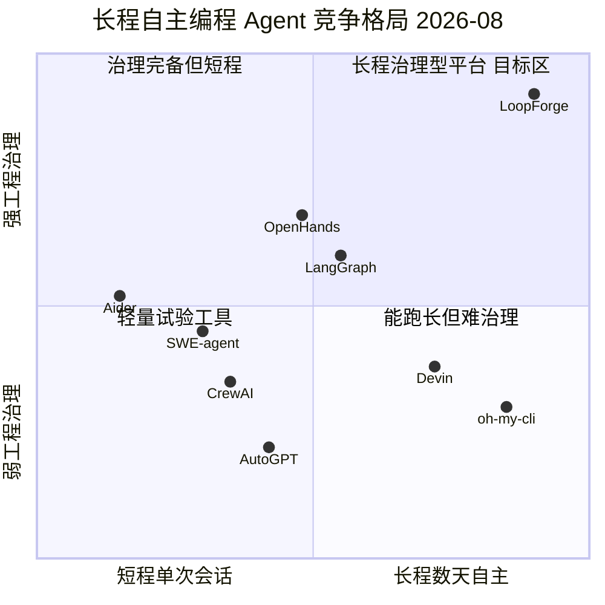
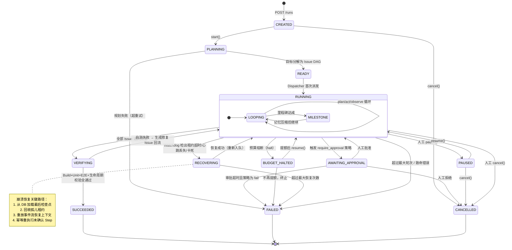
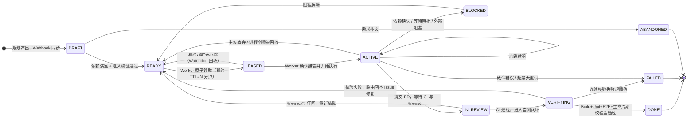
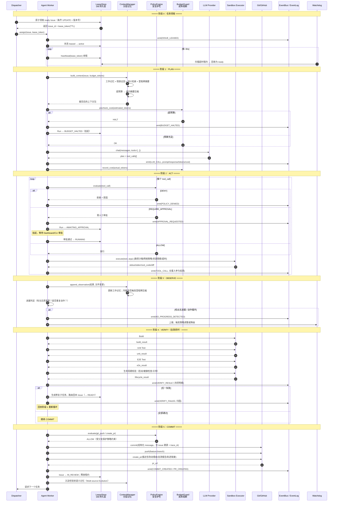
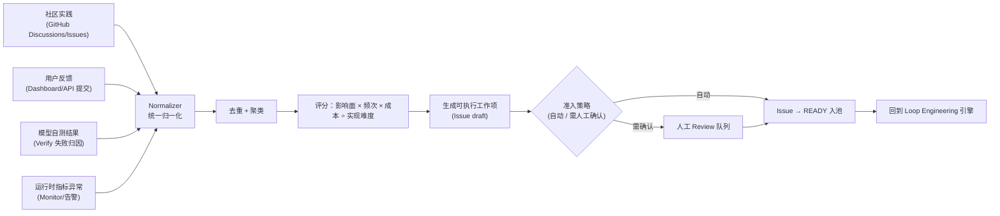

# LoopForge 产品需求文档（PRD）

> **开源的长程自主编程智能体编排与治理平台**
> Open-source Orchestration & Governance Platform for Long-Horizon Autonomous Coding Agents

---

## 0. 项目信息

| 项 | 内容 |
|---|---|
| **文档语言** | 中文（代码、标识符、API 字段、目录名一律英文） |
| **项目名（Project Name）** | `loopforge` |
| **代号 / 品牌名** | LoopForge |
| **文档版本** | v1.0 |
| **撰写日期** | 2026-08-03 |
| **产品经理** | 许清楚 |
| **接收人** | 齐活林（主理人）→ 架构师 → 工程团队 |
| **PRD 类型** | 完整 PRD（重点项目） |
| **后端技术栈** | Python 3.11+ / FastAPI / SQLAlchemy 2.x / Alembic / Pydantic v2 / Typer / Rich |
| **前端技术栈** | React 18 + TypeScript + Vite + Tailwind CSS |
| **部署** | Docker Compose（单机） + Kubernetes/Helm（集群） |
| **CI/CD** | GitHub Actions |
| **开源协议** | Apache-2.0（建议，待法务确认） |
| **工程规模预期** | **300+ 源文件量级的大型工程，非脚手架、非 Demo** |

### 0.1 原始需求复述

基于 2026-08-03 阿里发布 Qwen 3.8-Max 所展示的 **Loop Engineering（循环工程）** 范式，构建一个**真正可运行、企业级规模**的开源工程平台 **LoopForge**：让任何团队都能自行部署一套长程自主编程智能体的编排与治理系统，用任意 LLM（Qwen/DashScope、OpenAI 兼容、Anthropic、DeepSeek、Ollama 本地）驱动 Agent，在**数小时到数天**的时间尺度上自主完成真实软件工程任务，并具备状态持久化恢复、上下文治理、成本安全护栏、全链路可观测与可审计四大核心能力。

---

## 1. 产品背景与热点溯源

### 1.1 触发事件（2026-08-03）

**阿里巴巴于 2026-08-03 正式发布 Qwen 3.8-Max。**

**模型规格：**

| 维度 | 参数 |
|---|---|
| 总参数量 | 2.4T |
| 激活参数量 | 95B |
| 架构 | MoE（混合专家）+ 混合注意力（Hybrid Attention） |
| 上下文长度 | 1M tokens |
| 开源计划 | 下周开源权重 |

**最大亮点不是参数规模，而是「长程自主编程」（Long-Horizon Autonomous Coding）：**

- 官方以一句话指令 **「创建一个自进化的智能体 Harness」** 启动，模型从**空文件夹**出发，**连续 16 天无人干预**自主编程。
- 产出真实开源项目 `qwen-code-dev-bot/oh-my-cli`。
- 累计工程产出：**265 commits / 127 PRs / 151 issues**。

### 1.2 官方总结的核心工程范式：Loop Engineering（循环工程）

这是 LoopForge 要产品化的**核心理论原型**，共四大机制：

| # | 机制 | 说明 |
|---|---|---|
| **1** | **Issue 状态机** | 需求进入 GitHub Issues 后，Agent 通过状态机领取任务，流转 `ready → leased → active`。**租约（Lease）机制**防止多个 Agent 抢占同一任务。 |
| **2** | **Dispatcher + Monitor + Watchdog** | 三者组成执行闭环：**Dispatcher** 负责任务分派；**Monitor** 负责状态观测；**Watchdog** 负责卡死检测与恢复。 |
| **3** | **Self-testing 自测闭环** | 每次更新后自动触发 `Build → Unit Test → E2E → 生命周期校验`；异常状态被**路由回对应 issue/PR** 修复并重新验证。 |
| **4** | **Multi-source Evolution 多源演化** | 把社区实践、用户反馈、模型自测结果**统一转化为可执行工作项**，驱动能力持续演进。 |

### 1.3 其他长程能力佐证案例

| 场景 | 时长/规模 | 结果 |
|---|---|---|
| 论文复现与改进 | 连续 125 小时 | AIME24 分数 +2.7 |
| 编程竞赛 | 24 小时内 | 526 队中击败 458 队 |
| 芯片设计沙箱 | 500 轮交互 | 门数从 8298 精简至 678 |
| 电商经营模拟 | 365 天 | 排名第一 |

### 1.4 信息来源

> 以下来源已由主理人（齐活林）核实，日期均为 **2026-08-03**。**具体文章 permalink 以主理人核实的原始链接为准，实现阶段请在 README/文档中补全精确 URL，不得臆造。**

| 来源 | 类型 | 站点 |
|---|---|---|
| Qwen 官方博客 | 一手发布公告（模型规格、Loop Engineering 范式、16 天自主编程数据） | `https://qwen.ai/blog`（2026-08-03 发布） |
| `qwen-code-dev-bot/oh-my-cli` | 一手产出物仓库（265 commits / 127 PRs / 151 issues 可核对） | GitHub |
| 凤凰科技 | 中文媒体报道 | `https://tech.ifeng.com`（2026-08-03） |
| 澎湃新闻 | 中文媒体报道 | `https://www.thepaper.cn`（2026-08-03） |
| 证券时报 | 中文财经媒体报道 | `https://www.stcn.com`（2026-08-03） |

**同日次要热点（本次不采用）：** MiniMax H3 通用视频模型开源。

### 1.5 从热点到产品的推导逻辑

```
Qwen3.8 证明了：长程自主编程在技术上已可行（16 天 / 265 commits）
        ↓
但 Qwen 的 Loop Engineering 是「厂商内部的一次性 Harness」
        ↓
问题：普通团队无法复现 —— 缺编排层、缺治理层、缺可观测层
        ↓
LoopForge = 把 Loop Engineering 抽象为「可自托管、模型无关」的通用平台
```

**关键判断：** 2026 年 Agent 赛道的竞争焦点，已从「模型能不能写代码」转移到「**能不能让 Agent 连续跑 72 小时而不跑飞、不烧穿预算、且事后可审计**」。这正是 LoopForge 的market timing。

---

## 2. 产品定义

### 2.1 一句话定位

> **LoopForge 是一个开源、自托管、模型无关的长程自主编程智能体编排与治理平台 —— 让 Agent 能在数小时到数天的尺度上，安全、可控、可审计地完成真实软件工程任务。**

### 2.2 核心价值主张

现有 Agent 框架（AutoGPT / CrewAI / SWE-agent 等）本质上都是 **短程（Short-Horizon）** 的：跑几十轮就上下文爆炸、行为跑飞、成本失控、事后无法审计。

**LoopForge 专门解决长程场景的四大难题：**

| # | 难题 | LoopForge 的解法 |
|---|---|---|
| **1** | **状态持久化与恢复** | 全状态落库（非内存态）；Issue 状态机 + 租约机制；Watchdog 卡死检测；进程崩溃/机器重启后断点续跑 |
| **2** | **上下文治理** | 分层记忆（工作记忆 / 情景记忆 / 语义记忆 / 里程碑摘要）；上下文预算分配器；增量压缩与召回。**即便 1M 上下文也会被长程任务撑爆，必须主动治理** |
| **3** | **成本与安全护栏** | 多级预算熔断（Run/Day/Org）；命令白/黑名单；文件路径沙箱；网络出站策略；高危操作人工审批闸门（HITL Gate） |
| **4** | **可观测与可审计** | 全量事件流（Append-only Event Log）；轨迹回放（Trajectory Replay）；Prometheus 指标；成本归因到 Issue/PR/模型；每个 commit 可溯源到触发它的 issue 与 LLM 调用 |

### 2.3 产品目标（3 条量化目标）

| # | 目标 | 量化指标（可验收） |
|---|---|---|
| **G1** | **长程可靠性** —— 让 Agent 真正跑得久、跑得住 | 在参考基准任务集上，**单 Run 连续运行 ≥ 72 小时无人干预**；期间人为注入 ≥ 3 次故障（进程 kill / 数据库断连 / LLM 5xx），**自动恢复成功率 ≥ 95%**，且**零状态丢失**（恢复后 Issue 状态与事件流完全一致） |
| **G2** | **成本与安全可控** —— 让企业敢把 Agent 放进真实仓库 | **预算熔断准确率 100%**（超预算必停，误停率 0）；**成本预估与实际偏差 ≤ 10%**；危险命令拦截召回率 **≥ 99%**（基于内置 ≥ 200 条红线用例集）；**沙箱逃逸用例 0 通过** |
| **G3** | **开箱可用与可移植** —— 让任何团队 30 分钟跑起来 | `docker compose up` 后 **≤ 30 分钟**完成首个真实 Run（含 GitHub PR 产出）；**≥ 5 类 LLM Provider** 开箱支持（Qwen/DashScope、OpenAI 兼容、Anthropic、DeepSeek、Ollama）+ **Mock Provider 零 Key 全流程可跑通**；核心链路测试覆盖率 **≥ 80%** |

### 2.4 明确的非目标（Non-Goals）

为避免范围蔓延，**v1.0 明确不做**：

- ❌ 不自研 LLM，不做模型微调/训练
- ❌ 不做通用 RPA / 浏览器自动化 Agent（仅聚焦软件工程域）
- ❌ 不做 SaaS 托管服务与计费系统（v1.0 只做自托管开源版）
- ❌ 不做 IDE 插件（VSCode/JetBrains 插件列入 P2 或后续版本）
- ❌ 不做多租户 SaaS 级隔离（v1.0 为单组织多项目模型）

---

## 3. 目标用户与用户故事

### 3.1 用户画像总览

| 角色 | 画像 | 核心诉求 | 关注的 KPI |
|---|---|---|---|
| **平台工程师**（Platform Engineer） | 中大型公司基础设施/效能团队，负责给业务线提供内部工具平台 | 能自托管、能对接内部 GitLab/GitHub Enterprise、能横向扩容 | 部署成本、可维护性、SLA |
| **AI 应用开发者**（AI App Developer） | 用 LLM 做产品的工程师，正在自研 Agent | 不想重复造轮子（状态机/记忆/沙箱），要可扩展的 SDK | 上手速度、扩展性 |
| **DevOps / SRE** | 负责生产稳定性与值班 | Agent 跑飞时能告警、能止损、能回滚 | MTTR、告警准确率 |
| **技术负责人 / 研发效能负责人** | 决定要不要引入 Agent 的人 | ROI 可量化、成本可预测、风险可控 | 成本/任务、任务成功率 |
| **安全与合规** | 安全团队 / 合规审计 | Agent 做过什么必须全部留痕、可审计、可追责 | 审计完整率、越权事件数 |
| **开源维护者**（OSS Maintainer） | 个人或社区维护者，仓库 issue 堆积 | 让 Agent 自动处理低复杂度 issue，自己只做 Review | Issue 消化率、PR 质量 |

### 3.2 用户故事（P0 场景）

#### US-01 · 平台工程师 —— 自托管部署
> **As a** 平台工程师，
> **I want** 通过一条 `docker compose up`（或一份 Helm Chart）在公司内网完整部署 LoopForge，并接入内部的 GitHub Enterprise 与自建 vLLM/Ollama 推理服务，
> **so that** 我不必把代码和 Prompt 发送到任何外部 SaaS，就能给全公司业务线提供长程 Agent 能力。

**验收要点：** 全组件容器化；无外网依赖也能启动；Provider/Git 地址全部可配置；提供 Helm values 完整示例。

---

#### US-02 · AI 应用开发者 —— 用自己的模型与工具跑长程任务
> **As an** AI 应用开发者，
> **I want** 在配置文件里切换 LLM Provider（DashScope→OpenAI→Ollama）而不改一行业务代码，并能用插件机制注册我自己的工具（如内部 API 调用、私有构建系统），
> **so that** 我可以把 LoopForge 当作长程 Agent 的「运行时」，专注写我的领域逻辑。

**验收要点：** Provider 抽象层统一接口；工具以 Plugin/Entry-point 注册；提供 ≥ 3 个自定义工具示例与 SDK 文档。

---

#### US-03 · AI 应用开发者 —— 断点续跑
> **As an** AI 应用开发者，
> **I want** 在 Agent 跑了 40 小时后我的服务器意外重启时，重新拉起服务能从上一个已确认的检查点继续，而不是从头再来，
> **so that** 我不会浪费掉已经烧掉的几十美元 token 和几十小时的进度。

**验收要点：** 所有状态落库；Run/Issue/Step 三级检查点；重启后 Watchdog 自动接管孤儿租约；恢复后事件流连续无断层。

---

#### US-04 · DevOps / SRE —— 跑飞时能止损
> **As a** SRE，
> **I want** 当某个 Run 出现异常（连续失败、循环卡死、成本速率突增、触发危险命令）时，系统自动熔断并通过 Webhook/Slack 告警到我的值班频道，同时我能一键 Pause / Kill / 回滚该 Run 已产生的分支，
> **so that** Agent 的失控不会演变成生产事故或账单事故。

**验收要点：** 内置 ≥ 8 条告警规则；Prometheus 指标齐全；`pause/resume/cancel` API 与 CLI 均可用且幂等；分支/PR 可一键关闭清理。

---

#### US-05 · 技术负责人 —— 成本可预测、ROI 可量化
> **As a** 技术负责人，
> **I want** 在 Dashboard 上看到每个 Run / 每个 Issue / 每个模型的 token 与金额消耗、任务成功率、平均耗时与人工介入次数，并能给团队设置日预算上限，
> **so that** 我能判断引入 Agent 到底省了多少人力、值不值得继续投入。

**验收要点：** 成本归因到 Issue/PR/Model/Provider 四个维度；日/周报表；预算超限自动停机并通知。

---

#### US-06 · 安全与合规 —— 全链路可审计
> **As a** 安全合规负责人，
> **I want** 对任意一次 Agent 提交的 commit，都能反查出：是哪个 Issue 触发的、Agent 当时的完整思考轨迹是什么、调用了哪个模型的哪次请求、执行了哪些 shell 命令、读写了哪些文件、是否经过人工审批，
> **so that** 出现问题时能定责、能复盘，且满足内部审计与合规要求。

**验收要点：** Append-only 事件日志不可篡改（含哈希链）；轨迹回放 UI；命令与文件访问全量留痕；审计数据可导出（JSON/CSV）。

---

#### US-07 · 开源维护者 —— 自动消化 Issue
> **As an** 开源维护者，
> **I want** 给仓库打上 `loopforge:auto` 标签的 issue 被 Agent 自动领取、实现、自测并提交 PR，PR 描述里附上完整的改动理由与测试结果，
> **so that** 我只需要做 Code Review，而不必亲自处理每一个小 bug。

**验收要点：** GitHub Webhook 双向同步；Label 驱动的任务准入；PR 模板含轨迹链接与自测报告。

---

#### US-08 · 安全与合规 —— 人工审批闸门
> **As a** 安全负责人，
> **I want** 对「删除文件 / 修改 CI 配置 / 安装新依赖 / 推送到 main 分支 / 访问外网域名」这类高危操作，强制要求人工在 Dashboard 上点击审批后 Agent 才能继续，
> **so that** Agent 拥有的权限始终小于等于我批准的范围。

**验收要点：** 策略引擎支持 `allow / deny / require_approval` 三态；审批超时策略可配置；审批记录进审计日志。

---

#### US-09 · 平台工程师 —— 多 Agent 并发不打架
> **As a** 平台工程师，
> **I want** 同时跑 10 个 Agent Worker 处理同一个仓库的不同 issue，系统保证同一 issue 不会被两个 Agent 同时领走，且冲突的文件改动能被检测并串行化，
> **so that** 我能通过加 Worker 来线性提升吞吐，而不是引入一堆竞态 bug。

**验收要点：** 租约（Lease）基于数据库原子操作实现；租约续期与超时释放；并发压测 ≥ 10 Worker 无重复领取。

---

#### US-10 · AI 应用开发者 —— 零 Key 也能验证
> **As a** 首次接触 LoopForge 的开发者，
> **I want** 在完全没有任何 LLM API Key 的情况下，用内置 Mock Provider 跑通「创建 Run → 分解 Issue → 领取 → 编码 → 自测 → 提 PR」的完整流程，
> **so that** 我能在 10 分钟内评估这个平台到底靠不靠谱，再决定要不要充值买 Key。

**验收要点：** Mock Provider 产出确定性可复现的响应；本地 Git 沙箱仓库替代 GitHub；E2E 测试全部基于 Mock 运行。

---

## 4. 竞品分析

### 4.1 竞品对比矩阵

评估维度说明：

- **长程能力**：能否稳定运行数小时～数天（而非几十轮即失控）
- **状态恢复**：崩溃/重启后能否断点续跑
- **成本治理**：预算、熔断、成本归因
- **安全护栏**：沙箱、命令管控、审批闸门
- **可观测/审计**：事件流、轨迹回放、指标
- **自托管**：能否完全私有化部署
- **模型无关**：是否绑定特定厂商

| 竞品 | 类型 | 长程能力 | 状态恢复 | 成本治理 | 安全护栏 | 可观测/审计 | 自托管 | 模型无关 | 核心优势 | 关键短板 |
|---|---|---|---|---|---|---|---|---|---|---|
| **oh-my-cli**<br>(qwen-code-dev-bot) | Qwen3.8 自主产出的 Agent Harness | ★★★★★ | ★★★☆☆ | ★☆☆☆☆ | ★★☆☆☆ | ★★☆☆☆ | ★★★☆☆ | ★★☆☆☆ | **唯一被 16 天/265 commits 实证验证的长程范式**；Loop Engineering 原创出处 | 面向 Qwen 自身场景的 Harness，非通用平台；治理层（成本/安全/审计）薄弱；无 Web 控制台；开箱部署能力弱 |
| **OpenHands**<br>(原 OpenDevin) | 开源通用编码 Agent | ★★★☆☆ | ★★☆☆☆ | ★★☆☆☆ | ★★★★☆ | ★★★☆☆ | ★★★★★ | ★★★★☆ | 社区大、沙箱（Docker runtime）成熟、有 Web UI、多模型支持 | 面向**单会话交互式**任务，长程编排与租约机制缺失；无 Issue 状态机；成本治理弱；跨天任务易失控 |
| **SWE-agent** | 学术出身的 Issue→Patch Agent | ★★☆☆☆ | ★☆☆☆☆ | ★☆☆☆☆ | ★★★☆☆ | ★★☆☆☆ | ★★★★☆ | ★★★★☆ | SWE-bench 基准表现优秀；ACI（Agent-Computer Interface）设计精良 | **单 issue 单次修补**定位，天然短程；无持久化编排；无 Dashboard；不面向生产运维 |
| **AutoGPT** | 早期自主 Agent 代表 | ★★☆☆☆ | ★★☆☆☆ | ★★☆☆☆ | ★★☆☆☆ | ★★☆☆☆ | ★★★★☆ | ★★★★☆ | 知名度最高、生态插件多、有低代码流程编辑器 | 长程即「跑飞」的典型：目标漂移、上下文爆炸、成本失控；非软件工程域专精 |
| **CrewAI** | 多 Agent 协作框架 | ★★☆☆☆ | ★★☆☆☆ | ★★☆☆☆ | ★★☆☆☆ | ★★★☆☆ | ★★★★☆ | ★★★★★ | 角色/任务抽象直观，上手快，企业版有观测能力 | 是**框架不是平台**：无内置持久化运行时、无租约、无沙箱、无 Watchdog；长程需自建大量基建 |
| **LangGraph** | 有状态 Agent 图编排框架 | ★★★☆☆ | ★★★★☆ | ★★☆☆☆ | ★★☆☆☆ | ★★★★☆ | ★★★★☆ | ★★★★★ | **Checkpointer 持久化设计优秀**、支持 HITL 中断恢复、LangSmith 观测强 | 通用图编排，**不含软件工程域能力**（无 Git/PR/自测闭环/沙箱）；治理需自行拼装；学习曲线陡 |
| **Devin**<br>(Cognition) | 商业闭源 AI 软件工程师 | ★★★★☆ | ★★★★☆ | ★★☆☆☆ | ★★★☆☆ | ★★★☆☆ | ☆☆☆☆☆ | ☆☆☆☆☆ | 端到端体验成熟、真实交付案例多、产品打磨度高 | **闭源 + 纯 SaaS + 绑定自有模型**：无法私有化、无法审计内部实现、代码需上云、成本不透明 |
| **Aider** | CLI 结对编程工具 | ★☆☆☆☆ | ★☆☆☆☆ | ★★★☆☆ | ★★☆☆☆ | ★★☆☆☆ | ★★★★★ | ★★★★★ | 极轻量、Git 集成优雅（自动 commit）、成本显示清晰、开发者口碑好 | **人在环中的短程工具**，非自主长程；无编排、无并发、无服务端、无 Dashboard |
| **▶ LoopForge**<br>（本产品） | 长程 Agent 编排与治理**平台** | ★★★★★ | ★★★★★ | ★★★★★ | ★★★★★ | ★★★★★ | ★★★★★ | ★★★★★ | 把 Loop Engineering 范式**平台化**：状态机+租约+Watchdog+分层记忆+预算熔断+策略引擎+事件流回放，全部开箱内置且自托管 | 新项目，生态与社区需从零建设；组件多导致部署复杂度高于单体工具（需靠 Compose/Helm 与文档抵消） |

### 4.2 竞争象限图

**X 轴：** 短程工具 ←→ 长程自主能力
**Y 轴：** 弱工程治理 ←→ 强工程治理（可观测 + 成本 + 安全 + 自托管的加权得分）



### 4.3 竞争结论与差异化定位

**市场空白判断：** 象限图右上角（**长程 + 强治理**）目前**无开源玩家**。

- `oh-my-cli` 与 `Devin` 证明了长程可行，但一个是**厂商内部 Harness**、一个是**闭源 SaaS**，企业都不可控。
- `OpenHands` / `LangGraph` 治理侧较强，但**长程编排与软件工程域闭环缺失**。
- `AutoGPT` / `CrewAI` / `SWE-agent` / `Aider` 定位在左侧短程区，与 LoopForge 不直接竞争，反而可作为**上游生态**（LoopForge 可将其作为可插拔的执行器）。

**LoopForge 的三条护城河：**

1. **域专精的长程运行时** —— Issue 状态机 + 租约 + Watchdog + 自测闭环，是软件工程域独有的编排语义，通用图框架无法平替。
2. **治理即产品（Governance-as-Product）** —— 成本熔断、策略引擎、审计链路不是"加个中间件"，而是贯穿架构的一等公民。
3. **完全自托管 + 模型无关** —— 直接吃掉 Devin 无法覆盖的「代码不能出内网」的企业市场。

**生态策略：** 不与短程工具为敌。将 Aider / SWE-agent / OpenHands Runtime 设计为**可插拔 Executor Adapter**（P1），LoopForge 做它们之上的编排与治理层。

---

## 5. 需求池（Requirements Pool）

> 优先级定义：**P0 = Must have（v1.0 必须交付，缺一不可）** / **P1 = Should have（v1.1）** / **P2 = Nice to have（后续版本）**
> 需求语言：**必须（MUST）** / **应当（SHOULD）** / **可以（COULD）**

### 5.1 P0 需求（v1.0 必交付）

#### 【引擎与编排】

| ID | 需求 | 说明与验收要点 |
|---|---|---|
| **P0-01** | **Loop Engineering 引擎** | 系统**必须**实现 `plan → act → observe → verify → commit → evolve` 的可持续循环内核。支持循环轮次上限、单轮超时、里程碑（Milestone）划分与达成判定。引擎**必须**是可恢复的状态机而非内存循环。**验收：** 单 Run 可连续执行 ≥ 500 轮循环不退化。 |
| **P0-02** | **Issue 状态机与租约机制** | **必须**实现完整 Issue 生命周期状态机（见 §6.2），至少覆盖 `draft / ready / leased / active / blocked / in_review / verifying / done / failed / abandoned`。租约（Lease）**必须**基于数据库原子操作（`SELECT ... FOR UPDATE` 或条件 UPDATE + 版本号），含 TTL、心跳续期、超时自动回收。**验收：** 10 Worker 并发抢同一 issue，有且仅有 1 个成功领取，重复领取率 0。 |
| **P0-03** | **Dispatcher（调度器）** | **必须**支持基于优先级、依赖关系（DAG）、Worker 能力标签、并发上限的任务分派。**必须**支持公平调度与饥饿防护。**验收：** 支持 ≥ 3 种调度策略（FIFO / Priority / Dependency-aware）可配置。 |
| **P0-04** | **Monitor（监控器）** | **必须**持续采集 Run/Issue/Worker/Step 的实时状态、心跳、进度、资源与成本速率，并对外暴露查询接口与 SSE/WebSocket 实时流。 |
| **P0-05** | **Watchdog（看门狗）** | **必须**检测并处理：租约超时、心跳丢失、循环卡死（无进展检测）、重复动作循环（Loop Detection）、异常退出的孤儿任务。**必须**支持自动恢复策略（重试 / 重新入队 / 降级 / 上报人工）。**验收：** 注入 kill -9、DB 断连、LLM 超时三类故障，自动恢复成功率 ≥ 95%。 |

#### 【模型与执行】

| ID | 需求 | 说明与验收要点 |
|---|---|---|
| **P0-06** | **多 LLM Provider 适配层** | **必须**开箱支持：**Qwen/DashScope、OpenAI 兼容（含 vLLM/自建网关）、Anthropic、DeepSeek、Ollama 本地**，外加 **Mock Provider**。统一抽象：Chat / Tool-Calling / Streaming / Token 计数 / 成本计算 / 重试退避 / 限流。**必须**支持多 Provider 故障转移（Failover）与按任务类型路由（如规划用大模型、格式化用小模型）。 |
| **P0-07** | **工具沙箱执行（Sandbox Executor）** | **必须**提供隔离的命令与文件执行环境（v1.0 基于 Docker，接口抽象需为后续 gVisor/Firecracker 预留）。**必须**支持：工作目录限定、路径白名单、只读挂载、资源限额（CPU/内存/磁盘/超时）、网络策略（默认 deny，白名单放行）、输出截断与流式回传。内置工具集**必须**≥ 12 个：`read_file / write_file / edit_file / list_dir / search_code(grep) / run_shell / run_tests / git_ops / http_fetch / apply_patch / create_pr / ask_human`。 |
| **P0-08** | **Git / GitHub 集成** | **必须**支持：仓库 clone/fetch、分支创建与切换、原子 commit（含结构化 message 与 issue 溯源）、push、PR 创建/更新/评论、Issue 双向同步、Webhook 接收（issue/PR/CI 事件）、Label 驱动的任务准入、冲突检测与处理。**必须**支持 GitHub.com 与 GitHub Enterprise；Git 层抽象需为 GitLab（P1）预留。 |

#### 【上下文与记忆】

| ID | 需求 | 说明与验收要点 |
|---|---|---|
| **P0-09** | **分层记忆与上下文压缩** | **必须**实现四层记忆：**工作记忆**（当前循环）/ **情景记忆**（本 Run 历史事件）/ **语义记忆**（代码库知识、经验沉淀）/ **里程碑摘要**（跨阶段压缩）。**必须**实现上下文预算分配器（按 token 配额动态裁剪）、递归摘要压缩、相关性召回（向量或 BM25，v1.0 至少一种）。**验收：** 连续 500 轮循环，上下文占用稳定在配置上限内不溢出，且关键决策信息不丢失（基于回归用例集校验）。 |

#### 【治理与安全】

| ID | 需求 | 说明与验收要点 |
|---|---|---|
| **P0-10** | **成本预算与熔断** | **必须**实时计量 token 与金额，并归因到 **Run / Issue / PR / Model / Provider** 五个维度。**必须**支持多级预算（单 Run / 单日 / 组织级）与三级动作（`warn → throttle → halt`）。**必须**支持成本预估（执行前）与实际对账（执行后）。**验收：** 超预算必停，误停率 0；预估与实际偏差 ≤ 10%。 |
| **P0-11** | **安全策略引擎** | **必须**支持声明式策略（YAML/JSON），规则维度覆盖：**命令白/黑名单（正则+AST 双重）、文件路径沙箱、网络出站域名策略、Git 分支保护、敏感信息（Secret）扫描与脱敏、依赖安装管控**。每条规则支持 `allow / deny / require_approval` 三态。**必须**提供人工审批闸门（HITL Gate）：挂起 Run、通知、超时策略、审批留痕。**验收：** 内置 ≥ 200 条红线用例，拦截召回率 ≥ 99%；沙箱逃逸用例 0 通过。 |

#### 【可观测与审计】

| ID | 需求 | 说明与验收要点 |
|---|---|---|
| **P0-12** | **事件流与轨迹回放** | **必须**采用 Append-only 事件日志（Event Sourcing 风格），记录全部：LLM 请求/响应（含 prompt 与 token）、工具调用与结果、状态迁移、策略判定、审批、错误与恢复。事件**必须**含哈希链以保证不可篡改。**必须**提供轨迹回放（Trajectory Replay）：按时间轴逐步重现 Agent 的完整决策过程。**必须**支持审计数据导出（JSON / CSV / JSONL）。 |
| **P0-16** | **指标与告警** | **必须**暴露 Prometheus `/metrics`，指标覆盖：Run/Issue 状态分布、循环轮次速率、LLM 延迟与错误率、token/成本速率、工具成功率、租约超时数、Watchdog 恢复次数、队列深度、Worker 健康度。**必须**内置 ≥ 8 条告警规则与 Grafana Dashboard JSON。**必须**支持 Webhook / Slack / 飞书 / 企业微信 告警通道（至少 Webhook + 2 个）。 |

#### 【接口层】

| ID | 需求 | 说明与验收要点 |
|---|---|---|
| **P0-13** | **REST API** | **必须**基于 FastAPI 提供完整 API：Projects / Runs / Issues / Steps / Events / Artifacts / Providers / Policies / Budgets / Approvals / Metrics / Health。**必须**自动生成 OpenAPI 3.1 文档。**必须**支持 API Key 认证、RBAC（至少 admin/operator/viewer 三角色）、请求限流、幂等键。**必须**提供 SSE/WebSocket 实时事件订阅。 |
| **P0-14** | **CLI** | **必须**基于 Typer + Rich 提供命令行：`init / config / provider / project / run（create/start/pause/resume/cancel/logs/replay）/ issue / policy / budget / approve / db（migrate/seed）/ doctor / version`。**必须**支持人类可读（Rich 表格/进度）与机器可读（`--json`）双输出模式。 |
| **P0-15** | **Web Dashboard** | **必须**基于 React 18 + TS + Vite + Tailwind 提供：总览大盘、Run 列表与详情、实时事件流、轨迹回放器、Issue 看板（状态机可视化）、成本分析、策略与审批中心、Provider 配置、系统健康。**必须**支持实时推送（SSE/WS）、暗色模式、响应式布局。 |

#### 【数据与部署】

| ID | 需求 | 说明与验收要点 |
|---|---|---|
| **P0-17** | **持久化与迁移** | **必须**使用 SQLAlchemy 2.x + Alembic。**必须**同时支持 **PostgreSQL（生产）** 与 **SQLite（本地/测试）**。**必须**提供完整迁移链、种子数据、备份/恢复脚本。数据模型至少覆盖：Project / Run / Issue / Lease / Step / Event / LLMCall / ToolCall / Artifact / Memory / Budget / CostRecord / Policy / Approval / User / ApiKey / AuditLog。 |
| **P0-18** | **Docker / K8s 部署** | **必须**提供：多阶段构建 Dockerfile（api / worker / web）、`docker-compose.yml`（含 Postgres + Redis + API + Worker + Web + Prometheus + Grafana）、完整 Helm Chart（Deployment/StatefulSet/Service/Ingress/ConfigMap/Secret/HPA/PDB/ServiceMonitor）。**必须**提供 `.env.example` 与配置校验。**验收：** 全新环境 `docker compose up` 后 ≤ 30 分钟跑通首个 Run。 |

### 5.2 P1 需求（v1.1）

| ID | 需求 |
|---|---|
| P1-01 | **GitLab / Gitea 集成**（Git Provider 抽象落地第二实现） |
| P1-02 | **多 Agent 协作角色**：Planner / Coder / Reviewer / Tester 分工与交接协议 |
| P1-03 | **可插拔 Executor Adapter**：接入 Aider / SWE-agent / OpenHands Runtime 作为执行器 |
| P1-04 | **向量记忆增强**：可选接入 pgvector / Qdrant，做代码语义检索与经验召回 |
| P1-05 | **Prompt / 策略版本管理与 A/B 实验**，含效果对比报表 |
| P1-06 | **任务模板市场**：预置常见工程任务模板（重构、补测试、升级依赖、修复 CI） |
| P1-07 | **成本优化器**：自动模型降级路由、Prompt 缓存、批处理合并 |
| P1-08 | **OpenTelemetry 全链路追踪**（Trace 打通 LLM 调用与工具执行） |
| P1-09 | **SSO / OIDC 登录**与更细粒度 RBAC（项目级权限） |
| P1-10 | **Run 对比与回归基准**：内置 benchmark 套件，衡量版本迭代的能力变化 |

### 5.3 P2 需求（后续）

| ID | 需求 |
|---|---|
| P2-01 | VSCode / JetBrains 插件 |
| P2-02 | 多租户隔离与 SaaS 化计费 |
| P2-03 | 移动端告警与审批 App |
| P2-04 | 自然语言运维助手（对 LoopForge 自身的 ChatOps） |
| P2-05 | 更强隔离沙箱（gVisor / Firecracker / Kata） |
| P2-06 | 跨仓库、跨服务的联合任务编排（Monorepo 与微服务多仓协同） |
| P2-07 | Agent 能力自进化：把 Multi-source Evolution 的产物自动回写为平台自身的改进 issue |

---

## 6. 核心业务流程

### 6.1 Run 生命周期状态图



### 6.2 Issue 状态机（含租约）



### 6.3 一次完整循环的时序图（plan → act → observe → verify → commit）



### 6.4 多源演化（Multi-source Evolution）数据流



---

## 7. 技术架构约束（硬性）

> 以下为**硬性约束**，架构师与工程团队**必须**遵守。

### 7.1 工程规模

- **本项目是数百个文件量级的大型工程，规模预期 300+ 源文件，不是脚手架、不是示例、不是 Demo。**
- 后端 Python 源文件预期 ≥ 180 个；前端 TS/TSX 预期 ≥ 90 个；测试文件 ≥ 60 个；配置与部署清单 ≥ 30 个；文档 ≥ 25 篇。
- 模块边界必须清晰，禁止巨型文件（单文件建议 ≤ 500 行）。

### 7.2 真实可运行（最高优先级约束）

- **填好配置（LLM API Key + GitHub Token）后必须即可真跑。**
- **严禁**：示例代码、伪实现、`pass` 占位、`TODO` 占位、`NotImplementedError` 占位、假数据 Mock 冒充真实逻辑。
- **必须**同时提供 **Mock Provider + 本地 Git 沙箱仓库**，使**无任何 API Key 的用户也能完整跑通全流程**用于验证与 CI。
- Mock Provider 的响应**必须确定性可复现**（固定 seed / 录制回放），以支撑稳定的 E2E 测试。

### 7.3 技术栈（不可替换）

| 层 | 技术 |
|---|---|
| 后端语言 | Python 3.11+ |
| Web 框架 | FastAPI |
| ORM / 迁移 | SQLAlchemy 2.x + Alembic |
| 数据校验 | Pydantic v2 |
| CLI | Typer + Rich |
| 数据库 | PostgreSQL（生产） / SQLite（本地与测试） |
| 队列与缓存 | Redis |
| 前端 | React 18 + TypeScript + Vite + Tailwind CSS |
| 容器化 | Docker（多阶段构建） |
| 编排部署 | Docker Compose + Kubernetes / Helm |
| CI/CD | GitHub Actions |
| 监控 | Prometheus + Grafana |
| 测试 | pytest / pytest-asyncio / Vitest / Playwright |
| 代码质量 | ruff + mypy（strict）+ ESLint + Prettier |

### 7.4 文档交付要求（极其完善）

`docs/` 下**必须**包含（不少于以下清单）：

```
docs/
├── PRD.md                     # 本文档
├── architecture/
│   ├── overview.md            # 总体架构与组件图
│   ├── data-model.md          # ER 图与表设计
│   ├── loop-engine.md         # Loop Engineering 引擎设计
│   ├── state-machine.md       # Run/Issue 状态机规约
│   ├── memory.md              # 分层记忆与上下文治理
│   ├── concurrency.md         # 租约、并发与一致性模型
│   └── adr/                   # ADR（架构决策记录），≥ 12 篇
├── deployment/
│   ├── docker-compose.md
│   ├── kubernetes.md
│   ├── helm.md
│   └── production-checklist.md
├── api/
│   ├── rest-api.md
│   ├── events.md              # 事件类型全量字典
│   └── openapi.json
├── guides/
│   ├── quickstart.md          # 30 分钟跑通
│   ├── mock-mode.md           # 零 Key 验证
│   ├── providers.md           # 各 LLM Provider 配置
│   ├── writing-tools.md       # 自定义工具开发
│   └── troubleshooting.md
├── security/
│   ├── threat-model.md
│   ├── policy-reference.md    # 策略 DSL 完整参考
│   └── sandbox.md
├── operations/
│   ├── monitoring.md
│   ├── alerting.md
│   ├── backup-restore.md
│   ├── cost-management.md
│   └── runbook.md             # 值班手册
└── contributing/
    ├── CONTRIBUTING.md
    ├── code-style.md
    ├── testing.md
    └── release-process.md
```

### 7.5 语言约定

- 文档、注释、日志中的说明性文本：**中文为主**。
- 代码标识符、API 字段、目录名、Git commit message、错误码：**英文**。

---

## 8. 非功能需求（NFR）

### 8.1 性能

| 指标 | 要求 |
|---|---|
| REST API P95 延迟（非 LLM 路径） | ≤ 200 ms |
| Dashboard 首屏加载（本地网络） | ≤ 2 s |
| 事件写入吞吐 | ≥ 1000 events/s（单实例，Postgres） |
| 事件实时推送延迟 | ≤ 500 ms |
| 单实例支持并发 Worker | ≥ 20 |
| 单实例支持并发活跃 Run | ≥ 50 |
| 上下文构建耗时 | ≤ 2 s（含召回与压缩） |
| 轨迹回放加载（1 万条事件） | ≤ 3 s（分页/虚拟滚动） |

### 8.2 可靠性

| 指标 | 要求 |
|---|---|
| 单 Run 最长连续运行 | ≥ 72 小时无人干预 |
| 崩溃恢复成功率 | ≥ 95%（kill -9 / DB 断连 / LLM 5xx 三类注入故障） |
| 恢复后状态一致性 | 100% 无丢失、无重复副作用（幂等保证） |
| 租约重复领取率 | 0% |
| 数据持久化 | 所有状态变更落库，无内存态单点 |
| LLM 调用重试 | 指数退避，最大重试可配置，支持 Provider 级 Failover |
| 服务可用性目标 | 99.5%（自托管单集群） |

### 8.3 安全

| 指标 | 要求 |
|---|---|
| 危险命令拦截召回率 | ≥ 99%（内置 ≥ 200 条红线用例集） |
| 沙箱逃逸 | 0 通过（含路径穿越、符号链接、容器逃逸用例） |
| 网络出站 | 默认 deny，仅白名单放行 |
| Secret 管理 | 不入库明文；配置支持环境变量与外部 Secret Manager；日志与事件自动脱敏 |
| 认证授权 | API Key + RBAC（admin/operator/viewer） |
| 审计完整性 | 事件日志 Append-only + 哈希链，篡改可检出 |
| 依赖安全 | CI 集成 SCA 扫描（pip-audit / npm audit），高危漏洞阻断合入 |

### 8.4 可扩展性

| 维度 | 要求 |
|---|---|
| Worker 水平扩展 | 无状态 Worker，加节点线性提升吞吐（≥ 0.8 线性度，10 Worker 内） |
| Provider 扩展 | 新增一个 LLM Provider ≤ 1 个文件 + 注册，不改核心代码 |
| 工具扩展 | 通过 Plugin/Entry-point 注册，不改核心代码 |
| 存储扩展 | DB 后端可切换（Postgres/SQLite），事件存储可外接对象存储归档 |
| Git 后端扩展 | Git Provider 抽象接口，GitLab/Gitea 可后续实现（P1） |

### 8.5 可观测性

| 要求 |
|---|
| Prometheus `/metrics`，指标 ≥ 40 项，覆盖 §5.1 P0-16 列表 |
| 结构化日志（JSON），含 `trace_id / run_id / issue_id / step_id` 贯穿 |
| 内置 Grafana Dashboard JSON（≥ 3 个：总览 / 成本 / 可靠性） |
| 内置告警规则 ≥ 8 条（成本速率、失败率、租约超时、队列积压、Worker 失联、LLM 错误率、卡死检出、审批积压） |
| 健康检查：`/healthz`（存活）、`/readyz`（就绪）、`/health/detail`（依赖项明细） |

### 8.6 可维护性

| 要求 |
|---|
| 核心链路（引擎/状态机/租约/预算/策略）单元测试覆盖率 ≥ 85%；整体 ≥ 80% |
| E2E 测试基于 Mock Provider，CI 全绿方可合入 |
| `mypy --strict` 与 `ruff` 零告警 |
| 所有公共 API 有 docstring，所有配置项有说明与默认值 |
| 数据库迁移可前滚可回滚，含迁移测试 |

---

## 9. 验收标准

> **总原则：** 验收以「**能不能真跑起来**」为唯一硬标准。以下场景**必须**全部通过。

### 9.1 A 组 —— 零 Key 验收（Mock 模式，无需任何 API Key）

| ID | 场景 | 通过标准 |
|---|---|---|
| **AC-A1** | 一键启动 | 全新机器执行 `docker compose up -d` 后，`/healthz` 与 `/readyz` 在 5 分钟内全绿；Dashboard 可访问 |
| **AC-A2** | Mock 全流程 | 使用 Mock Provider + 本地 Git 沙箱仓库，创建 Run「给示例项目补齐单元测试」，端到端跑通 `PLANNING → READY → RUNNING → VERIFYING → SUCCEEDED`，产出 ≥ 1 个本地分支 + ≥ 1 个 commit + PR 对象 |
| **AC-A3** | 事件与回放 | 上述 Run 的事件流完整（含 LLM_CALL / TOOL_CALL / 状态迁移 / VERIFY_RESULT），Dashboard 轨迹回放可逐步重现全过程 |
| **AC-A4** | CLI 等价性 | AC-A2 的全部操作可纯 CLI 完成，`--json` 输出可被脚本解析 |
| **AC-A5** | E2E 测试套件 | `pytest tests/e2e` 全绿，且不依赖任何外部网络 |

### 9.2 B 组 —— 真实模式验收（配置 LLM API Key + GitHub Token）

| ID | 场景 | 通过标准 |
|---|---|---|
| **AC-B1** | 真实 PR 产出 | 配置 DashScope（Qwen）Key + GitHub Token，对一个真实测试仓库下达任务「为模块 X 增加输入校验并补充测试」，Agent **自主完成并在 GitHub 上提交真实 PR**，PR 含改动说明与自测报告，CI 通过 |
| **AC-B2** | 多 Provider 切换 | 仅修改配置，分别用 **OpenAI 兼容 / Anthropic / DeepSeek / Ollama 本地** 各跑通一次 AC-B1 同类任务（允许任务成功率差异，但流程必须跑通不报错） |
| **AC-B3** | Issue 驱动 | 在 GitHub 仓库创建带 `loopforge:auto` 标签的 issue，Webhook 触发后 Agent 自动领取并在 ≤ 30 分钟内产出 PR，Issue 状态在 Dashboard 上正确流转 `ready→leased→active→in_review` |
| **AC-B4** | 长程续航 | 单 Run 连续运行 ≥ 72 小时不中断（可用累积多任务队列构造），期间上下文占用稳定不溢出，成本记录连续无缺失 |

### 9.3 C 组 —— 可靠性与恢复验收

| ID | 场景 | 通过标准 |
|---|---|---|
| **AC-C1** | 进程崩溃恢复 | Run 运行中 `kill -9` Worker 进程，重启后 Watchdog 在 ≤ 2 分钟内回收孤儿租约，任务从上一检查点继续，**无重复 commit、无状态丢失** |
| **AC-C2** | 数据库断连恢复 | 运行中断开 Postgres 60 秒再恢复，系统自动重连续跑，事件流无断层 |
| **AC-C3** | LLM 故障转移 | 主 Provider 返回连续 5xx，系统按配置自动 Failover 到备用 Provider 并继续，事件中记录切换原因 |
| **AC-C4** | 恢复成功率 | 上述三类故障各注入 20 次（共 60 次），**自动恢复成功率 ≥ 95%** |
| **AC-C5** | 并发租约 | 10 个 Worker 同时争抢同一批 issue，**零重复领取**；压测 1000 次领取操作无竞态异常 |
| **AC-C6** | 卡死检测 | 人为构造重复动作循环，Watchdog 在 ≤ 10 轮内检出 `NO_PROGRESS_DETECTED` 并触发干预策略 |

### 9.4 D 组 —— 成本与安全验收

| ID | 场景 | 通过标准 |
|---|---|---|
| **AC-D1** | 预算熔断 | 设置单 Run 预算 $1，Agent 消耗触及阈值时**必定停机**并置为 `BUDGET_HALTED`，告警送达；提额后 `resume` 可继续。误停率 0 |
| **AC-D2** | 成本准确性 | 对比平台记录成本与 Provider 账单，**偏差 ≤ 10%**；成本可按 Run/Issue/PR/Model/Provider 五维下钻 |
| **AC-D3** | 危险命令拦截 | 内置红线用例集（≥ 200 条，含 `rm -rf /`、`curl \| sh`、写入 `~/.ssh`、`git push --force main`、`chmod 777 /` 等）**拦截召回率 ≥ 99%** |
| **AC-D4** | 沙箱隔离 | 路径穿越（`../../etc/passwd`）、符号链接逃逸、越界写入、未授权外网访问 —— **全部用例 0 通过** |
| **AC-D5** | 审批闸门 | 配置「修改 CI 配置需审批」策略，Agent 触发时 Run 挂起为 `AWAITING_APPROVAL`，Dashboard 与 CLI 均可审批，审批前后行为正确，全程留痕 |
| **AC-D6** | 审计溯源 | 任取一个 Agent 产出的 commit，可完整反查：触发 Issue → 决策轨迹 → LLM 调用记录 → 执行的命令 → 文件读写 → 审批记录。**溯源链路 100% 完整** |
| **AC-D7** | Secret 脱敏 | 日志、事件流、Dashboard 中不出现明文 API Key / Token（正则扫描零命中） |

### 9.5 E 组 —— 工程质量验收

| ID | 场景 | 通过标准 |
|---|---|---|
| **AC-E1** | 规模达标 | 源文件数 ≥ 300（不含依赖与生成物），无空壳文件 |
| **AC-E2** | 无占位实现 | 全仓扫描：无 `TODO: implement`、无裸 `pass` 占位函数、无 `NotImplementedError` 出现在 P0 功能路径 |
| **AC-E3** | 测试覆盖 | 核心链路覆盖率 ≥ 85%，整体 ≥ 80%；CI 全绿 |
| **AC-E4** | 静态检查 | `ruff` 与 `mypy --strict` 零告警；前端 ESLint 零错误 |
| **AC-E5** | 部署验证 | Helm Chart 在 kind/minikube 上 `helm install` 成功，Pod 全部 Ready，可完成 AC-A2 |
| **AC-E6** | 文档完备 | §7.4 文档清单全部存在且非空；ADR ≥ 12 篇；快速开始文档可被无背景开发者按步骤复现 |
| **AC-E7** | 可观测 | Prometheus 指标 ≥ 40 项可抓取；Grafana Dashboard 导入后有数据；告警规则可触发 |

---

## 10. 待确认问题（Open Questions）

| # | 问题 | 影响面 | 建议 | 需谁决策 |
|---|---|---|---|---|
| **Q1** | 开源协议选 **Apache-2.0** 还是 **AGPL-3.0**？ | 商业化路径与企业采用意愿 | 建议 Apache-2.0（最大化企业采用，符合"自托管开源"定位）；若未来考虑云服务收费再评估 | 齐活林 / 法务 |
| **Q2** | v1.0 沙箱是否**只做 Docker**？gVisor/Firecracker 是否进 P0？ | 安全强度 vs 交付周期 | 建议 v1.0 只做 Docker + 严格策略引擎，接口为强隔离预留；gVisor 列 P2 | 架构师 |
| **Q3** | 分层记忆的语义检索，v1.0 用 **BM25/关键词** 还是直接上 **pgvector**？ | 依赖复杂度与部署门槛 | 建议 v1.0 默认 BM25/ripgrep（零额外依赖），pgvector 作为可选开关（P1 增强） | 架构师 |
| **Q4** | Run 的检查点粒度：**每 Step** 还是 **每循环轮次**？ | 恢复精度 vs 写入压力 | 建议每 Step 落库 + 每轮次做一致性快照，兼顾精度与性能 | 架构师 |
| **Q5** | 是否在 v1.0 支持 **GitLab**？ | 国内企业覆盖率 | 建议 v1.0 只做 GitHub（含 Enterprise）但**必须**做好 Git Provider 抽象；GitLab 放 P1 | 齐活林 |
| **Q6** | 成本计价表（各模型单价）如何维护？硬编码还是可配置？ | 成本准确性与维护成本 | 建议内置默认价目表 YAML + 支持用户覆盖 + 定期更新机制 | 产品 + 架构师 |
| **Q7** | 多 Agent 角色分工（Planner/Coder/Reviewer）是否进 v1.0？ | 能力上限 vs 复杂度 | 建议 v1.0 用**单角色多轮**验证长程可靠性，角色分工放 P1 —— 先把"跑得久"做扎实 | 齐活林 |
| **Q8** | 默认参考模型选谁？Mock 之外的"官方推荐配置"？ | 文档与 Benchmark 基线 | 建议以 **Qwen3.8-Max（DashScope）** 为首推（呼应热点来源），并给出 DeepSeek 与 Ollama 的低成本/离线替代配置 | 齐活林 |
| **Q9** | 是否需要 Web Dashboard 的 i18n（中英双语）？ | 国际化社区接受度 | 建议 v1.0 做 i18n 框架 + 中英两套文案（成本可控，对开源传播价值高） | 齐活林 |
| **Q10** | 项目仓库归属与命名（org/loopforge？）、是否同步发 PyPI 包？ | 发布与分发 | 建议同时发布 PyPI（`loopforge`）与 Docker Hub / GHCR 镜像 | 齐活林 |

---

## 附录 A · 术语表

| 术语 | 英文 | 说明 |
|---|---|---|
| 循环工程 | Loop Engineering | Qwen3.8 提出的长程自主编程工程范式，含 Issue 状态机、调度三件套、自测闭环、多源演化四大机制 |
| 长程 | Long-Horizon | 任务持续时间在数小时到数天量级，需跨越大量循环轮次 |
| 租约 | Lease | Worker 领取 Issue 时获得的带 TTL 的独占权，需心跳续期，超时自动回收 |
| 看门狗 | Watchdog | 检测卡死、超时、孤儿任务并触发恢复的守护组件 |
| 自测闭环 | Self-testing Loop | Build → Unit → E2E → 生命周期校验，失败自动回流修复 |
| 多源演化 | Multi-source Evolution | 将社区实践、用户反馈、自测结果统一转为可执行工作项的机制 |
| 人工审批闸门 | HITL Gate | Human-In-The-Loop，高危操作前强制人工审批的挂起点 |
| 轨迹回放 | Trajectory Replay | 按时间轴重现 Agent 完整决策过程的审计能力 |
| 里程碑摘要 | Milestone Summary | 阶段性压缩的长期记忆，用于抑制上下文膨胀 |

## 附录 B · 变更记录

| 版本 | 日期 | 作者 | 变更 |
|---|---|---|---|
| v1.0 | 2026-08-03 | 许清楚 | 初始版本，基于 2026-08-03 Qwen3.8-Max 发布事件立项 |
