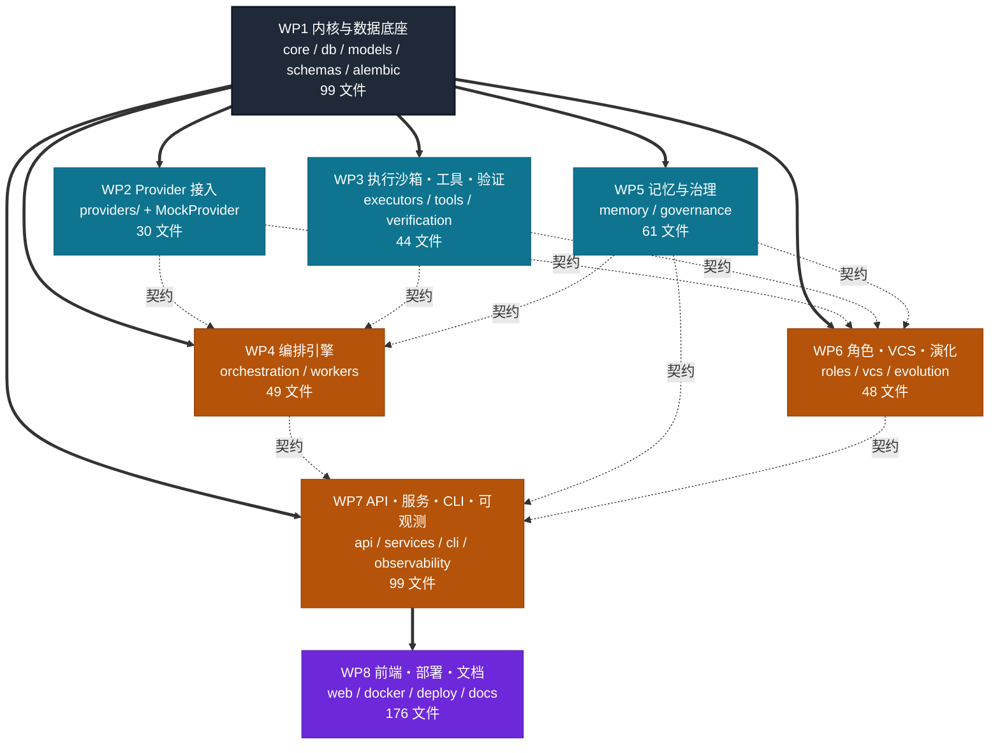

# LoopForge 任务分解（TASK_BREAKDOWN.md）

> 配套文档：`docs/PRD.md`（要什么）、`docs/ARCHITECTURE.md`（怎么建）。
> **本文档只回答一个问题：611 个文件，谁先干、谁后干、并行时靠什么保证不打架。**

---

## 0. 文档信息

| 项 | 值 |
|---|---|
| 版本 | v1.0 |
| 日期 | 2026-08-03 |
| 作者 | 高见远（架构师） |
| 上游 | `docs/PRD.md` v1.0、`docs/ARCHITECTURE.md` v1.0 |
| 状态 | 已冻结（接口签名部分见 §11，冻结后修改需走变更流程 §13.5） |

### 0.1 怎么用这份文档

1. **工程负责人**：读 §1 ~ §2，确定人力投放与波次排期。
2. **各 WP owner**：读自己那一节（§3 ~ §10），拿到「文件清单 + 实现顺序 + DoD」，然后**必读 §11 接口冻结清单与 §13 冲突规避**。
3. **所有人**：动手前先确认 §14 的上一道集成闸门已经通过。**没过闸门就往下做，返工成本由该 WP 承担。**

### 0.2 三条铁律

| # | 铁律 | 违反后果 |
|---|---|---|
| R1 | **§11 冻结的签名一个字符都不能改**（函数名、参数名、参数顺序、默认值、返回类型、异常类型） | 拼装期整包返工 |
| R2 | **不属于你 WP 的文件一行都不能改**，需要改就提变更申请（§13.5） | merge 冲突 + 责任不清 |
| R3 | **禁止空壳交付**：没有 `pass` / `...` / `TODO` / 裸 `NotImplementedError` 作为唯一函数体（`@abstractmethod` 除外） | CI 的 `verify_scale.py` 直接挂，AC-E2 不通过 |

---

## 1. 工作包总览

### 1.1 分包原则

1. **按架构分层切，不按文件类型切** —— 一个 WP 拿走「一层的实现 + 该层的单测 + 该层的文档」，交付即闭环，不需要等别人写测试。
2. **公共可变文件全部前置到 WP1** —— 枚举、错误码、事件名、ORM 模型、迁移脚本、依赖清单一次性写全并冻结，从根上消灭「多人改同一文件」。
3. **跨包只依赖抽象，不依赖实现** —— WP4 编排引擎依赖的是 `BaseProvider` / `BaseExecutor` / `BaseTool` 的签名，不是 WP2/WP3 的具体类，因此可以并行开工。
4. **每个 WP 必须能独立自测** —— 依赖别的包时用 `tests/fixtures/` 里的假实现，不许等。

### 1.2 八个工作包

| WP | 名称 | 覆盖范围 | 文件数 | 依赖 | 波次 | 优先级 |
|:--:|---|---|---:|---|:--:|:--:|
| **WP1** | 内核与数据底座 | `core/` `db/` `models/` `schemas/` `alembic/` + 工程配置 | **99** | — | W0 | P0 |
| **WP2** | Provider 与模型接入 | `providers/`（含 MockProvider 三件套） | **30** | WP1 | W1 | P0 |
| **WP3** | 执行沙箱・工具集・验证闭环 | `executors/` `tools/` `verification/` | **44** | WP1 | W1 | P0 |
| **WP4** | 编排引擎与 Worker 运行时 | `orchestration/` `workers/` | **49** | WP1（契约：WP2/WP3） | W2 | P0 |
| **WP5** | 上下文治理与治理层 | `memory/` `governance/` + 策略数据 | **61** | WP1（契约：WP2） | W1 | P0 |
| **WP6** | 角色・VCS/GitHub・演化 | `roles/` `vcs/` `evolution/` + `prompts/` | **48** | WP1（契约：WP2/WP3/WP5） | W2 | P0 |
| **WP7** | API・服务层・CLI・可观测 | `api/` `services/` `cli/` `observability/` | **99** | WP1（契约：WP4/WP5/WP6） | W2 | P0 |
| **WP8** | 前端・部署・示例・文档收口 | `web/` `docker/` `deploy/` `monitoring/` `.github/` `examples/` + 文档 | **176** | WP7（契约：§11.8 API 契约） | W2→W3 | P0/P1 |
| — | 架构师已产出 | `PRD.md` `ARCHITECTURE.md` `TASK_BREAKDOWN.md` + 2 个 `.mermaid` | **5** | — | — | ✅ 已完成 |
| | **合计** | | **611** | | | |

### 1.3 分类口径对账（与 `ARCHITECTURE.md` §3.9 严格一致）

| WP | Python | 前端 | 测试 | 文档 | 配置/部署 | 小计 |
|:--:|---:|---:|---:|---:|---:|---:|
| WP1 | 74 | 0 | 9 | 5 | 11 | **99** |
| WP2 | 19 | 0 | 5 | 5 | 1 | **30** |
| WP3 | 33 | 0 | 7 | 4 | 0 | **44** |
| WP4 | 31 | 0 | 11 | 7 | 0 | **49** |
| WP5 | 43 | 0 | 8 | 6 | 4 | **61** |
| WP6 | 30 | 0 | 6 | 2 | 10 | **48** |
| WP7 | 82 | 0 | 8 | 8 | 1 | **99** |
| WP8 | 0 | 87 | 10 | 16 | 63 | **176** |
| 架构师 | 0 | 0 | 0 | 5 | 0 | **5** |
| **合计** | **312** | **87** | **64** | **58** | **90** | **611** |
| **下限** | ≥190 | ≥55 | ≥45 | ≥28 | ≥25 | ≥320 |
| **达标** | ✅ | ✅ | ✅ | ✅ | ✅ | ✅ |

> `scripts/verify_scale.py`（WP8）在 CI 中按这张表逐行校验，任一格低于下限即失败。

---

## 2. 依赖关系与并行波次

### 2.1 依赖图



**图例**：
- **粗实线 `==>`（硬依赖）**：被依赖方**必须先完成并通过闸门**，否则下游无法编译/运行。
- **虚线 `-.契约.->`（软依赖）**：下游只依赖 §11 冻结的抽象签名，**可以并行开工**，用 `tests/fixtures/` 的假实现自测，到集成闸门再换真货。

> 这张图的关键设计：**除 WP1 外，没有任何一条硬依赖链长度超过 2**。这是为了让 8 个包最大程度并行，避免出现「A 等 B 等 C 等 D」的串行长链。

### 2.2 四个波次

| 波次 | 内容 | 并行度 | 出口闸门 |
|:--:|---|:--:|---|
| **W0** | WP1 单独跑完 | 1 | **G1 · 底座冻结**（§14.1） |
| **W1** | WP2 ∥ WP3 ∥ WP5 | 3 | **G2 · 能力就绪**（§14.2） |
| **W2** | WP4 ∥ WP6 ∥ WP7 ∥ WP8（前端骨架） | 4 | **G3 · 首次贯通**（§14.3） |
| **W3** | 集成收口：WP8 剩余 + 全量 E2E + 部署 + 文档 | 2~4 | **G4 · 验收就绪**（§14.4） |

### 2.3 为什么 WP1 必须独占 W0

WP1 交付的不只是代码，更是**全项目的公共词汇表**：

- `core/enums.py` —— 11 组状态/分类枚举，其他 7 个包全都要 import
- `core/event_types.py` —— 62 种事件名 + payload 模型
- `core/error_codes.py` —— 全量 `LF-<DOMAIN>-<NNNN>` 错误码
- `models/` + `alembic/` —— 26 张表，一次建完
- `schemas/` —— 前后端共用的 DTO
- `requirements.txt` —— 依赖版本锁

这些文件一旦让多个 WP 并行去改，**必然爆发 merge 冲突且语义打架**（详见 §13.1）。所以策略是：**WP1 一次性把它们写满、写死、冻结，之后所有包只读不写。** 这是整份任务分解里最重要的一个决定。

---

## 3. WP1 · 内核与数据底座

| 项 | 值 |
|---|---|
| **代号** | Foundation |
| **文件数** | 99（Python 74 / 测试 9 / 文档 5 / 配置 11） |
| **依赖** | 无 |
| **被依赖** | 全部 7 个 WP |
| **波次** | W0（独占） |
| **出口闸门** | G1 |
| **一句话目标** | 交付一个「能建表、能连库、能读配置、能打日志、能发事件、能抛带码异常」的底座，并把全项目公共词汇表一次性冻结。 |

### 3.1 文件清单

#### 3.1.1 包根（3）

| 文件 | 关键交付点 |
|---|---|
| `loopforge/__init__.py` | `__version__`；导出 `LoopForgeError` / `get_settings` |
| `loopforge/__main__.py` | `python -m loopforge` → `cli.main:app`（WP7 补 app，此处先做惰性 import 兜底提示） |
| `loopforge/constants.py` | 默认 TTL、重试次数、token 配额比例、分页上限、git trailer 键名 |

#### 3.1.2 `core/`（14）

| 文件 | 关键交付点 |
|---|---|
| `core/__init__.py` | 内核公共导出 |
| `core/config.py` | 8 个 Settings 子树；`get_settings()` 单例 + `reload_settings()`；**七层覆盖顺序必须实现完整** |
| `core/logging.py` | structlog JSON/Console 双渲染；`trace_id/run_id/task_id/step_id` contextvar；脱敏处理器接入 |
| `core/errors.py` | `LoopForgeError` 根类 + 12 个域异常，**全部带 `code`/`http_status`/`details`/`retryable`** |
| `core/error_codes.py` | 全量错误码枚举 + `code_to_http()` |
| `core/enums.py` | **11 组枚举一次写全**（§11.1） |
| `core/event_types.py` | **62 种 `EventType` + 每种的 payload 模型 + `EVENT_PAYLOAD_MAP`** |
| `core/event_bus.py` | `publish`/`subscribe`/`unsubscribe`；背压队列 + 持久化钩子 |
| `core/ids.py` | `new_ulid()` / `short_id()` / `new_trace_id()` / 确定性 seed 模式 |
| `core/clock.py` | `Clock` 协议 + `SystemClock` + `FrozenClock`；**全仓禁用 `datetime.now()`** |
| `core/hashing.py` | `sha256_hex` / `canonical_json` / `chain_hash` |
| `core/resilience.py` | `retry_async` / `CircuitBreaker` / `TokenBucketLimiter` / `timeout_guard` |
| `core/redaction.py` | 24 条 Secret 正则；`redact_text` / `redact_mapping` |
| `core/registry.py` | 泛型 `Registry[T]`，供 Provider/Tool/Executor/Retriever/Role 复用 |

#### 3.1.3 `db/`（19）

`db/__init__.py`、`base.py`、`engine.py`、`session.py`、`types.py`、`mixins.py`、`uow.py`、`seed.py`，以及 `repositories/` 下 11 个文件（`__init__.py`、`base.py`、`project_repo.py`、`run_repo.py`、`task_repo.py`、`lease_repo.py`、`step_repo.py`、`event_repo.py`、`memory_repo.py`、`governance_repo.py`、`system_repo.py`）。

> **重中之重**：`db/types.py` 的方言中立类型（`JsonType`/`UtcDateTime`/`StrEnumType`/`DecimalMoney`）与 `lease_repo.acquire_lease_cas()` / `task_repo.cas_transition()` 两个条件 UPDATE。后者是 WP4 整个并发正确性的地基，必须在 SQLite 与 PostgreSQL 上都通过 1000 次并发争抢测试。

#### 3.1.4 `models/`（16）

`__init__.py`、`project.py`、`run.py`、`task.py`、`lease.py`、`step.py`、`event.py`、`call.py`、`artifact.py`、`memory.py`、`budget.py`、`policy.py`、`worker.py`、`agent_role.py`、`auth.py`、`evolution.py` —— **26 张表全部在此定义完毕，其他 WP 不得新增模型文件。**

#### 3.1.5 `schemas/`（15）

`__init__.py`、`common.py`、`project.py`、`run.py`、`task.py`、`step.py`、`event.py`、`artifact.py`、`memory.py`、`budget.py`、`policy.py`、`approval.py`、`provider.py`、`worker.py`、`auth.py`。

#### 3.1.6 `alembic/`（7 Python + 1 模板）

`env.py`、`script.py.mako`、`versions/0001_initial_schema.py` ~ `0006_indexes_and_constraints.py`。

> **26 张表一次建完，revision 链 0001→0006 由 WP1 owner 独家维护。其他 WP 一律禁止新增迁移文件（§13.2）。**

#### 3.1.7 工程配置（9）+ 默认配置（1）+ 测试（9）+ 文档（5）

| 组 | 文件 |
|---|---|
| 工程配置（9） | `pyproject.toml`（ruff/mypy strict/pytest/coverage 全配置）、`requirements.txt`、`requirements-dev.txt`、`alembic.ini`、`Makefile`、`.pre-commit-config.yaml`、`.env.example`、`.gitignore`、`.dockerignore` |
| 默认配置（1） | `config/default.yaml` —— **必须把 8 个配置节的键全部预先写好**（含尚未实现的包的节），后续 WP 只改值不加节（§13.4） |
| 测试（9） | `tests/conftest.py`、`tests/factories.py`、`tests/fixtures/db.py`、`tests/unit/core/test_config.py`、`test_errors.py`、`test_event_bus.py`、`test_redaction.py`、`tests/unit/db/test_repositories.py`、`test_migrations.py` |
| 文档（5） | `docs/architecture/data-model.md`、`docs/adr/ADR-0001-tech-stack.md`、`docs/adr/ADR-0002-db-neutral-orm.md`、`docs/contributing/code-style.md`、`CONTRIBUTING.md` |

### 3.2 实现顺序

| 步 | 内容 | 产出即可验证 |
|:--:|---|---|
| 1 | `pyproject.toml` + `requirements*.txt` + `Makefile` + pre-commit | `make lint` 能跑 |
| 2 | `core/enums.py` → `error_codes.py` → `errors.py` → `event_types.py` | 纯数据，无依赖，**最先冻结** |
| 3 | `core/config.py` + `config/default.yaml` + `core/logging.py` | `get_settings()` 可用，日志有 trace 字段 |
| 4 | `core/ids/clock/hashing/redaction/resilience/registry` | 单测 `test_redaction.py` 绿 |
| 5 | `core/event_bus.py` | `test_event_bus.py` 绿（含背压） |
| 6 | `db/base/types/mixins/engine/session` | SQLite + PG 双引擎能连上 |
| 7 | `models/` 16 个文件 | `Base.metadata` 完整 |
| 8 | `alembic/` 0001~0006 | **`alembic upgrade head` 在 SQLite 与 PG 双通过** |
| 9 | `db/repositories/` 11 个 | `test_repositories.py` 绿 |
| 10 | `db/uow.py` + `db/seed.py` | `loopforge db seed` 的底层能跑（CLI 由 WP7 包） |
| 11 | `schemas/` 15 个 | `mypy --strict` 通过 |
| 12 | 测试补齐 + 5 篇文档 | 覆盖率 ≥ 80% |

### 3.3 关键约定

1. **枚举写全再冻结**：`enums.py` / `event_types.py` / `error_codes.py` 在第 2 步就要按 `ARCHITECTURE.md` §6/§10.2/§10.3 一次写满，**不允许「先写一半，后面用到再加」**。
2. **迁移不可变**：0001~0006 一旦合入主干，禁止 `--autogenerate` 重生成，禁止修改已合入的 revision 内容。
3. **时间只走 Clock**：任何模块要拿当前时间，注入 `Clock` 依赖；CI 加 ruff 自定义规则禁止 `datetime.now(` / `time.time(`。
4. **配置节预留**：`config/default.yaml` 必须包含 `providers` `executors` `memory` `governance` `orchestration` `api` `worker` `observability` 八个节的完整键，值可以是默认值。

### 3.4 DoD（完成定义）

- [ ] `alembic upgrade head` 与 `downgrade base` 在 **SQLite 与 PostgreSQL 16 上均通过**
- [ ] `mypy --strict loopforge/core loopforge/db loopforge/models loopforge/schemas` 零错误
- [ ] `pytest tests/unit/core tests/unit/db` 全绿，覆盖率 ≥ 80%
- [ ] `test_repositories.py` 含 **1000 并发争抢同一 Task 的 CAS 测试**，有且仅有 1 个成功
- [ ] `core/redaction.py` 对 24 类密钥样本 100% 命中
- [ ] `EventType` 枚举成员数 == 62，`EVENT_PAYLOAD_MAP` 覆盖率 100%
- [ ] §11.1 ~ §11.2 的签名与代码逐字一致
- [ ] 5 篇文档写完，`ADR-0002` 说清「为什么不用 pgvector / 为什么方言中立」

---

## 4. WP2 · Provider 与模型接入

| 项 | 值 |
|---|---|
| **代号** | Providers |
| **文件数** | 30（Python 19 / 测试 5 / 文档 5 / 配置 1） |
| **依赖** | WP1（硬） |
| **被依赖** | WP4、WP5（Summarizer 走 LLM）、WP6（契约） |
| **波次** | W1 |
| **一句话目标** | 让上层「换模型像换配置一样简单」，并交付一个**零 Key 也能产出可运行代码**的 MockProvider。 |

### 4.1 文件清单（19 Python + 1 配置）

| 文件 | 关键交付点 |
|---|---|
| `providers/__init__.py` | 注册表初始化，导出 `get_provider()` |
| `providers/base.py` | **`BaseProvider` 抽象类**（签名见 §11.3，逐字冻结） |
| `providers/types.py` | `Message`/`ToolSpec`/`ToolCallRequest`/`ChatRequest`/`ChatResult`/`StreamChunk`/`Usage`/`ProviderCapabilities` |
| `providers/registry.py` | 名称→类映射；从配置与 DB `provider_configs` 实例化；entry-point 插件加载 |
| `providers/router.py` | `ProviderRouter.resolve(role, hint) -> ProviderBinding` |
| `providers/failover.py` | `FailoverChain`：错误分类、切换原因记录、熔断冷却 |
| `providers/token_counter.py` | tiktoken 可选 + 各家近似 + 字符兜底；`count_messages()` |
| `providers/pricing.py` | 价目表加载 + `price_of` / `estimate_cost` / `actual_cost` |
| `providers/tool_schema.py` | `ToolSpec` ↔ OpenAI / Anthropic / DashScope 三方言双向转换 |
| `providers/mock/__init__.py` | Mock 包导出 |
| `providers/mock/provider.py` | **`MockProvider`**：确定性输出 + tool_calls + 流式 + 可注入故障 |
| `providers/mock/scripts.py` | 五角色状态化剧本 |
| `providers/mock/codegen.py` | **基于 AST 的真实代码生成器**（产出可编译可跑的代码与 unified diff） |
| `providers/openai_compat.py` | OpenAI 兼容（官方 / vLLM / 自建网关 / 任意 base_url） |
| `providers/dashscope.py` | DashScope（Qwen 系，兼容+原生双通道） |
| `providers/anthropic.py` | Anthropic Messages API |
| `providers/deepseek.py` | DeepSeek（含 reasoning_content 处理） |
| `providers/ollama.py` | Ollama 本地推理，无成本计量 |
| `providers/embedding.py` | `BaseEmbedder` + OpenAI/DashScope/Mock 三实现 |
| `config/pricing.yaml` | 6 类 Provider × 主流模型价目 |

### 4.2 测试（5）与文档（5）

- 测试：`tests/fixtures/providers.py`（**对外提供 `mock_provider` fixture，WP4/WP5/WP6 都要用**）、`tests/unit/providers/test_mock_provider.py`、`test_router_failover.py`、`test_pricing.py`、`test_openai_compat.py`
- 文档：`docs/guides/providers.md`、`docs/guides/writing-providers.md`、`docs/guides/mock-mode.md`、`docs/adr/ADR-0010-provider-abstraction.md`、`docs/adr/ADR-0013-mock-provider-determinism.md`

### 4.3 实现顺序

| 步 | 内容 |
|:--:|---|
| 1 | `types.py` → `base.py` —— **先冻结抽象，立刻通知 WP4/WP6 可以开工** |
| 2 | `token_counter.py` + `pricing.py` + `config/pricing.yaml` |
| 3 | `mock/codegen.py` → `mock/scripts.py` → `mock/provider.py`（**优先级高于所有真实 Provider**） |
| 4 | `tests/fixtures/providers.py` —— 尽早产出，解除下游阻塞 |
| 5 | `tool_schema.py` |
| 6 | `openai_compat.py` → `dashscope.py` → `deepseek.py` → `ollama.py` → `anthropic.py` |
| 7 | `registry.py` → `router.py` → `failover.py` |
| 8 | `embedding.py`（默认关闭路径，但要能跑通） |
| 9 | 测试 + 文档 |

### 4.4 关键约定

1. **MockProvider 的确定性是硬指标**：相同 `(role, loop_index, task_key, context_digest)` 必须产出**字节级相同**的输出。实现上用 `sha256` 派生随机种子，**禁止使用未播种的 `random` / 未排序的 `dict` 迭代 / 系统时间**。
2. **MockProvider 不许产出假代码**：`codegen.py` 必须解析目标仓库真实 AST 后生成语法正确、`pytest` 能实际跑绿的代码。这是 AC-A2（零 Key 端到端）成败的关键。
3. **所有 Provider 异常必须归一**：鉴权/限流/超时/服务端错误/全部不可用五类分别映射到 `LF-PROVIDER-0701` ~ `0705`，并正确设置 `retryable`。上层只认错误码，不认各家原始报文。
4. **成本永远算两遍**：`estimate_cost()`（调用前，给 BudgetGuard 预检）与 `actual_cost()`（调用后，据真实 usage 回填）。缺任何一个，WP5 的预算三级动作就失效。
5. **不得在 Provider 层做重试**：重试统一由 `core/resilience.py` 的 `retry_async` 与 `FailoverChain` 编排，避免双层重试放大成本。

### 4.5 DoD

- [ ] `MockProvider` 连续 100 次相同入参输出完全一致（含 tool_calls 顺序）
- [ ] `MockProvider` 生成的代码在 `examples/sample-python-lib` 上 `pytest` 真的跑绿
- [ ] 五类故障注入（5xx / 超时 / 限流 / 鉴权失败 / 截断）均可通过配置触发，供 WP4 恢复测试使用
- [ ] `count_messages()` 在 tiktoken 缺失时自动降级且误差 < 15%
- [ ] `ProviderRouter` 支持按 `RoleName` 绑定不同 Provider/Model，且可被 DB 配置覆盖
- [ ] `tests/fixtures/providers.py` 已交付并被至少一个其他 WP 实际引用
- [ ] §11.3 签名逐字一致

---

## 5. WP3 · 执行沙箱・工具集・验证闭环

| 项 | 值 |
|---|---|
| **代号** | Execution |
| **文件数** | 44（Python 33 / 测试 7 / 文档 4） |
| **依赖** | WP1（硬） |
| **被依赖** | WP4、WP6 |
| **波次** | W1 |
| **一句话目标** | 交付「Agent 的手」——受策略约束的文件系统、Shell、Git、测试执行能力，且**每个工具都能回答"我到底执行了没有"**。 |

### 5.1 文件清单

#### 5.1.1 `executors/`（9）

| 文件 | 关键交付点 |
|---|---|
| `executors/__init__.py` | 注册表与导出 |
| `executors/base.py` | **`BaseExecutor` 抽象类**（§11.4 冻结） |
| `executors/local_subprocess.py` | **默认实现**：asyncio subprocess；POSIX 用 `setsid`、Windows 用 `CREATE_NEW_PROCESS_GROUP` 保证整组可杀 |
| `executors/docker_executor.py` | **生产实现**：容器复用、只读挂载、`--network none` 默认、cgroup 限额、流式输出 |
| `executors/path_sandbox.py` | `realpath` 归一化 + 符号链接解析 + 前缀白名单；抵御 `../`、`~`、symlink 逃逸、Windows UNC |
| `executors/command_policy.py` | 把 WP5 的 `PolicyEngine` 裁决接到 Executor 边界（双保险第二层） |
| `executors/resource_limits.py` | 超时 / 内存（`setrlimit` 与 Job Object）/ 输出字节上限 / 并发进程数 |
| `executors/workspace.py` | `WorkspaceHandle`：run/task 级隔离目录、快照、磁盘配额 |
| `executors/factory.py` | 按 `executor.kind` 构造；`ExecutorPool` 生命周期管理 |

#### 5.1.2 `tools/`（16）

`__init__.py`、`base.py`（**`BaseTool` 抽象，§11.5 冻结**）、`registry.py`、`plugins.py`、`fs_read.py`、`fs_write.py`、`fs_edit.py`、`fs_patch.py`、`list_dir.py`、`search_code.py`、`run_shell.py`、`run_tests.py`、`git_ops.py`、`create_pr.py`、`http_fetch.py`、`ask_human.py`。

#### 5.1.3 `verification/`（8）

`__init__.py`、`pipeline.py`、`build.py`、`unit_test.py`、`e2e.py`、`lifecycle.py`、`detectors.py`、`failure_router.py`。

#### 5.1.4 测试（7）与文档（4）

- 测试：`tests/unit/executors/test_path_sandbox.py`（穿越/符号链接）、`test_command_policy.py`、`test_local_subprocess.py`；`tests/unit/tools/test_fs_tools.py`、`test_patch_tools.py`、`test_shell_git_tools.py`；`tests/unit/verification/test_pipeline.py`
- 文档：`docs/guides/writing-tools.md`、`docs/guides/writing-executors.md`、`docs/security/sandbox.md`、`docs/adr/ADR-0007-dual-executor.md`

### 5.2 实现顺序

| 步 | 内容 |
|:--:|---|
| 1 | `executors/base.py` + `tools/base.py` —— **两个抽象先冻结，立刻通知 WP4/WP6** |
| 2 | `path_sandbox.py` + `resource_limits.py`（安全地基，先于任何执行能力） |
| 3 | `workspace.py` → `local_subprocess.py` → `factory.py` |
| 4 | `tools/registry.py` + `plugins.py` |
| 5 | 只读工具：`fs_read` / `list_dir` / `search_code`（`side_effect_class = PURE`） |
| 6 | 写工具：`fs_write` / `fs_edit` / `fs_patch`（`IDEMPOTENT`，且必须实现 `probe()`） |
| 7 | `run_shell` / `run_tests`（`UNSAFE` / `PURE`） |
| 8 | `git_ops`（`PROBEABLE`，靠 trailer 探测）、`create_pr`（`PROBEABLE`）、`http_fetch`、`ask_human` |
| 9 | `verification/detectors.py` → `build/unit_test/e2e/lifecycle` → `pipeline.py` → `failure_router.py` |
| 10 | `docker_executor.py`（可最后做，CI 上带 `@pytest.mark.docker` 标记） |
| 11 | 测试 + 文档 |

### 5.3 关键约定

1. **每个工具必须显式声明 `side_effect_class`**，四选一：`PURE` / `IDEMPOTENT` / `PROBEABLE` / `UNSAFE`。这个字段直接决定崩溃恢复时 WP4 是重放还是重规划（`ARCHITECTURE.md` §8.1.4 决策表）。**漏声明 = 恢复逻辑失效**，CI 加检查：`BaseTool` 子类未覆写 `side_effect_class` 直接报错。
2. **`PROBEABLE` 工具必须实现 `probe()`**，且探测证据要可验证：
   - `git_ops.commit` → 扫描 `git log` 中的 `LoopForge-Step-Key:` trailer
   - `create_pr` → 按 head 分支查询已存在 PR
   - `fs_write` → 比对目标文件的 `sha256`
3. **双层策略拦截，缺一不可**：工具层调 `PolicyEngine.evaluate()`，Executor 层再过一遍 `command_policy`。**理由**：工具可能被插件绕过，Executor 是最后一道闸。
4. **输出必须截断且可追溯**：命令输出超过 `executor.max_output_bytes` 时截断并写 Artifact，返回中给出 `truncated=True` 与 artifact_id。禁止把 10MB 日志塞进 LLM 上下文。
5. **Windows / POSIX 双平台**：`path_sandbox` 与 `resource_limits` 必须在两个平台都有实现分支，CI 矩阵覆盖 `ubuntu-latest` 与 `windows-latest`。
6. **`verification` 的失败必须结构化**：`failure_router` 输出的失败分类（编译 / 断言 / 超时 / 环境 / 依赖）是 WP4 生成修复子任务的输入，**不能只给一段 stderr 文本**。

### 5.4 DoD

- [ ] `test_path_sandbox.py` 覆盖 ≥ 20 种逃逸手法（`../`、绝对路径、symlink、`~`、UNC、`%2e%2e`、双重编码…）全部拦截
- [ ] `LocalSubprocessExecutor` 超时后**进程组被完整杀死**，无孤儿进程（POSIX + Windows 各验证一次）
- [ ] 16 个工具全部声明 `side_effect_class`，3 个 `PROBEABLE` 工具的 `probe()` 有真实探测逻辑与单测
- [ ] `run_tests` 能自动识别并解析 pytest / vitest 两种输出为结构化结果
- [ ] `VerificationPipeline` 在 `examples/sample-python-lib` 上跑出「build 通过 / 单测失败 / 定位到 2 个缺陷」的报告
- [ ] `DockerExecutor` 与 `LocalSubprocessExecutor` **通过同一套 `BaseExecutor` 契约测试**（参数化跑两遍）
- [ ] §11.4 ~ §11.5 签名逐字一致

---

## 6. WP4 · 编排引擎与 Worker 运行时

| 项 | 值 |
|---|---|
| **代号** | Orchestration |
| **文件数** | 49（Python 31 / 测试 11 / 文档 7） |
| **依赖** | WP1（硬）；WP2 / WP3 / WP5（契约软依赖，可并行） |
| **被依赖** | WP7 |
| **波次** | W2 |
| **一句话目标** | 交付 LoopForge 的心脏——**能连续跑 1000 轮、被 `kill -9` 后能自愈且不重复副作用**的循环引擎。 |

> **这是全项目技术难度最高、最容易出隐蔽 bug 的一个包，建议配置最强的人。** 三大设计难点里有两个（幂等恢复、租约并发）落在这里。

### 6.1 文件清单

#### 6.1.1 `orchestration/`（26）

| 文件 | 关键交付点 |
|---|---|
| `__init__.py` | 编排层导出 |
| `loop_engine.py` | **`LoopEngine`**：`plan→act→observe→verify→commit→evolve`；轮次上限、单轮超时、里程碑判定 |
| `state_machine.py` | 通用 `StateMachine[StateT]`：声明式转移表 + 守卫 + 副作用钩子 + `IllegalTransitionError` |
| `run_states.py` | Run 14 状态与全部合法转移（`ARCHITECTURE.md` §6.1） |
| `task_states.py` | Task 10 状态与全部合法转移（§6.2） |
| `dispatcher.py` | **`Dispatcher`**：候选拉取 → 依赖检查 → 路径冲突检查 → CAS 领取 → 投递；饥饿防护 |
| `scheduling/__init__.py` | 调度策略注册 |
| `scheduling/strategies.py` | `BaseSchedulingStrategy` + Fifo / Priority / DependencyAware（拓扑序 + 关键路径） |
| `lease_manager.py` | **`LeaseManager`**：`acquire` / `heartbeat` / `extend` / `release` / `revoke` / `reclaim_expired`；fence token |
| `heartbeat.py` | `HeartbeatLoop`：后台续租；租约丢失抛 `LeaseLostError` 让 Worker 自我熔断 |
| `monitor.py` | **`Monitor`**：Run/Task/Worker/Step 实时状态、进度、成本速率快照与流 |
| `watchdog.py` | **`Watchdog`**：过期租约 / 失联 Worker / 卡死 Run 的回收、重排、降级、上报；`grace_period` 防误杀 |
| `progress_detector.py` | 动作指纹环形缓冲 + 文件变更净值 + 无变更计数 → `NO_PROGRESS_DETECTED` / `ACTION_LOOP_DETECTED` |
| `checkpoint.py` | **`CheckpointStore`**：Step 增量点 + 轮次一致性快照；`save` / `load_latest` / `restore` / `prune` |
| `idempotency.py` | **`IdempotencyGuard`**：幂等键 + 两阶段意图协议（§8.1） |
| `recovery.py` | **`RecoveryCoordinator`**：扫描未确认 Step → `probe()` 对账 → `skip/replay/replan/ask_human` |
| `replay.py` | 由 `events` 重建 `ReplayFrame` 序列，支持分页与上下文快照还原 |
| `agent_runtime.py` | **`AgentRuntime`**：绑定租约 → 装配依赖 → 驱动 `LoopEngine` |
| `phases/__init__.py` | 阶段注册 |
| `phases/base.py` | `BasePhase`：统一事件发射、异常包装、检查点写入 |
| `phases/plan.py` | 构建上下文 → 预算预检 → Planner 出计划与 tool_calls |
| `phases/act.py` | 逐 tool_call：策略裁决 → 两阶段意图 → 执行 → 落库 |
| `phases/observe.py` | 结果入工作记忆、变更汇总、进展判定、压缩触发判定 |
| `phases/verify.py` | 调 `VerificationPipeline`，失败生成修复子任务回流 |
| `phases/commit.py` | 策略裁决 → 结构化 commit → push → 建 PR → 释放租约 → `IN_REVIEW` |
| `phases/evolve.py` | 经验沉淀为语义记忆；失败归因投递 `EvolutionIntake` |

#### 6.1.2 `workers/`（5）

`__init__.py`、`entrypoint.py`（`run_agent_worker` / `run_supervisor` / `run_inline`）、`agent_worker.py`、`watchdog_worker.py`（Supervisor，DB 咨询锁选主）、`signals.py`（优雅停机）。

#### 6.1.3 测试（11）与文档（7）

- 单测（7）：`tests/unit/orchestration/test_state_machine.py`、`test_lease_manager.py`、`test_dispatcher.py`、`test_watchdog.py`、`test_idempotency.py`、`test_recovery.py`、`test_loop_engine.py`
- 集成（2）：`tests/integration/test_lease_concurrency.py`（10 Worker 抢同一 Task）、`test_crash_recovery.py`（`kill -9` 注入）
- 性能（2）：`tests/perf/test_event_throughput.py`（≥1000 events/s）、`tests/perf/test_lease_contention.py`（1000 次领取无竞态）
- 文档（7）：`docs/architecture/loop-engine.md`、`state-machine.md`、`concurrency.md`、`idempotency.md`、`docs/adr/ADR-0003-lease-optimistic-lock.md`、`ADR-0004-two-phase-intent.md`、`ADR-0012-checkpoint-granularity.md`

### 6.2 实现顺序

| 步 | 内容 | 说明 |
|:--:|---|---|
| 1 | `state_machine.py` → `run_states.py` → `task_states.py` | 纯逻辑，无 IO，最先做完最先跑绿 |
| 2 | `idempotency.py` | **两阶段协议是后面一切的前提** |
| 3 | `lease_manager.py` + `heartbeat.py` | 直接压 WP1 的 `acquire_lease_cas`；此时就要跑并发测试 |
| 4 | `checkpoint.py` | |
| 5 | `dispatcher.py` + `scheduling/` | |
| 6 | `watchdog.py` + `progress_detector.py` | |
| 7 | `phases/base.py` → plan / act / observe / verify / commit / evolve | 用 fixtures 里的假 Provider/Tool 自测 |
| 8 | `loop_engine.py` + `agent_runtime.py` | 串起来 |
| 9 | `recovery.py` + `replay.py` | 依赖 2/4/7 |
| 10 | `monitor.py` | |
| 11 | `workers/` 5 个文件 | |
| 12 | 集成测试 + 性能测试 + 7 篇文档 | |

### 6.3 关键约定（三大难点在本包的落地）

#### 6.3.1 幂等键公式（逐字冻结）

```python
idempotency_key = sha256(
    canonical_json({
        "run_id":     run_id,
        "task_id":    task_id,
        "loop_index": loop_index,
        "phase":      phase,          # PLAN/ACT/OBSERVE/VERIFY/COMMIT/EVOLVE
        "tool_name":  tool_name,
        "args":       args,           # 已归一化的工具参数
    })
).hexdigest()[:32]
```

- `steps.idempotency_key` 上有**唯一索引**，重复写入直接被 DB 挡住。
- `canonical_json` 必须来自 `core/hashing.py`，**不许各包自己实现 JSON 序列化**（键序、浮点格式、Unicode 转义规则必须完全一致，否则同一动作算出两个 key）。

#### 6.3.2 两阶段意图协议

```
begin_intent()  →  Step(state=INTENT_RECORDED) 落库并 commit 事务
      ↓
   实际执行
      ↓
confirm()       →  Step(state=CONFIRMED) + result_payload 落库
```

崩溃后凡是停在 `INTENT_RECORDED` 的 Step，都要由 `RecoveryCoordinator` 按 `side_effect_class` 判定（§8.1.4 决策表）。**`UNSAFE` 一律 `replan`，不许盲目重放。**

#### 6.3.3 租约五条铁律

| # | 规则 |
|:--:|---|
| L1 | 领取只能走 `acquire_lease_cas()` 条件 UPDATE + `version` 乐观锁，**禁止 `SELECT ... FOR UPDATE` 之外的任何锁方案，禁止引入 Redis 锁** |
| L2 | 每次续租返回 `fence_token`；**所有写操作必须携带 fence_token**，DB 侧校验，token 过期的写入被拒绝而不是让 Worker 崩溃 |
| L3 | 租约超时 ≠ 任务失败：只加 `reclaim_count`，**绝不加 `attempt_count`** |
| L4 | `Watchdog` 回收前必须过 `grace_period`，且要求「租约过期」+「Worker 心跳也失联」**双证据**才判定为孤儿 |
| L5 | `tasks` 表上有 partial unique index 作为双保险：`WHERE state='LEASED'` 时 `(task_id)` 唯一 |

#### 6.3.4 其他约定

- **单轮超时与总轮次上限双保险**：`loop.max_iterations` 与 `loop.iteration_timeout_s` 任一触发即安全收敛到 `PAUSED`，不许无限跑。
- **每个 Phase 结束必写检查点**，`kill -9` 最多损失一个 Phase 的进度。
- **事件发射不得吞异常**：EventBus 满时按背压策略丢弃**低优先级**事件并记录 `EVENT_DROPPED` 指标，但 `RUN_*` / `TASK_*` / `LEASE_*` 类事件**永不丢弃**。

### 6.4 DoD

- [ ] `test_lease_concurrency.py`：10 个 Worker 并发抢同一 Task，**恰好 1 个成功**，重复 1000 轮无一例外
- [ ] `test_crash_recovery.py`：在 6 个不同时点注入 `kill -9`（意图前 / 意图后执行前 / 执行后确认前 / 确认后 / commit 中 / push 后），**恢复后均无重复副作用**，60 秒内自愈
- [ ] `test_lease_contention.py`：1000 次领取零竞态，P99 领取延迟 < 50ms
- [ ] `test_event_throughput.py`：≥ 1000 events/s 持续 60 秒
- [ ] `Watchdog` 误杀率测试：慢 Worker（单步 5 分钟）在 grace 内**不被回收**
- [ ] 状态机拒绝全部非法转移，`test_state_machine.py` 穷举 14×14 与 10×10 转移矩阵
- [ ] `LoopEngine` 用 MockProvider 连续跑 **1000 轮**不崩、内存不涨（RSS 增幅 < 10%）
- [ ] §11.6 签名逐字一致

---

## 7. WP5 · 上下文治理与治理层

| 项 | 值 |
|---|---|
| **代号** | Governance |
| **文件数** | 61（Python 43 / 测试 8 / 文档 6 / 配置 4） |
| **依赖** | WP1（硬）；WP2（契约，Summarizer 需要 LLM） |
| **被依赖** | WP4、WP6、WP7 |
| **波次** | W1 |
| **一句话目标** | 让 Agent「跑 16 天还记得第 1 天的约束」，并且「不会把钱烧光、不会 `rm -rf /`」。 |

### 7.1 文件清单

#### 7.1.1 `memory/`（19）

| 文件 | 关键交付点 |
|---|---|
| `__init__.py` | 导出 |
| `manager.py` | **`ContextManager.build_context()`**：四层召回 + Pinned 注入 + 预算裁剪 + 压缩触发 |
| `context_pack.py` | `ContextPack`：分层 messages、token 明细、被裁剪项清单、`to_messages()` |
| `pinned.py` | **`PinnedConstraintStore`**：增删查、优先级、命中计数、来源溯源、**硬配额守卫** |
| `budget_allocator.py` | **`ContextBudgetAllocator`**：按层配额 + 空闲再分配 + 最小保障 |
| `compressor.py` | **三级压缩**：L1 结构化裁剪 / L2 抽取式（确定性规则）/ L3 生成式递归摘要 |
| `summarizer.py` | 摘要树（level 0..N）、覆盖区间、产出 `MilestoneSummary` |
| `salience.py` | 显著性打分 + 时间衰减 + 命中反馈提升 |
| `layers/__init__.py` | 层注册 |
| `layers/base.py` | `BaseMemoryLayer`：`append` / `recall` / `compact` / `token_size` |
| `layers/working.py` | L1 工作记忆（当前轮滚动窗口） |
| `layers/episodic.py` | L2 情景记忆（本 Run 历史结构化条目） |
| `layers/semantic.py` | L3 语义记忆（符号表/README/接口签名 + 跨 Run 经验） |
| `layers/milestone.py` | L4 里程碑摘要树 |
| `retrieval/__init__.py` | 检索器注册 |
| `retrieval/base.py` | **`BaseRetriever` 抽象**（§11.7 冻结） |
| `retrieval/bm25.py` | **纯 Python BM25** + 增量索引 + SQLite 持久化倒排表，**零外部依赖** |
| `retrieval/tokenizer.py` | 代码感知分词（驼峰/下划线/路径）+ 中文二元切分 + 停用词 |
| `retrieval/embedding_retriever.py` | **默认关闭**；走 `BaseEmbedder`，numpy 余弦，与 BM25 可 RRF 融合 |

#### 7.1.2 `governance/`（24）

| 组 | 文件 |
|---|---|
| 根（1） | `governance/__init__.py` |
| budget（5） | `budget/__init__.py`、`guard.py`（**`BudgetGuard`**：`precheck` / `record`，三级动作 `warn→throttle→halt`）、`estimator.py`、`ledger.py`、`attribution.py`（五维归因） |
| policy（13） | `policy/__init__.py`、`engine.py`（**`PolicyEngine.evaluate()`**）、`dsl.py`、`loader.py`、`ast_analyzer.py`、`redlines.py`、`rules/__init__.py`、`rules/command.py`、`path.py`、`network.py`、`git.py`、`secret.py`、`dependency.py` |
| approval（2） | `approval/__init__.py`、`gate.py`（**`ApprovalGate`**：创建/挂起/通知/超时策略/裁决恢复） |
| audit（3） | `audit/__init__.py`、`chain.py`（**`AuditChain`** 哈希链）、`exporter.py`（JSON/CSV/JSONL 溯源导出） |

#### 7.1.3 配置数据（4）、测试（8）、文档（6）

- 配置：`config/policies/default.yaml`、`strict.yaml`、`permissive.yaml`、`config/redlines.yaml`（**≥200 条红线用例**）
- 测试：`tests/unit/memory/test_bm25.py`、`test_compressor.py`、`test_budget_allocator.py`、`test_pinned.py`；`tests/unit/governance/test_policy_engine.py`、`test_redlines.py`、`test_budget_guard.py`、`test_audit_chain.py`
- 文档：`docs/architecture/memory.md`、`docs/security/policy-reference.md`、`docs/security/threat-model.md`、`docs/adr/ADR-0005-four-layer-memory.md`、`ADR-0006-bm25-over-pgvector.md`、`ADR-0011-budget-multi-scope.md`

### 7.2 实现顺序

| 步 | 内容 |
|:--:|---|
| 1 | `retrieval/tokenizer.py` → `retrieval/base.py` → `retrieval/bm25.py`（纯算法，先跑绿） |
| 2 | `layers/base.py` → working / episodic / semantic / milestone |
| 3 | `pinned.py` + `salience.py` + `budget_allocator.py` |
| 4 | `context_pack.py` → `compressor.py`（L1/L2 确定性部分先做）→ `summarizer.py`（L3 走 LLM） |
| 5 | `manager.py` —— **`build_context()` 是给 WP4 的核心出口，尽早冻结** |
| 6 | `policy/dsl.py` → `loader.py` → `rules/*` 六个 → `ast_analyzer.py` → `engine.py` |
| 7 | `config/redlines.yaml` 200 条 + `redlines.py` 召回率自测 |
| 8 | `budget/estimator.py` → `ledger.py` → `guard.py` → `attribution.py` |
| 9 | `approval/gate.py` |
| 10 | `audit/chain.py` → `exporter.py` |
| 11 | `retrieval/embedding_retriever.py`（默认关闭路径） |
| 12 | 测试 + 文档 |

### 7.3 关键约定

#### 7.3.1 记忆层四条红线

| # | 规则 |
|:--:|---|
| M1 | **L0 Pinned Constraints 永不压缩、永不裁剪**，硬配额 8% 上下文预算；配额不足时**宁可裁掉 L2/L3 也不动 L0** |
| M2 | **原文永不物理删除**，压缩只写 `compressed_into` 标记 + `MemoryLineage` 谱系记录，任何摘要都能回溯到原始条目 |
| M3 | **每 20 轮强制跑一次 `check_fidelity()`**，用 `prompts/constraint_check.md` 校验所有 Pinned 约束仍被满足；不满足则发 `CONSTRAINT_VIOLATION` 事件并暂停 |
| M4 | 压缩必须**分级降级**：优先 L1 结构化裁剪（零成本），不够再 L2 抽取式（零 LLM 成本），最后才 L3 生成式（有成本）。**禁止一上来就调 LLM 压缩。** |

#### 7.3.2 治理层四条红线

| # | 规则 |
|:--:|---|
| G1 | `PolicyEngine.evaluate()` 判定顺序**严格短路**：`deny` > `require_approval` > `allow`，**先匹配到 deny 立即返回**，不再评估后续规则 |
| G2 | 命令类规则必须**正则 + AST 双重判定**。只做正则一定会被 `$(echo cm0K \| base64 -d)` 这类绕过 |
| G3 | `BudgetGuard.precheck()` **必须在 LLM 调用前**执行，`record()` 必须在调用后执行且写入同一事务；漏掉任一个，预算就形同虚设 |
| G4 | `AuditChain` 断链即告警：`hash = sha256(prev_hash + canonical_json(payload))`，校验失败发 `AUDIT_CHAIN_BROKEN` 严重告警，**不得静默修复** |

#### 7.3.3 BM25 实现约束

- **零外部依赖**（不引 elasticsearch / whoosh / rank_bm25），纯 Python 实现，倒排表持久化到 `inverted_index` 表。
- k1 / b 参数可配（默认 `k1=1.2, b=0.75`）。
- 必须支持**增量索引**：新增一条记忆不能触发全量重建。
- 中文按二元切分，代码标识符按驼峰/下划线/路径拆分（`getUserName` → `get` `user` `name` `getusername`）。

### 7.4 DoD

- [ ] `test_pinned.py`：连续 500 轮压缩后，**Pinned 约束原文 100% 无损**
- [ ] `test_compressor.py`：三级压缩各自可单独触发；L1/L2 完全确定性（同输入同输出）
- [ ] `test_bm25.py`：10 万条记忆下检索 P95 < 100ms；增量索引 1000 条 < 1s
- [ ] `test_redlines.py`：**200+ 条红线用例召回率 100%，误报率 < 5%**
- [ ] `test_policy_engine.py`：`curl \| sh`、`$(...)`、`&&` 链、base64 解码执行等 ≥ 10 种绕过手法全部拦截
- [ ] `test_budget_guard.py`：三级动作在正确阈值触发；`halt` 后 Run 确实停住
- [ ] `test_audit_chain.py`：1 万条事件链完整；人为篡改中间一条能被精确定位
- [ ] `ContextManager.build_context()` 在 128k 上下文预算下，各层 token 分配符合配额且总和不超限
- [ ] §11.7 签名逐字一致

---

## 8. WP6 · 角色・VCS/GitHub・演化

| 项 | 值 |
|---|---|
| **代号** | Agents & VCS |
| **文件数** | 48（Python 30 / 测试 6 / 文档 2 / 配置 10） |
| **依赖** | WP1（硬）；WP2 / WP3 / WP5（契约） |
| **被依赖** | WP4（`RoleRouter`）、WP7（演化与 Webhook 服务） |
| **波次** | W2 |
| **一句话目标** | 交付五个「有分工、有边界、有产出格式」的角色，以及一条**零 Key 也能走完 commit→PR** 的版本控制链路。 |

### 8.1 文件清单

#### 8.1.1 `roles/`（9）

| 文件 | 关键交付点 |
|---|---|
| `roles/__init__.py` | 角色注册表 |
| `roles/base.py` | **`BaseRole` 抽象**（§11.9 冻结）：`name` / `allowed_tools` / `build_messages` / `parse_output` / `act` |
| `roles/planner.py` | Run goal → `TaskDraft[]` + 里程碑定义 + **初始 Pinned Constraints** |
| `roles/coder.py` | 读码 → 改码 → 自查；工具集 fs/search/patch/shell |
| `roles/reviewer.py` | 产出 `ReviewVerdict{approved, findings[], must_fix[]}`；**`allowed_tools` 中不含任何写工具** |
| `roles/tester.py` | 设计补齐测试、跑验证流水线、解析失败归因 |
| `roles/summarizer.py` | 递归压缩、里程碑摘要、PR 描述、**约束保真度校验** |
| `roles/router.py` | **`RoleRouter.select()`**：按阶段 + 任务类型 + 上轮结果选角色；支持单角色降级 |
| `roles/prompts.py` | Prompt 加载 + Jinja2 渲染 + **版本号与 hash 记录**（写入 `LlmCall` 便于 A/B） |

#### 8.1.2 `vcs/`（14）

| 文件 | 关键交付点 |
|---|---|
| `vcs/__init__.py` | provider 注册 |
| `vcs/base.py` | **`BaseVcsProvider` 抽象**（§11.10 冻结） |
| `vcs/git_client.py` | 本地 Git（subprocess），**全部经 Executor 走策略**，不直连 `subprocess` |
| `vcs/workspace.py` | 按 run/task 隔离 clone、稀疏检出、缓存复用、脏工作区检测 |
| `vcs/commit_message.py` | `<type>(<scope>): <subject>` + 四个 trailer（§11.11 冻结） |
| `vcs/diff.py` | unified diff 解析、文件级/行级统计、**变更净值**（供 WP4 进展检测） |
| `vcs/conflict.py` | 冲突识别、冲突文件提取、串行化建议、自动 abort 回滚 |
| `vcs/local_sandbox.py` | **本地 bare 仓库模拟 remote，PR 存 DB**；AC-A2 零 Key 全流程依赖它 |
| `vcs/github/__init__.py` | 子包导出 |
| `vcs/github/client.py` | REST/GraphQL + PAT/App 认证 + 限流 + 重试 + Enterprise base_url |
| `vcs/github/issues.py` | Issue 双向同步；`loopforge:auto` label 驱动准入 |
| `vcs/github/pulls.py` | PR 创建/更新/评论/合并状态；body 模板（理由 + 自测报告 + 轨迹链接） |
| `vcs/github/webhooks.py` | HMAC 校验、事件解析、`delivery_id` 幂等去重 |
| `vcs/github/mapper.py` | Issue↔Task、PR↔Artifact、CheckRun↔VerifyResult |

#### 8.1.3 `evolution/`（7）

`__init__.py`、`sources.py`（`BaseEvolutionSource` + Community / Feedback / VerifyFailure / MetricsAnomaly 四类）、`normalizer.py`、`dedup.py`（SimHash + BM25 + 标题规范化）、`scorer.py`（`impact × frequency × cost_saved / effort`）、`intake.py`、`workitem_factory.py`。

#### 8.1.4 Prompts（10）、测试（6）、文档（2）

- Prompts：`prompts/planner.md`、`coder.md`、`reviewer.md`、`tester.md`、`summarizer.md`、`compress_milestone.md`、`pr_description.md`、`constraint_check.md`、`evolution_normalize.md`、`fix_from_failure.md`
- 测试：`tests/fixtures/repos.py`（构造本地 git 沙箱仓库，**WP3/WP4 也会用**）、`tests/unit/roles/test_roles.py`、`tests/unit/vcs/test_git_client.py`、`test_local_sandbox.py`、`tests/integration/test_webhooks.py`、`tests/e2e/test_multi_role.py`
- 文档：`docs/architecture/roles.md`、`docs/adr/ADR-0008-multi-role-in-v1.md`

### 8.2 实现顺序

| 步 | 内容 |
|:--:|---|
| 1 | `roles/base.py` + `roles/prompts.py` + 10 个 prompt 模板 |
| 2 | `vcs/base.py` + `vcs/commit_message.py`（**trailer 格式先冻结，WP3 的 `git_ops.probe()` 依赖它**） |
| 3 | `vcs/git_client.py` + `vcs/workspace.py` + `vcs/diff.py` |
| 4 | `vcs/local_sandbox.py` —— **优先于 GitHub 实现**，因为零 Key 链路更关键 |
| 5 | `tests/fixtures/repos.py` —— 尽早交付，解除 WP3/WP4 阻塞 |
| 6 | 五个角色：planner → coder → reviewer → tester → summarizer |
| 7 | `roles/router.py` |
| 8 | `vcs/conflict.py` |
| 9 | `vcs/github/client.py` → `issues.py` → `pulls.py` → `webhooks.py` → `mapper.py` |
| 10 | `evolution/` 7 个文件 |
| 11 | 测试 + 文档 |

### 8.3 关键约定

1. **角色的 `allowed_tools` 是硬边界**：`Reviewer` 拿不到任何写工具，`Planner` 拿不到 `run_shell`。运行时由 `ToolRegistry.for_role()` 过滤，**不是靠 prompt 里写"请不要修改文件"**。
2. **输出必须结构化解析**：`parse_output()` 返回强类型对象（`PlanResult` / `CodeChangeResult` / `ReviewVerdict` / `TestReport` / `SummaryResult`），解析失败抛 `LF-ROLE-1601`，由 WP4 决定重试或降级。**禁止把 LLM 原始文本直接透传给下游。**
3. **Prompt 必须版本化**：每个 `.md` 头部带 `version:` front matter，`prompts.py` 计算内容 hash 并写入 `LlmCall.prompt_version` / `prompt_hash`。没有这个就没法做 A/B 与回归定位。
4. **commit trailer 是幂等探测的凭据**（§11.11 逐字冻结）。`git_ops.probe()` 靠扫描 `LoopForge-Step-Key:` 判断"这个 commit 到底有没有做过"。**trailer 键名一个字符都不能改。**
5. **`local_sandbox` 与 `github` 必须通过同一套 `BaseVcsProvider` 契约测试**（参数化跑两遍），保证零 Key 模式与真实模式行为一致。
6. **Webhook 必须幂等**：GitHub 会重投，按 `delivery_id` 去重，重复投递返回 200 但不重复处理。

### 8.4 DoD

- [ ] 五个角色各自的 `parse_output()` 对**畸形输出**（截断 JSON、多余解释文字、markdown 代码块包裹）均能鲁棒解析或明确报错
- [ ] `Reviewer` 尝试调用写工具时被 `ToolRegistry` 拒绝，且发 `POLICY_DENIED` 事件
- [ ] `local_sandbox` 能完成 clone → branch → commit → push → create_pr 全链路，**PR 对象可在 DB 中查到**
- [ ] `test_local_sandbox.py` 与 `test_git_client.py` 共用同一套契约用例
- [ ] `commit_message.py` 产出的 trailer 能被 `git log --format=%(trailers)` 正确解析
- [ ] Webhook HMAC 校验：错误签名返回 401，重复 `delivery_id` 不重复处理
- [ ] `evolution/dedup.py` 对 100 条含 30 组重复的样本聚类准确率 ≥ 90%
- [ ] §11.9 ~ §11.11 签名逐字一致

---

## 9. WP7 · API・服务层・CLI・可观测

| 项 | 值 |
|---|---|
| **代号** | Interface |
| **文件数** | 99（Python 82 / 测试 8 / 文档 8 / 配置 1） |
| **依赖** | WP1（硬）；WP4 / WP5 / WP6（契约） |
| **被依赖** | WP8 |
| **波次** | W2 |
| **一句话目标** | 把内核能力包装成 **141 个 REST 端点 + 1 个 WS 通道 + 15 组 CLI 命令 + 48 项指标**，并且这套接口就是前端唯一的事实来源。 |

### 9.1 文件清单

#### 9.1.1 `api/`（37）

| 组 | 文件 |
|---|---|
| 基础（6） | `__init__.py`、`app.py`（`create_app()`）、`lifespan.py`、`deps.py`、`errors.py`、`pagination.py` |
| security（4） | `security/__init__.py`、`api_key.py`、`rbac.py`、`idempotency.py` |
| middleware（4） | `middleware/__init__.py`、`request_context.py`、`access_log.py`、`rate_limit.py` |
| routers（20） | `routers/__init__.py`、`health.py`、`system.py`、`auth.py`、`projects.py`、`runs.py`、`tasks.py`、`steps.py`、`events.py`、`artifacts.py`、`memory.py`、`budgets.py`、`policies.py`、`approvals.py`、`providers.py`、`workers.py`、`replay.py`、`audit.py`、`evolution.py`、`webhooks.py` |
| ws（3） | `ws/__init__.py`、`ws/manager.py`、`ws/stream.py` |

#### 9.1.2 `services/`（13）

`__init__.py`、`project_service.py`、`run_service.py`、`task_service.py`、`event_service.py`、`artifact_service.py`、`budget_service.py`、`policy_service.py`、`approval_service.py`、`provider_service.py`、`replay_service.py`、`evolution_service.py`、`auth_service.py`。

#### 9.1.3 `cli/`（18）

`__init__.py`、`main.py`、`context.py`、`output.py`、`commands/__init__.py` + 13 个命令模块（`init`、`config`、`provider`、`project`、`run`、`task`、`policy`、`budget`、`approve`、`worker`、`db`、`replay`、`doctor`）。

#### 9.1.4 `observability/`（14）

`__init__.py`、`metrics.py`（**48 项指标集中声明**）、`collectors.py`、`tracing.py`、`health.py`、`alerting/__init__.py`、`alerting/rules.py`（10 条内置规则）、`alerting/evaluator.py`、`alerting/channels/__init__.py`、`channels/base.py`、`webhook.py`、`slack.py`、`feishu.py`、`wecom.py`。

#### 9.1.5 配置（1）、测试（8）、文档（8）

- 配置：`config/alerts.yaml`
- 测试：`tests/unit/observability/test_metrics_alerts.py`；`tests/integration/test_api_runs.py`、`test_api_tasks.py`、`test_api_governance.py`、`test_api_auth_rbac.py`、`test_ws_stream.py`、`test_cli.py`、`test_db_reconnect.py`
- 文档：`docs/api/rest-api.md`、`docs/api/events.md`、`docs/api/errors.md`、`docs/guides/cli.md`、`docs/operations/monitoring.md`、`alerting.md`、`cost-management.md`、`runbook.md`

### 9.2 实现顺序

| 步 | 内容 |
|:--:|---|
| 1 | `api/errors.py` + `api/deps.py` + `api/pagination.py` + `schemas/common.py` 的响应封装落地 |
| 2 | `api/security/`（api_key → rbac → idempotency）+ `api/middleware/` 三件套 |
| 3 | `api/app.py` + `lifespan.py` + `routers/health.py` —— **先让 `/healthz` 通，前端就能开工** |
| 4 | `observability/metrics.py` + `tracing.py` + `health.py`（`/metrics` 端点尽早可用） |
| 5 | `services/` 13 个（按资源，先 project/run/task 三个核心） |
| 6 | `routers/` 剩余 17 个（顺序：projects → runs → tasks → steps → events → 其余） |
| 7 | `api/ws/manager.py` + `stream.py` |
| 8 | `observability/alerting/` + `config/alerts.yaml` + 4 个通道 |
| 9 | `cli/main.py` + `context.py` + `output.py` → 13 个命令模块 |
| 10 | 集成测试 8 个 + 8 篇文档 |

### 9.3 关键约定

1. **响应封装无例外**：所有端点返回 `ApiResponse{code, data, message, trace_id}`，包括错误。**唯一例外是 `/metrics`（Prometheus 文本格式）与文件下载端点。**
2. **异常一律走 `api/errors.py` 兜底**：路由里不写 `try/except` 转 HTTP，直接抛 `LoopForgeError`，由全局处理器按 `code_to_http()` 映射状态码并附 `trace_id`。
3. **写操作强制幂等**：所有 `POST`/`PUT`/`DELETE` 支持 `Idempotency-Key` 头，重复请求返回首次结果（存 `idempotency_records`）。**这是前端重试与网络抖动的兜底。**
4. **路由零业务逻辑**：`routers/*` 只做参数校验 + 调 `services/*` + 组装响应。业务逻辑一律在 service 层，**便于 CLI 的本地直连模式复用同一套代码**。
5. **CLI 双模**：`--api-url` 走 HTTP，缺省走本地直连（直接调 service 层）。两条路径**必须复用同一个 service**，不许各写一套。
6. **CLI 双输出**：Rich 人类可读 + `--json` 机器可读，`--json` 模式下**不许有任何非 JSON 输出到 stdout**（进度条走 stderr）。
7. **指标名冻结**：48 项指标名与 label 集在 `metrics.py` 一次声明完毕（§12.4），后续不得改名——改名会让所有 Grafana 面板与告警规则失效。
8. **WS 消息信封冻结**（§11.12），且必须支持 `since_seq` 断线续传。

### 9.4 DoD

- [ ] 141 个端点全部实现且在 OpenAPI 中可见，`/docs` 可交互调用
- [ ] `test_api_auth_rbac.py`：`admin`/`operator`/`viewer` 三角色对全部端点的权限矩阵逐条验证
- [ ] 同一 `Idempotency-Key` 重复 POST 创建 Run，**只创建 1 条**，两次响应体一致
- [ ] `test_ws_stream.py`：断线后带 `since_seq` 重连，**事件零丢失零重复**
- [ ] `test_db_reconnect.py`：DB 重启后 API 自动恢复，期间返回 503 而非 500
- [ ] `/metrics` 暴露全部 48 项指标，`promtool check metrics` 通过
- [ ] 10 条告警规则可被 `evaluator` 正确触发与消解（去抖生效）
- [ ] `loopforge doctor` 能检出 ≥ 8 类环境问题并给出可操作建议
- [ ] `loopforge --json` 全部子命令输出合法 JSON（`jq .` 可解析）
- [ ] §11.8 / §11.12 契约逐字一致

---

## 10. WP8 · 前端・部署・示例・文档收口

| 项 | 值 |
|---|---|
| **代号** | Frontend & Delivery |
| **文件数** | 176（前端 87 / 测试 10 / 文档 16 / 配置部署 63） |
| **依赖** | WP7（硬，OpenAPI 契约）；§11.8 冻结后可提前开工 |
| **被依赖** | — |
| **波次** | W2（骨架）→ W3（收口） |
| **一句话目标** | 让「16 天无人干预」这件事**看得见、点得动、可回放、可交付**。 |

> 这是文件数最多的包（176），但技术难度低于 WP4/WP5，**适合并行投入 2~3 人**：一人前端骨架 + 通用组件，一人业务页面 + 图表，一人部署 + 文档 + E2E。

### 10.1 文件清单

#### 10.1.1 前端源码（87）

| 组 | 数量 | 说明 |
|---|---:|---|
| 入口与基础 | 5 | `main.tsx`、`App.tsx`、`router.tsx`、`vite-env.d.ts`、`styles/index.css` |
| API 与数据访问 | 5 | `api/client.ts`、`types.ts`、`endpoints.ts`、`ws.ts`、`queryKeys.ts` |
| Hooks | 11 | `useRuns` / `useRunDetail` / `useTasks` / `useEvents` / `useEventStream` / `useCosts` / `usePolicies` / `useApprovals` / `useProviders` / `useHealth` / `useTheme` |
| 状态与 i18n | 5 | `stores/uiStore.ts`、`stores/authStore.ts`、`i18n/index.ts`、`zh-CN.ts`、`en-US.ts` |
| 布局与通用组件 | 16 | AppShell / Sidebar / TopBar + Button / Card / Badge / DataTable / Modal / Drawer / Tabs / Toast / EmptyState / ErrorBoundary / JsonViewer / CodeDiff / Pagination |
| 图表 | 4 | CostTrendChart / TokenUsageChart / RunStatusPie / LoopRateChart |
| 业务组件 | 25 | run(4) / task(4) / event(3) / replay(3) / governance(4) / provider(2) / memory(3) / audit(2) |
| 页面 | 13 | Overview / Runs / RunDetail / TaskBoard / Replay / Cost / Policies / Approvals / Providers / Projects / Health / Settings / NotFound |
| 工具函数 | 3 | `format.ts`、`time.ts`、`download.ts` |

#### 10.1.2 前端配置（10）

`package.json`、`tsconfig.json`、`tsconfig.node.json`、`vite.config.ts`、`tailwind.config.ts`、`postcss.config.js`、`.eslintrc.cjs`、`.prettierrc`、`vitest.config.ts`、`index.html`。

#### 10.1.3 部署（40）

| 组 | 数量 | 内容 |
|---|---:|---|
| Docker | 8 | `Dockerfile.api` / `.worker` / `.web`、两个 entrypoint、`nginx.conf`、`wait-for-db.sh`、`healthcheck.sh` |
| Compose | 3 | `docker-compose.yml`（生产形态）、`.dev.yml`（热重载）、`.mock.yml`（**零 Key 最小集：sqlite+api+worker+web**） |
| Kubernetes | 12 | namespace / configmap / secret.example / postgres-sts / redis / api / worker / supervisor / web / services / ingress / hpa-pdb |
| Helm | 10 | Chart / values / values-production / .helmignore / _helpers + 5 个模板 |
| Monitoring | 5 | `prometheus.yml`、`rules/loopforge-alerts.yml`、3 个 Grafana Dashboard JSON |
| Scripts | 2 | `bootstrap_dev.sh`、**`verify_scale.py`（AC-E1/E2 规模与空壳扫描）** |

#### 10.1.4 CI 与仓库模板（8）

`.github/workflows/ci.yml`、`e2e.yml`、`docker.yml`、`release.yml`、`security.yml`、`.github/ISSUE_TEMPLATE/bug_report.md`、`feature_request.md`、`.github/PULL_REQUEST_TEMPLATE.md`。

#### 10.1.5 示例仓库（5）

`examples/sample-python-lib/pyproject.toml`、`src/calc/__init__.py`、`src/calc/core.py`（**含 2 个已知缺陷供 Agent 修复**）、`src/calc/validators.py`（**无测试，供 Agent 补测**）、`README.md`。

#### 10.1.6 测试（10）与文档（16）

- 前端测试（6）：`api/client.test.ts`、`hooks/useEventStream.test.ts`、`components/common/DataTable.test.tsx`、`components/run/RunTable.test.tsx`、`components/replay/ReplayPlayer.test.tsx`、`utils/format.test.ts`
- E2E（4）：`tests/e2e/test_mock_full_run.py`（**AC-A2 全流程**）、`test_replay.py`、`test_budget_halt.py`、`test_approval_flow.py`
- 文档（16）：`README.md`、`LICENSE`、`CHANGELOG.md`、`SECURITY.md`、`docs/architecture/overview.md`、`docs/guides/quickstart.md`、`troubleshooting.md`、`docs/deployment/docker-compose.md`、`kubernetes.md`、`helm.md`、`production-checklist.md`、`docs/operations/backup-restore.md`、`docs/contributing/testing.md`、`release-process.md`、`docs/adr/ADR-0009-event-sourcing-hash-chain.md`、`ADR-0014-frontend-stack.md`

### 10.2 实现顺序

| 阶段 | 步 | 内容 |
|---|:--:|---|
| **W2 骨架** | 1 | 10 个前端配置 + `index.html` + Tailwind 主题变量 |
| | 2 | `api/types.ts` + `client.ts` + `endpoints.ts` + `queryKeys.ts`（**按 §11.8 契约写，不等 WP7 跑起来**） |
| | 3 | 16 个通用组件 + AppShell/Sidebar/TopBar（用 MSW 假数据开发） |
| | 4 | `router.tsx` + 13 个页面骨架 + i18n 全量键 |
| **W2 业务** | 5 | `hooks/` 11 个 + `stores/` 2 个 |
| | 6 | `api/ws.ts` + `useEventStream` + `EventStreamPanel`（**实时链路优先，这是产品最核心的体验**） |
| | 7 | run / task 业务组件 9 个 + 4 个图表 |
| | 8 | replay 3 个 + governance 4 个 + memory 3 个 + provider 2 个 + audit 2 个 |
| **W3 收口** | 9 | `examples/sample-python-lib`（**要早于 E2E**） |
| | 10 | Docker 8 + Compose 3（`docker-compose.mock.yml` 优先，AC-A2 靠它） |
| | 11 | `scripts/verify_scale.py` + `.github/workflows/` 5 个 |
| | 12 | 4 个 E2E + 6 个前端测试 |
| | 13 | K8s 12 + Helm 10 + Monitoring 5 |
| | 14 | 16 篇文档（`quickstart.md` 与 `README.md` 最后写，确保与实际行为一致） |

### 10.3 关键约定

1. **`api/types.ts` 必须与后端 DTO 字段名逐字一致**，包括 `snake_case`（**不做驼峰转换**）。理由见 `ARCHITECTURE.md` §10.6：转换层是 bug 温床且让排查时前后端字段对不上。
2. **`queryKeys.ts` 是 Query key 的唯一来源**，禁止在组件里写字符串字面量 key，否则缓存失效逻辑会散架。
3. **实时数据只走一条路**：WS 事件 → `useEventStream` → 合并进 TanStack Query 缓存 → 组件读缓存。**禁止组件直接订阅 WS**。
4. **所有列表页必须有**：加载骨架、空态（带操作引导）、错误态（**展示 `trace_id`**）、游标分页。`DataTable` 统一提供，业务组件不许自己实现。
5. **`docker-compose.mock.yml` 是 AC-A2 的载体**：`docker compose -f docker-compose.mock.yml up` 后**不需要任何 API Key**，浏览器打开就能创建 Run 并看到它跑完、产出 commit 与 PR。这是项目对外的第一印象，质量优先级最高。
6. **`verify_scale.py` 必须能独立跑**：扫描文件数分类统计、检测空壳文件（函数体只有 `pass`/`...`/`TODO`）、检测 `datetime.now(` 直接调用，输出与 §1.3 同格式的表格。
7. **文档要能被复制粘贴执行**：`quickstart.md` 里的每条命令都要在干净环境实测过。

### 10.4 DoD

- [ ] `docker compose -f docker-compose.mock.yml up` 一条命令起全栈，**零 API Key**
- [ ] 浏览器创建 Run → 实时看到事件流 → Run 跑完 → 有真实 commit 与 PR → 可回放（**AC-A2 完整走通**）
- [ ] 13 个页面全部可访问、无 console error、暗色主题正常
- [ ] `npm run build` 产物 gzip 后 < 800KB；首屏 LCP < 2.5s
- [ ] `tsc --noEmit` 零错误，ESLint 零 warning
- [ ] 6 个前端测试 + 4 个 E2E 全绿
- [ ] `verify_scale.py` 输出的统计表与本文 §1.3 完全一致，且**零空壳文件**
- [ ] Helm chart `helm lint` + `helm template` 通过；K8s manifest `kubectl apply --dry-run=server` 通过
- [ ] 3 个 Grafana Dashboard 能加载并显示真实数据
- [ ] 16 篇文档中的所有命令在干净环境实测通过

---

## 11. 跨包接口冻结清单（Frozen Contracts）

> **这一节是整份任务分解的核心。**
> 下列签名在 WP1 合入主干时即冻结。**函数名、参数名、参数顺序、关键字参数、默认值、返回类型、异常类型，一个字符都不能改。**
> 需要变更时走 §13.5 的变更流程，由架构师单点裁决并广播，**禁止任何人私自修改后再通知**。
> 与 `ARCHITECTURE.md` §7 内容一致；若两处出现差异，**以 `ARCHITECTURE.md` §7 为准**并立即修正本节。

### 11.1 【WP1 → 全体】核心枚举

```python
# loopforge/core/enums.py  —— 成员名即字符串值，DB 与 API 直接使用，不得改名

class RunState(StrEnum):
    CREATED = "CREATED"; PLANNING = "PLANNING"; READY = "READY"; RUNNING = "RUNNING"
    PAUSING = "PAUSING"; PAUSED = "PAUSED"; RECONCILING = "RECONCILING"; RECOVERING = "RECOVERING"
    AWAITING_APPROVAL = "AWAITING_APPROVAL"; HALTED = "HALTED"; CANCELLING = "CANCELLING"
    CANCELLED = "CANCELLED"; SUCCEEDED = "SUCCEEDED"; FAILED = "FAILED"

class TaskState(StrEnum):
    CREATED = "CREATED"; READY = "READY"; LEASED = "LEASED"; ACTIVE = "ACTIVE"
    BLOCKED = "BLOCKED"; IN_REVIEW = "IN_REVIEW"; DEFERRED = "DEFERRED"
    DONE = "DONE"; FAILED = "FAILED"; CANCELLED = "CANCELLED"

class StepState(StrEnum):
    PENDING = "PENDING"; INTENT_RECORDED = "INTENT_RECORDED"; CONFIRMED = "CONFIRMED"
    FAILED = "FAILED"; ABANDONED = "ABANDONED"; UNCERTAIN = "UNCERTAIN"

class LeaseState(StrEnum):
    ACTIVE = "ACTIVE"; RELEASED = "RELEASED"; EXPIRED = "EXPIRED"; REVOKED = "REVOKED"

class SideEffectClass(StrEnum):
    PURE = "PURE"; IDEMPOTENT = "IDEMPOTENT"; PROBEABLE = "PROBEABLE"; UNSAFE = "UNSAFE"

class PolicyDecision(StrEnum):
    ALLOW = "ALLOW"; DENY = "DENY"; REQUIRE_APPROVAL = "REQUIRE_APPROVAL"

class MemoryLayer(StrEnum):
    PINNED = "PINNED"; WORKING = "WORKING"; EPISODIC = "EPISODIC"
    SEMANTIC = "SEMANTIC"; MILESTONE = "MILESTONE"

class RoleName(StrEnum):
    PLANNER = "PLANNER"; CODER = "CODER"; REVIEWER = "REVIEWER"
    TESTER = "TESTER"; SUMMARIZER = "SUMMARIZER"

class Severity(StrEnum):
    DEBUG = "DEBUG"; INFO = "INFO"; NOTICE = "NOTICE"
    WARNING = "WARNING"; ERROR = "ERROR"; CRITICAL = "CRITICAL"

class BudgetScope(StrEnum):
    RUN = "RUN"; DAY = "DAY"; ORG = "ORG"

class BudgetAction(StrEnum):
    WARN = "WARN"; THROTTLE = "THROTTLE"; HALT = "HALT"
```

### 11.2 【WP1 → 全体】内核工具

```python
# loopforge/core/errors.py
class LoopForgeError(Exception):
    code: str
    http_status: int
    details: dict[str, Any]
    retryable: bool
    def __init__(self, message: str = "", *, details: Mapping[str, Any] | None = None) -> None: ...

# loopforge/core/hashing.py  —— 全仓唯一实现，禁止各包自行序列化
def canonical_json(obj: Any) -> str: ...          # 键排序 / 无空格分隔符 / ensure_ascii=False
def sha256_hex(data: str | bytes) -> str: ...
def chain_hash(prev_hash: str | None, payload: Mapping[str, Any]) -> str: ...

# loopforge/core/ids.py
def new_ulid() -> str: ...
def new_trace_id() -> str: ...

# loopforge/core/clock.py
class Clock(Protocol):
    def now(self) -> datetime: ...                # 必须是 tz-aware UTC
    def monotonic(self) -> float: ...

# loopforge/core/event_bus.py
class EventBus:
    async def publish(self, event_type: EventType, payload: BaseModel, *,
                      run_id: str | None = None, task_id: str | None = None,
                      severity: Severity = Severity.INFO) -> int: ...   # 返回 seq
    def subscribe(self, handler: Callable[[EventEnvelope], Awaitable[None]], *,
                  types: Sequence[EventType] | None = None) -> str: ...
    def unsubscribe(self, subscription_id: str) -> None: ...

# loopforge/db/uow.py
class UnitOfWork:
    async def __aenter__(self) -> "UnitOfWork": ...
    async def __aexit__(self, *exc: Any) -> None: ...
    async def commit(self) -> None: ...
    async def rollback(self) -> None: ...
    # 仓储属性名冻结：projects / runs / tasks / leases / steps / events / memory / governance / system
```

**WP1 提供的两个 CAS 原语（WP4 并发正确性的地基）**：

```python
# loopforge/db/repositories/task_repo.py
async def cas_transition(self, *, task_id: str, expected_state: TaskState,
                         new_state: TaskState, expected_version: int,
                         **fields: Any) -> bool: ...      # False 表示 CAS 失败

# loopforge/db/repositories/lease_repo.py
async def acquire_lease_cas(self, *, task_id: str, worker_id: str,
                            expected_version: int, ttl_s: int,
                            now: datetime) -> Lease | None: ...   # None 表示被抢
```

### 11.3 【WP2 → WP4/WP5/WP6】`BaseProvider`

```python
class BaseProvider(abc.ABC):
    name: ClassVar[str]

    def __init__(self, config: ProviderConfigModel, clock: Clock) -> None: ...

    @property
    @abc.abstractmethod
    def capabilities(self) -> ProviderCapabilities: ...

    @abc.abstractmethod
    async def chat(self, request: ChatRequest) -> ChatResult: ...

    @abc.abstractmethod
    async def chat_stream(self, request: ChatRequest) -> AsyncIterator[StreamChunk]: ...

    @abc.abstractmethod
    def count_tokens(self, messages: Sequence[Message], model: str) -> int: ...

    @abc.abstractmethod
    async def health_check(self) -> ProviderHealth: ...

    async def close(self) -> None: ...
```

配套 DTO（`providers/types.py`，字段名冻结）：`Message` / `ToolSpec` / `ToolCallRequest` / `ChatRequest` / `Usage` / `ChatResult` / `StreamChunk` / `ProviderCapabilities`，字段定义见 `ARCHITECTURE.md` §7.1。

路由与计价出口：

```python
class ProviderRouter:
    async def resolve(self, role: RoleName, hint: RoutingHint | None = None) -> ProviderBinding: ...

def estimate_cost(provider: str, model: str, *, prompt_tokens: int, completion_tokens: int) -> Decimal: ...
def actual_cost(provider: str, model: str, usage: Usage) -> Decimal: ...
```

异常（均继承 `LoopForgeError`）：`ProviderError` / `ProviderAuthError` / `ProviderRateLimitError` / `ProviderTimeoutError` / `ProviderServerError`。

### 11.4 【WP3 → WP4/WP6】`BaseExecutor`

```python
class BaseExecutor(abc.ABC):
    kind: ClassVar[str]

    @abc.abstractmethod
    async def prepare(self, spec: WorkspaceSpec) -> WorkspaceHandle: ...

    @abc.abstractmethod
    async def run(self, cmd: CommandSpec) -> CommandResult: ...

    @abc.abstractmethod
    async def write_file(self, handle: WorkspaceHandle, path: str, content: str,
                         *, encoding: str = "utf-8") -> FileStat: ...

    @abc.abstractmethod
    async def read_file(self, handle: WorkspaceHandle, path: str,
                        *, max_bytes: int = 1_048_576) -> FileContent: ...

    @abc.abstractmethod
    async def list_dir(self, handle: WorkspaceHandle, path: str,
                       *, depth: int = 1) -> DirListing: ...

    @abc.abstractmethod
    async def cleanup(self, handle: WorkspaceHandle) -> None: ...

    @abc.abstractmethod
    async def healthcheck(self) -> ExecutorHealth: ...
```

`CommandSpec` / `CommandResult` 字段冻结见 `ARCHITECTURE.md` §7.2。**注意 `argv: list[str]`，全仓禁止 `shell=True`。**

### 11.5 【WP3 → WP4/WP6】`BaseTool`

```python
class BaseTool(abc.ABC):
    name: ClassVar[str]
    description: ClassVar[str]
    args_schema: ClassVar[type[BaseModel]]
    side_effect_class: ClassVar[SideEffectClass]
    requires_confirmation: ClassVar[bool] = False

    @abc.abstractmethod
    async def execute(self, ctx: ToolContext, args: BaseModel) -> ToolResult: ...

    @abc.abstractmethod
    async def probe(self, ctx: ToolContext, intent: StepIntent) -> ProbeResult: ...

    async def dry_run(self, ctx: ToolContext, args: BaseModel) -> ToolPreview: ...

    def to_spec(self) -> ToolSpec: ...
```

```python
class ToolRegistry:
    def register(self, tool: BaseTool) -> None: ...
    def get(self, name: str) -> BaseTool: ...                       # 未注册抛 LF-TOOL-0903
    def for_role(self, role: RoleName) -> list[BaseTool]: ...        # 角色工具边界过滤
    def to_specs(self, role: RoleName) -> list[ToolSpec]: ...
```

`ToolContext` / `ToolResult` / `ProbeResult` 字段冻结见 `ARCHITECTURE.md` §7.3。

**16 个内置工具的 `name` 与 `side_effect_class` 一并冻结**（WP4 恢复决策表直接依赖）：

| tool name | side_effect_class | probe 依据 |
|---|---|---|
| `read_file` `list_dir` `search_code` `run_tests` | `PURE` | — |
| `write_file` `edit_file` `apply_patch` | `IDEMPOTENT` | 目标文件 sha256 |
| `git_ops` | `PROBEABLE` | `git log` 中的 `LoopForge-Step-Key` trailer |
| `create_pr` | `PROBEABLE` | 按 head 分支查询已存在 PR |
| `http_fetch` | `PROBEABLE` | `Idempotency-Key` 回查 |
| `run_shell` | `UNSAFE` | 不可探测，恢复时一律 `replan` |
| `ask_human` | `PROBEABLE` | Approval 记录是否已存在 |

### 11.6 【WP4 → WP7】`LeaseManager` / `IdempotencyGuard`

```python
class LeaseManager:
    async def acquire(self, *, task_id: str, worker_id: str,
                      expected_version: int, ttl_s: int) -> Lease | None: ...
    async def heartbeat(self, *, lease_id: str, fence_token: int,
                        progress_hint: str | None = None) -> LeaseHeartbeat: ...   # 失败抛 LeaseLostError
    async def extend(self, *, lease_id: str, fence_token: int,
                     extra_s: int, reason: str) -> Lease: ...
    async def release(self, *, lease_id: str, fence_token: int, reason: str) -> None: ...
    async def revoke(self, *, lease_id: str, reason: str) -> None: ...
    async def reclaim_expired(self, *, grace_s: int, limit: int = 100) -> list[ReclaimResult]: ...


class IdempotencyGuard:
    @staticmethod
    def compute_key(*, run_id: str, task_id: str, loop_index: int, phase: str,
                    tool_name: str, args: Mapping[str, Any]) -> str: ...   # sha256(canonical_json)[:32]

    async def begin_intent(self, intent: StepIntent) -> IntentTicket: ...
    async def confirm(self, ticket: IntentTicket, result: ToolResult) -> None: ...
    async def abort(self, ticket: IntentTicket, error: LoopForgeError) -> None: ...
    async def find_unconfirmed(self, run_id: str) -> list[Step]: ...
```

```python
class LoopEngine:
    async def run_loop(self, *, run_id: str, task_id: str, lease: Lease) -> LoopOutcome: ...

class Dispatcher:
    async def dispatch_once(self, *, worker_id: str, capabilities: Sequence[str]) -> Lease | None: ...

class Watchdog:
    async def scan_once(self) -> WatchdogReport: ...

class RecoveryCoordinator:
    async def reconcile(self, run_id: str) -> ReconcileReport: ...

class Monitor:
    async def snapshot(self, *, run_id: str | None = None) -> MonitorSnapshot: ...

class ReplayBuilder:
    async def frames(self, *, run_id: str, cursor: str | None = None,
                     limit: int = 100) -> CursorPage[ReplayFrame]: ...
```

异常：`LeaseLostError`（`LF-LEASE-0502`）、`FencedOutError`（`LF-LEASE-0503`）、`IllegalTransitionError`（`LF-RUN-0302` / `LF-TASK-0403`）。

### 11.7 【WP5 → WP4/WP6/WP7】`ContextManager` / `PolicyEngine` / `BudgetGuard` / `BaseRetriever`

```python
class ContextManager:
    async def build_context(self, *, run_id: str, task_id: str,
                            role: RoleName, token_budget: int) -> ContextPack: ...
    async def append_observation(self, *, step_id: str, content: str,
                                 layer: MemoryLayer) -> MemoryItem: ...
    async def maybe_compress(self, *, run_id: str, reason: str) -> CompactionResult | None: ...
    async def pin(self, *, run_id: str, text: str, origin: str,
                  priority: int = 100) -> PinnedConstraint: ...
    async def check_fidelity(self, *, run_id: str, plan_text: str) -> FidelityReport: ...


class PolicyEngine:
    async def evaluate(self, action: PolicyAction) -> PolicyVerdict: ...
    async def evaluate_batch(self, actions: Sequence[PolicyAction]) -> list[PolicyVerdict]: ...
    def reload(self, policy: PolicyDocument) -> None: ...


class BudgetGuard:
    async def precheck(self, *, run_id: str, estimated_usd: Decimal) -> BudgetVerdict: ...
    async def record(self, *, run_id: str, task_id: str | None, provider: str,
                     model: str, actual_usd: Decimal, usage: Usage) -> None: ...


class ApprovalGate:
    async def request(self, *, run_id: str, task_id: str, step_id: str,
                      action: PolicyAction, verdict: PolicyVerdict,
                      timeout_s: int) -> Approval: ...
    async def wait(self, *, approval_id: str, timeout_s: int) -> ApprovalOutcome: ...
    async def decide(self, *, approval_id: str, approved: bool,
                     decided_by: str, reason: str) -> Approval: ...


class AuditChain:
    async def append(self, *, payload: Mapping[str, Any]) -> str: ...        # 返回本条 hash
    async def verify(self, *, run_id: str | None = None) -> ChainVerifyReport: ...


class BaseRetriever(abc.ABC):
    name: ClassVar[str]

    @abc.abstractmethod
    async def index(self, docs: Sequence[IndexDoc]) -> IndexStats: ...

    @abc.abstractmethod
    async def search(self, query: str, *, top_k: int = 10,
                     run_id: str | None = None,
                     layers: Sequence[MemoryLayer] | None = None,
                     min_score: float = 0.0) -> list[RetrievedDoc]: ...

    @abc.abstractmethod
    async def delete(self, doc_ids: Sequence[str]) -> int: ...

    @abc.abstractmethod
    async def stats(self, run_id: str | None = None) -> IndexStats: ...
```

`PolicyAction` / `PolicyVerdict` / `IndexDoc` / `RetrievedDoc` 字段冻结见 `ARCHITECTURE.md` §7.4 / §7.5。

### 11.8 【WP7 → WP8】HTTP 契约

```jsonc
// 成功
{ "code": "OK", "data": { /* ... */ }, "message": "", "trace_id": "01J..." }
// 失败
{ "code": "LF-RUN-0301", "data": null, "message": "Run 不存在", "trace_id": "01J..." }
// 分页（data 固定形状）
{ "code": "OK", "data": { "items": [], "next_cursor": "eyJ...", "has_more": true, "total": 123 },
  "message": "", "trace_id": "01J..." }
```

| 约定 | 值 |
|---|---|
| 基址 | `/api/v1` |
| 认证头 | `Authorization: Bearer lf_<prefix>_<secret>` |
| 幂等头 | `Idempotency-Key: <客户端生成的唯一串>`（所有 POST/PUT/DELETE 支持） |
| 追踪头 | 响应必带 `X-Trace-Id` |
| 分页参数 | `?cursor=<opaque>&limit=<1..200>`（**统一游标分页，不用 offset**） |
| 时间格式 | ISO 8601 UTC，带毫秒与 `Z`（如 `2026-08-03T12:34:56.789Z`） |
| 金额格式 | 字符串形式的十进制（如 `"12.34567890"`），**不用 float**，避免精度丢失 |
| 字段命名 | 一律 `snake_case`，**前端不做驼峰转换** |
| 状态码映射 | 由 `core/error_codes.py` 的 `code_to_http()` 单点决定 |

**端点清单以 `ARCHITECTURE.md` §11 的 141 个为准**，WP8 按该清单编写 `endpoints.ts`，WP7 按该清单实现，两边以 OpenAPI 做 CI 交叉校验。

### 11.9 【WP6 → WP4】`BaseRole`

```python
class BaseRole(abc.ABC):
    name: ClassVar[RoleName]
    allowed_tools: ClassVar[tuple[str, ...]]
    prompt_file: ClassVar[str]

    def __init__(self, binding: RoleBinding, provider: BaseProvider) -> None: ...

    @abc.abstractmethod
    def build_messages(self, ctx: RoleContext) -> list[Message]: ...

    @abc.abstractmethod
    def parse_output(self, result: ChatResult) -> RoleOutput: ...

    async def act(self, ctx: RoleContext) -> RoleOutput: ...


class RoleRouter:
    def select(self, *, phase: str, task_kind: str,
               last_output: RoleOutput | None = None) -> RoleName: ...
```

`RoleOutput` 字段冻结见 `ARCHITECTURE.md` §7.5。**五个角色的 `allowed_tools` 同步冻结**：

| 角色 | `allowed_tools` |
|---|---|
| `PLANNER` | `("read_file", "list_dir", "search_code")` |
| `CODER` | `("read_file", "list_dir", "search_code", "write_file", "edit_file", "apply_patch", "run_shell", "run_tests", "git_ops")` |
| `REVIEWER` | `("read_file", "list_dir", "search_code")` —— **零写权限** |
| `TESTER` | `("read_file", "list_dir", "search_code", "write_file", "run_tests", "run_shell")` |
| `SUMMARIZER` | `()` —— **纯文本角色，不调工具** |

### 11.10 【WP6 → WP3/WP4】`BaseVcsProvider`

```python
class BaseVcsProvider(abc.ABC):
    kind: ClassVar[str]                              # "local_sandbox" | "github"

    @abc.abstractmethod
    async def clone(self, *, repo: RepoRef, dest: str, branch: str | None = None) -> CloneResult: ...
    @abc.abstractmethod
    async def create_branch(self, *, repo: RepoRef, name: str, base: str) -> BranchRef: ...
    @abc.abstractmethod
    async def commit(self, *, repo: RepoRef, message: str, paths: Sequence[str]) -> CommitRef: ...
    @abc.abstractmethod
    async def push(self, *, repo: RepoRef, branch: str, force: bool = False) -> PushResult: ...
    @abc.abstractmethod
    async def create_pr(self, *, repo: RepoRef, head: str, base: str,
                        title: str, body: str) -> PullRequestRef: ...
    @abc.abstractmethod
    async def update_pr(self, *, repo: RepoRef, number: int, **fields: Any) -> PullRequestRef: ...
    @abc.abstractmethod
    async def comment(self, *, repo: RepoRef, number: int, body: str) -> CommentRef: ...
    @abc.abstractmethod
    async def list_issues(self, *, repo: RepoRef, labels: Sequence[str] = ()) -> list[IssueRef]: ...
    @abc.abstractmethod
    async def sync_issue(self, *, repo: RepoRef, task: Task) -> IssueRef: ...
    @abc.abstractmethod
    async def get_checks(self, *, repo: RepoRef, sha: str) -> list[CheckRunRef]: ...
```

### 11.11 【WP6 → WP3/WP4】Git commit trailer（幂等探测凭据）

```
<type>(<scope>): <subject>

<body>

LoopForge-Run: <run_id>
LoopForge-Task: <task_id>
LoopForge-Step-Key: <idempotency_key>
LoopForge-Trace: <trace_id>
```

**四个 trailer 键名逐字冻结。** `git_ops.probe()` 通过 `git log --format=%(trailers:key=LoopForge-Step-Key,valueonly)` 判定某个 Step 是否已经真的提交过——**改一个字符，崩溃恢复就会重复提交**。

### 11.12 【WP7 → WP8】WebSocket 信封

见 `ARCHITECTURE.md` §10.7。要点冻结：

- 下行统一字段：`kind` / `seq` / `event_type` / `severity` / `run_id` / `task_id` / `trace_id` / `ts` / `payload`
- `kind` 枚举：`event` / `ack` / `ping` / `error` / `overflow`
- 上行 `kind` 枚举：`subscribe` / `unsubscribe` / `pong`
- **`seq` 在单个 Run 内严格单调递增且连续**；断线用 `since_seq` 续传；缺口过大回 `overflow`

---

## 12. 共享常量冻结（所有 WP 只读）

### 12.1 错误码

`LF-<DOMAIN>-<NNNN>`，17 个域段见 `ARCHITECTURE.md` §10.2。**域段已冻结，新增码只能在既有域的空闲号内追加。**

### 12.2 事件名

62 种 `EventType`，见 `ARCHITECTURE.md` §10.3。规则：

- 全大写下划线，动词用**过去式**（`RUN_STARTED` 不是 `RUN_START`）
- 每种事件必须在 `EVENT_PAYLOAD_MAP` 注册 payload 模型，`event_service` 写入前强制校验
- **新增事件必须由 WP1 owner 追加在枚举段尾**，不得插入中间（避免 merge 冲突）

### 12.3 指标名

48 项，统一前缀 `loopforge_`，见 `ARCHITECTURE.md` §10.4。**指标名与 label 集冻结**——改名会让 3 个 Grafana Dashboard 与 10 条告警规则同时失效。

### 12.4 日志字段

必带：`ts` `level` `logger` `event` `trace_id`；有上下文时带 `run_id` `task_id` `step_id` `worker_id` `role` `provider` `model`。**禁止把完整 prompt 写入日志**（脱敏版存事件表）。

### 12.5 配置键

`config/default.yaml` 的八个顶层节由 WP1 一次性写全并冻结：

```
providers:  executors:  memory:  governance:  orchestration:  api:  worker:  observability:
```

各 WP **只能修改自己节下的默认值，不得新增顶层节**；节内新增子键需在 PR 描述里显式列出。

---

## 13. 并行冲突高发区与规避方案

> 8 个包并行，真正会出事的不是「代码写错」，而是「两个人同时改同一个文件」和「两边对同一个概念理解不一致」。以下是识别出的**三个最高危冲突点**与对应的工程手段。

### 13.1 冲突点一（最高危）· 公共枚举与常量文件

| 项 | 内容 |
|---|---|
| **文件** | `core/enums.py`、`core/event_types.py`、`core/error_codes.py`、`core/constants.py` |
| **为什么会冲突** | 8 个包**全都**要往里加枚举成员。WP4 加 Run 状态、WP5 加 PolicyDecision、WP6 加 RoleName、WP7 加错误码……同一个文件被 8 个分支同时修改，Git 无法自动合并（枚举成员是相邻行），且**合并后极易出现语义重复**（比如两个人各加一个 `TASK_RETRY` 和 `TASK_REQUEUED` 表达同一件事）。 |
| **规避方案** | ① **WP1 在 W0 一次性写满**：11 组枚举、62 个事件、17 域错误码全部按 `ARCHITECTURE.md` §6/§10.2/§10.3 写全，**不留"用到再加"**。<br>② 冻结后这四个文件转为**只读**，加入 `CODEOWNERS`，PR 必须 WP1 owner 审批。<br>③ 确需新增：走 §13.5 变更流程，由 WP1 owner **单点合入**，且**只能追加在枚举段尾**（保证 diff 只有末尾几行，天然无冲突）。<br>④ CI 加检查：`EventType` 成员数与 `EVENT_PAYLOAD_MAP` 键数必须相等，防止加了枚举忘了 payload。 |
| **兜底** | 每日一次 `git merge main` 到各 WP 分支（**由各 WP owner 主动拉，不等到最后**），把冲突暴露在小规模阶段。 |

### 13.2 冲突点二 · ORM 模型与 Alembic 迁移链

| 项 | 内容 |
|---|---|
| **文件** | `models/*.py`、`models/__init__.py`、`alembic/versions/*.py` |
| **为什么会冲突** | 这是**比枚举更致命**的一类。Alembic 的 `down_revision` 是单链表：两个分支各自 `--autogenerate` 生成一个迁移，两个新 revision 的 `down_revision` 都指向同一个父节点，合并后**迁移链分叉，`alembic upgrade head` 直接报 "Multiple head revisions"**。而且 `models/__init__.py` 的汇总导入行也会冲突。 |
| **规避方案** | ① **26 张表全部由 WP1 在 `0001`~`0006` 六个迁移里一次建完**，覆盖所有包的需求（含 memory / governance / evolution 等尚未实现的包的表）。<br>② **W1~W3 期间，其他 WP 一律禁止新增迁移文件、禁止修改 `models/`**。<br>③ 确需加列：向 WP1 owner 提申请，由其在 `0007+` 上**串行追加，一次一个 revision**，`down_revision` 由 owner 手工指定，**禁止 `--autogenerate`**。<br>④ CI 加检查：`alembic heads` 输出必须**恰好一行**；`alembic upgrade head && alembic downgrade base && alembic upgrade head` 三连必须通过。 |
| **兜底** | 迁移评审清单：新列必须有默认值或 nullable（防止已有数据升级失败）；SQLite 不支持的 DDL（如 `ALTER COLUMN`）必须用 `batch_alter_table`。 |

### 13.3 冲突点三 · 注册表初始化文件

| 项 | 内容 |
|---|---|
| **文件** | `providers/__init__.py`、`tools/__init__.py`、`roles/__init__.py`、`executors/__init__.py`、`memory/retrieval/__init__.py`、`api/routers/__init__.py` |
| **为什么会冲突** | 传统写法是在 `__init__.py` 里逐条 `registry.register(XxxTool())`。WP3 加 16 个工具、WP6 加 5 个角色、WP7 加 20 个路由——**每加一个组件就要改一次公共文件**，且都是在同一个函数体里加相邻行，冲突概率接近 100%。 |
| **规避方案** | **改为「约定式自动发现」，让 `__init__.py` 变成不需要修改的文件**：<br>① `core/registry.py` 提供 `Registry.autoload(package, base_class)`，扫描包内模块、找出 `base_class` 的具体子类、自动注册。<br>② 各 `__init__.py` 只写**一行** `autoload(__name__, BaseTool)`，**从此不再改动**。<br>③ 新增组件 = **只新建自己的文件**，零公共文件改动。<br>④ `api/routers/__init__.py` 同理：遍历模块收集 `router` 对象，按模块名排序注册（保证 OpenAPI 顺序稳定）。<br>⑤ 第三方扩展走 `importlib.metadata.entry_points`，同样不碰公共文件。 |
| **附带收益** | 这条规避方案同时消灭了「新加了工具但忘了注册」这类低级 bug，并让 `tools/plugins.py` 的第三方加载与内置加载走同一条路径。 |

### 13.4 次高危冲突点（一并声明规避）

| 文件 | 风险 | 规避 |
|---|---|---|
| `config/default.yaml` | 各包都要加配置项 | WP1 预先把 8 个顶层节与全部键写满；各包**只改自己节下的值** |
| `requirements.txt` | 各包私自加依赖导致版本打架 | WP1 一次性锁定全部依赖与版本；**新增依赖必须走 ADR**，由架构师批准 |
| `web/src/api/types.ts` | 前端手写类型与后端漂移 | CI 用 OpenAPI 做键名交叉校验（`verify_scale.py`）；发现不一致直接失败 |
| `tests/conftest.py` | 各包都往全局 conftest 加 fixture | 全局 conftest 由 WP1 冻结；各包 fixture 放**自己目录下的 conftest**（pytest 天然支持层级） |
| `docs/adr/` | 编号撞车 | ADR 编号在本文档 §3~§10 中已**预先分配给具体 WP**（0001~0014），不得自选编号 |

### 13.5 接口变更流程（唯一合法路径）

```
发现需要改冻结接口
   → 1. 在 PR 中提出，说明「为什么现有签名做不到」与「影响哪些 WP」
   → 2. 架构师裁决（默认倾向：不改，用适配层解决）
   → 3. 若批准：架构师同步更新 ARCHITECTURE.md §7 与本文档 §11
   → 4. 在团队频道广播变更，@ 所有受影响 WP owner
   → 5. 受影响 WP 在 1 个工作日内同步改造
   → 6. 合入主干
```

**严禁**：先改代码再补文档；私下和某一个 WP 约定"我们俩这么改就行"。

---

## 14. 集成检查点（Gates）

> **闸门不过，下一波次不许开工。** 每个闸门由工程负责人确认，检查项全绿才放行。

### 14.1 G1 · 底座冻结（WP1 出口，W0 → W1）

| # | 检查项 |
|:--:|---|
| 1 | `alembic upgrade head` / `downgrade base` 在 **SQLite 与 PostgreSQL 16 双通过**，`alembic heads` 恰好一行 |
| 2 | `mypy --strict` 对 `core/` `db/` `models/` `schemas/` 零错误 |
| 3 | `pytest tests/unit/core tests/unit/db` 全绿，覆盖率 ≥ 80% |
| 4 | **1000 并发 CAS 抢同一 Task，有且仅有 1 个成功** |
| 5 | `EventType` == 62 且 `EVENT_PAYLOAD_MAP` 全覆盖；错误码 17 域齐全 |
| 6 | `config/default.yaml` 八个顶层节的键写满 |
| 7 | **§11.1 / §11.2 签名与代码逐字一致，公共文件加入 CODEOWNERS** |
| 8 | 向全体广播：底座已冻结，可以开工 |

### 14.2 G2 · 能力就绪（WP2/WP3/WP5 出口，W1 → W2）

| # | 检查项 |
|:--:|---|
| 1 | `MockProvider` 确定性通过（100 次同入参字节级一致），**且生成的代码 `pytest` 真的跑绿** |
| 2 | `LocalSubprocessExecutor` 能执行命令、超时能杀干净进程组（POSIX + Windows） |
| 3 | 16 个工具全部注册、全部声明 `side_effect_class`、3 个 `PROBEABLE` 的 `probe()` 有真实逻辑 |
| 4 | `PolicyEngine` 对 200+ 红线用例**召回率 100%** |
| 5 | `Bm25Retriever` 可索引可检索，P95 < 100ms |
| 6 | `ContextManager.build_context()` 可用，Pinned 500 轮无损 |
| 7 | `tests/fixtures/providers.py` 与 `tests/fixtures/repos.py` 已交付并被引用 |
| 8 | §11.3 ~ §11.5、§11.7 签名逐字一致 |

### 14.3 G3 · 首次贯通（WP4/WP6/WP7 出口，W2 → W3）

| # | 检查项 |
|:--:|---|
| 1 | **`loopforge run create --mock` 能跑完一轮完整 Loop 并产出真实 commit**（这是全项目第一个"活"的时刻） |
| 2 | `test_lease_concurrency.py`：10 Worker 抢 1 Task，恰好 1 成功，重复 1000 轮 |
| 3 | `test_crash_recovery.py`：6 个注入点 `kill -9`，**恢复后零重复副作用**，60 秒内自愈 |
| 4 | 141 个端点在 OpenAPI 中可见，`/healthz` `/readyz` `/metrics` 正常 |
| 5 | WS 事件流可订阅，`since_seq` 续传零丢失零重复 |
| 6 | 五个角色可被 `RoleRouter` 正确选中，`Reviewer` 越权被拒 |
| 7 | `local_sandbox` 完成 clone→commit→push→PR 全链路 |
| 8 | §11.6、§11.8 ~ §11.12 契约逐字一致 |

### 14.4 G4 · 验收就绪（WP8 出口，W3 → 发布）

| # | 检查项 | 对应 AC |
|:--:|---|---|
| 1 | `docker compose -f docker-compose.mock.yml up` 零 Key 起全栈，浏览器创建 Run → 跑完 → 有 commit 与 PR → 可回放 | **AC-A2** |
| 2 | `kill -9` Worker 后 60 秒内自愈且无重复副作用 | **AC-A4** |
| 3 | `verify_scale.py` 统计与 §1.3 一致，**零空壳文件** | **AC-E1/E2** |
| 4 | 预算 `halt` 能真正停住 Run；审批流能挂起并恢复 | AC-G1/G2 |
| 5 | 200+ 红线用例召回 100%，误报 < 5% | AC-S1 |
| 6 | Pinned 约束 500 轮压缩后无损；`check_fidelity` 能检出违背 | AC-M1 |
| 7 | 全量测试通过：单测 36 + 集成 10 + E2E 5 + 性能 2 + 前端 6 | AC-Q1 |
| 8 | Helm `lint`+`template` 通过；K8s `--dry-run=server` 通过；3 个 Dashboard 正常 | AC-D1 |
| 9 | 58 篇文档齐全，`quickstart.md` 命令在干净环境实测通过 | AC-Doc |

---

## 15. 排期建议与人力投放

> 以下按「人 × 波次」给出建议，不含具体日期（由工程负责人结合实际排期填充）。

| 波次 | WP | 建议人力 | 相对工作量 | 关键风险 |
|:--:|---|:--:|:--:|---|
| **W0** | WP1 | 2 人（1 主 + 1 评审） | 中 | **不能赶工**。底座返工代价是全项目性的 |
| **W1** | WP2 | 1 人 | 中 | MockProvider 的 `codegen.py` 是隐藏难点，别低估 |
| | WP3 | 2 人 | 中高 | 路径沙箱的安全性；Windows/POSIX 双平台 |
| | WP5 | 2 人 | 高 | 200 条红线用例集编写耗时；压缩保真度难验证 |
| **W2** | WP4 | **2 人（最强配置）** | **最高** | 幂等 + 并发两大难点，隐蔽 bug 多，测试比实现更耗时 |
| | WP6 | 1~2 人 | 中 | 五个角色的输出解析鲁棒性 |
| | WP7 | 2 人 | 高（量大但难度中） | 141 端点是体力活，可拆两人按资源分 |
| | WP8 | 1 人先起骨架 | — | 靠 §11.8 契约 + MSW 提前开工 |
| **W3** | WP8 | 2~3 人 | 高（176 文件） | 部署与文档容易被压缩，但 AC-A2 靠它 |

### 15.1 关键路径

```
WP1 ──> WP3 ──> WP4 ──> WP7 ──> WP8(E2E)
```

**关键路径上的四个包（WP1 / WP3 / WP4 / WP7）任何一个延期，整体就延期。** WP2 / WP5 / WP6 有相对宽松的浮动时间，可作为人力调剂池。

### 15.2 三条排期忠告

1. **WP4 的测试时间要按实现时间的 1.5 倍预留**。并发与幂等的 bug 不会在功能测试里暴露，只会在压力测试和故障注入里暴露。
2. **WP8 不要等 WP7 完全做完**。§11.8 契约冻结后立刻用 MSW 起前端，否则 W3 会成为瓶颈。
3. **`examples/sample-python-lib` 要早做**。它是 WP2 的 `codegen.py`、WP3 的 `verification`、WP8 的 E2E 三方共同的验证靶子，晚做会同时卡三个包。

---

## 16. 附录

### 16.1 WP 责任矩阵（谁拥有哪些目录）

| 目录 | Owner | 其他包权限 |
|---|:--:|---|
| `loopforge/core/` `db/` `models/` `schemas/` `alembic/` | WP1 | **只读** |
| `loopforge/providers/` | WP2 | 只读 |
| `loopforge/executors/` `tools/` `verification/` | WP3 | 只读 |
| `loopforge/orchestration/` `workers/` | WP4 | 只读 |
| `loopforge/memory/` `governance/` | WP5 | 只读 |
| `loopforge/roles/` `vcs/` `evolution/` `prompts/` | WP6 | 只读 |
| `loopforge/api/` `services/` `cli/` `observability/` | WP7 | 只读 |
| `web/` `docker/` `deploy/` `monitoring/` `scripts/` `.github/` `examples/` | WP8 | 只读 |
| `config/default.yaml` | WP1 | **各包可改自己节下的值** |
| `docs/ARCHITECTURE.md` `docs/TASK_BREAKDOWN.md` | 架构师 | 只读 |

### 16.2 每日同步机制

| 频率 | 动作 |
|---|---|
| 每日 | 各 WP owner 主动 `git merge main`，把冲突暴露在小规模阶段 |
| 每日 | 主干 CI 必须绿；红了的第一责任人是最后一次合入者 |
| 每波次出口 | 走 §14 的闸门检查，工程负责人确认 |
| 随时 | 冻结接口需要改动 → 立刻走 §13.5，不要攒着 |

### 16.3 变更记录

| 版本 | 日期 | 变更 | 作者 |
|---|---|---|---|
| v1.0 | 2026-08-03 | 首版：611 文件拆分为 8 个工作包，冻结 12 组跨包接口契约，识别 3 个最高危并行冲突点并给出规避方案，定义 4 道集成闸门 | 高见远（架构师） |
